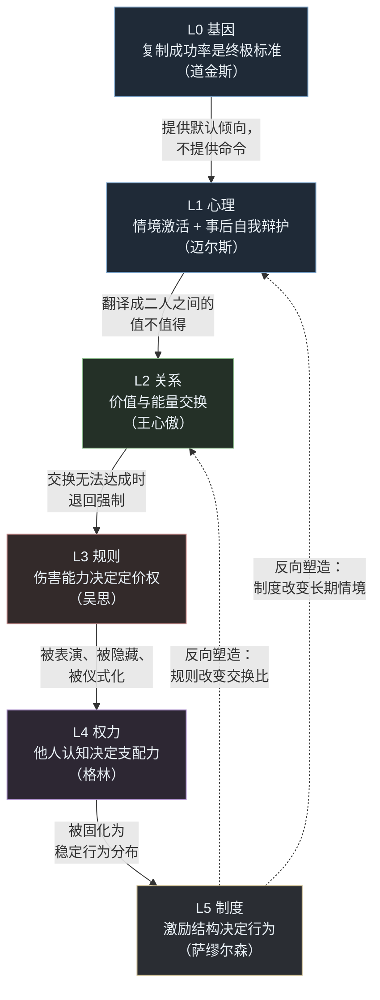

> **一份面向零基础读者的系统化理解笔记**
>
> 依据书目（均在本工作区）：
> ① 理查德·道金斯《自私的基因》｜② 戴维·迈尔斯《社会心理学》｜③ 王心傲《这就是人性》
> ④ 吴思《血酬定律》｜⑤ 罗伯特·格林《权力 48 法则》｜⑥ 保罗·萨缪尔森《经济学》
>
> **写作纪律**：本笔记区分三种内容，全文用固定标记——
> - 📖 **作者原意**：作者本人说了什么，附出处。不增、不删、不改。
> - 🔗 **结构整理**：把分散在六本书里的观点按因果 / 递进 / 对比关系连起来。这是**本笔记的编排**，不是作者的主张。
> - ✅ **可执行**：从原意**推导**出的练习动作。作者没说过这些，它们只是帮助你理解和落地的工具。
>
> 凡涉及尚未核实原文的推断，一律标注「（推断）」；凡作者本人划定的适用边界，一律单列，不与主张混写。

---

## 目录

- [第 0 章 为什么是这六本书：一条解释链](#第-0-章-为什么是这六本书一条解释链)
- [导读：先用大白话读一遍（10 分钟）](#导读先用大白话读一遍10-分钟)
- [第 1 章 核心概念：六层词典](#第-1-章-核心概念六层词典)
- [第 2 章 关键观点 K1–K41](#第-2-章-关键观点-k1k41)
- [第 3 章 逻辑关系图](#第-3-章-逻辑关系图)
- [第 4 章 交叉验证：同一现象的六种解释](#第-4-章-交叉验证同一现象的六种解释)
- [第 5 章 边界与误读警示](#第-5-章-边界与误读警示)
- [第 6 章 复习要点](#第-6-章-复习要点)
- [第 7 章 可执行行动清单](#第-7-章-可执行行动清单)
- [第 8 章 一页速查卡](#第-8-章-一页速查卡)

---

## 第 0 章 为什么是这六本书：一条解释链

### 0.1 六本书不是六个话题，是同一件事的六个尺度

零基础读者最常见的失败，是把这几本书当成「六种处世技巧」分别背诵。结果背得越多越混乱：道金斯说人自私，迈尔斯说情境决定行为，王心傲说关系是价值交换，吴思说暴力最强者说了算，格林说权力是表演——到底哪个对？

它们都对，但**回答的不是同一个问题**。每本书站的分析尺度不同，尺度不同，同一件事的面貌就不同。

| 尺度 | 书 | 它回答的问题 | 人性的表述方式 | 分析单位 |
| :- | :- | :- | :- | :- |
| **L0 生物层** | 道金斯《自私的基因》 | 为什么生命会这样行动？ | 提高自身被复制的概率 | 基因 |
| **L1 心理层** | 迈尔斯《社会心理学》 | 为什么好人在特定情境下会做出坏事？ | 情境激活的自动反应 + 事后自我辩护 | 个体 × 情境 |
| **L2 关系层** | 王心傲《这就是人性》 | 为什么我付出很多却得不到回报？ | 价值与能量的交换比 | 两个人的关系 |
| **L3 规则层** | 吴思《血酬定律》 | 为什么明面上的规则总是不算数？ | 伤害能力决定定价权 | 群体 × 暴力潜能 |
| **L4 权力层** | 格林《权力 48 法则》 | 为什么能力最强的人常常不是掌权的人？ | 他人对你的认知决定你的支配力 | 权力场中的个人 |
| **L5 制度层** | 萨缪尔森《经济学》 | 为什么改变一群人比改变一个人难？ | 激励结构决定行为分布 | 制度 / 市场 |

🔗 **结构整理**：这六层构成一条自上而下的解释链，越往下越"硬"（越难改变），越往上越"软"（越容易被个体操作）。**下层是上层的约束条件，上层是下层在具体场景里的表现形式。**

```
L0 基因      —— 给出默认倾向（不是命令，是初始参数）
      ↓ 被情境激活或抑制
L1 心理      —— 把倾向翻译成当下的情绪与判断
      ↓ 在二人互动中结算
L2 关系      —— 把判断翻译成"值不值得"
      ↓ 当交换无法达成时，退回到强制
L3 规则      —— 把"值不值得"翻译成"敢不敢"
      ↓ 在权力场中被表演和隐藏
L4 权力      —— 把"敢不敢"翻译成"服不服"
      ↓ 被制度固化为稳定分布
L5 制度      —— 把"服不服"翻译成"默认设置"
```

这条链有一个重要的性质：**越往下的层，个体越无法改变；越往上的层，个体越有操作空间。**所以"使用人性"的正确姿势不是从 L0 开始硬扛（你改不了基因），而是认清 L0–L1 的约束，在 L2–L4 上做文章，在 L5 上做长期布局。

### 0.2 一句话版本

> 人带着一套**为复制自身而设计的默认设置**（L0），在**具体情境**中被激活成具体情绪（L1），在**关系**中按交换比结算（L2），当交换破裂时按**伤害能力**重新定价（L3），在**权力场**中靠表演与隐藏获取支配（L4），最终被**制度**固化为可预测的行为分布（L5）。

背下这句话，六本书就不会再打架。

**更通俗的版本**：人一出厂就带着"先顾自己"的底子 → 在具体场合里被点着成各种情绪 → 跟人打交道时各自算"值不值" → 谈不拢了就比谁的拳头硬 → 而谁看起来厉害，比谁真厉害更管用 → 最后，这一套被写成规矩，大家都照着来。

（想看更细的大白话和例子，直接翻到 [导读](#导读先用大白话读一遍10-分钟)。）

### 0.3 一个必须提前说清的立场问题

这六本书里，有两本明确声明自己是**描述性**的，不是**倡导性**的：

- 📖 吴思在《血酬定律》中做的是历史现象的解释工作——用"血酬""命价""潜规则"去说明中国历史中的生存游戏如何运作，而不是主张人应该去拼命或去收保护费。
- 📖 格林在《权力 48 法则》每一章末尾都写"如何逆转"，即该法则被滥用后如何反噬。这本身说明作者把它当作**对历史行为的观察总结**，而非行动纲领。

🔗 **结构整理**：本笔记因此把全部内容分为"看懂"和"使用"两件事。"看懂"要求不美化——血酬就是血酬，权力就是权力；"使用"要求不越界——理解一个人为什么会伤害你，不等于你要去伤害别人。第 5 章专门处理这条线。

---

## 导读：先用大白话读一遍（10 分钟）

> 这一节是**"人话版"**：用大白话和日常场景，把后面几百页的内容先给你一个轮廓。
> 精确的定义、出处、页码都在正文里，这一节只负责让你"先有感觉"，不负责严谨。

### 一、六层链条，一句话版

整本笔记就讲一件事：**人为什么这样，以及怎么用这个"为什么"。** 六本书各管一段，串起来是一条从"出厂设置"到"社会规则"的线：

| 层 | 大白话 | 一个生活例子 |
| :- | :- | :- |
| L0 基因 | 人一出生就带着一套"先顾自己、好让自己活下去"的默认设置 | 婴儿半夜哭闹，才不管爸妈累不累 |
| L1 心理 | 这套设置在具体场合被"点燃"成情绪，事后还会给自己找理由 | 你插队被骂，第一反应是"我有急事"，而不是"我错了" |
| L2 关系 | 人和人相处本质是"交换"，各自在心里算"值不值" | 你帮了同事十次，他一次都不帮你，你就淡了 |
| L3 规则 | 当"交换"谈不拢时，谁的拳头硬（或谁捏着你的把柄）谁说了算 | 你不听话就扣你钱，这规矩就"管用"了 |
| L4 权力 | 别人觉得你厉害，你才真厉害——所以"会表演"和"会藏"都重要 | 两个能力一样的人，会汇报的那个先升职 |
| L5 制度 | 与其费劲改一个人，不如改他身边的规矩，一群人的行为就都变了 | 迟到一次扣一百，比天天讲"要有时间观念"管用 |

记住一句话：**越往下越难改（你改不了基因），越往上越有得操作（你可以换环境、改规则）。** 所以"使用人性"的正确姿势是——认清下面几层，在上面的几层动手。

### 二、十个"你原来以为 → 书里的答案"

**1｜人到底是自私还是善良？**
你原来以为：得选一边，要么"性本善"，要么"性本恶"。
书里的答案：都不是。**底色是"先求活下去、再求活得好"，善和恶都只是手段，不是底色**（《这就是人性》第一章；《自私的基因》说的"自私"也不是说你坏，而是说基因总想"把自己多复制几份"，这是本能，不是道德）。

**2｜为什么好人也会做出很坏的事？**
你原来以为：会做坏事，说明他骨子里坏。
书里的答案：**把人放进某个情境（比如当"狱警"、服从"权威"），多数普通人都会做违心的事**（《社会心理学》第 6 章；《这就是人性》第一章斯坦福监狱实验）。所以别高估自己"绝对不会"，也别拿情境去考验别人。

**3｜我掏心掏肺，他为什么不领情？**
你原来以为：只要我付出够多，对方就会珍惜。
书里的答案：**关系的本质是"交换"，而我给的，常常不是他要的**。给错了东西，付出再多也白搭（《这就是人性》第三章）。先问"他到底想要什么"，再决定给什么。

**4｜我能力最强，为什么升职的不是我？**
你原来以为：能力强就该被提拔。
书里的答案：**权力来自别人怎么看你，不来自你自己有多强**。你能力强但"不可替代"没被看见，就只是"能干的工具"；而会塑造形象、让人离不开你的人，才拿到了权力（《权力 48 法则》法则 11、25）。

**5｜说好的规则，怎么一执行就变味了？**
你原来以为：有制度就按制度来。
书里的答案：**台面上写的是一套，大家私下真正照做的是另一套（潜规则）**。而且规则其实是"谁实力强谁定的"——**暴力最强者说了算**（《血酬定律》）。看一个环境，别只看它贴出来的规定，要看谁真的被奖励、谁真的被罚。

**6｜为什么讲道理常常没用？**
你原来以为：只要我有理，对方就该听。
书里的答案：**道理只是"事后给规则一个解释"，真正让规则管用的是"谁实力强"**。你缺的不是道理，是"让对方不得不听你"的位置（《血酬定律》元规则）。

**7｜人多力量大，为什么反而没人帮忙？**
你原来以为：目击者越多越安全。
书里的答案：**恰恰相反——人越多，责任越分散，越没人出手**（《社会心理学》第 12 章旁观者效应）。求救要**点名**："穿蓝衣服的那位，请帮我打 120。"

**8｜我怎么老在同一个坑里跌倒？**
你原来以为：是我意志力不够。
书里的答案：**多半是坑周围的"规则"没变**。只要成本收益没变，行为就会重复（《经济学》激励）。想改变，先改自己身处的环境，而不是只骂自己。

**9｜为什么我一解释，对方反而更生气？**
你原来以为：解释清楚误会就消了。
书里的答案：**对方早就在心里把你的"人设"定好了，解释会被自动过滤**——这是"基本归因错误"和"认知失调"的叠加（《社会心理学》第 3、4 章）。先处理情绪和立场，再讲事实。

**10｜他那么对我，我凭什么不能那么对他？**
你原来以为：以牙还牙天经地义。
书里的答案：**这些书讲的是"描述"和"机制"，不是"许可"**。看懂一个人为什么会伤害你，不等于你要变成他（第 5 章红线）。而且"针锋相对"只适合**长期重复、且你守得住底线**的关系，用错了会把自己搭进去（《自私的基因》第 12 章）。

### 三、三句话速成

1. **人不是善也不是恶，人是"先求生存"的动物**，善和恶都是手段。
2. **别问"他是什么人"，要问"他处在什么处境、能得到什么、怕失去什么"。**
3. **想改变一个人很难，想改变他身边的规则相对容易**——所以把劲使在"换环境"上，而不是"说服人"上。

（这三句是通俗提炼，精确表述和出处见正文。）

### 四、21 个难词，初中生版对照表

> 下面这些词后面正文会反复出现。**先花 3 分钟把这张表扫一遍，后面就不卡壳了。**
> 注意：这是"帮你理解"的通俗说法，不是严格定义。严格定义在正文的概念词典里。

| 难词 | 说白了就是 |
| :- | :- |
| 基因 / 复制因子 | 一种会"复制自己"的小东西，想尽办法让自己一代代传下去 |
| 生存机器 | 我们的身体，其实是替"基因"打工的机器人 |
| 稳定进化策略 | 一种做法好不好，不看它本身，看"别人都在怎么做" |
| 亲缘选择 | 对亲戚好，本质是变相帮"和自己差不多的基因" |
| 互惠利他 | 你帮我、我帮你；因为以后还会见面，长期下来对大家都划算 |
| 觅母 | 像段子、洗脑神曲一样，会复制、会变、会流行开来的"想法" |
| 基本归因错误 | 别人做错了，你觉得是"他人品差"；其实多半是"环境逼的" |
| 认知失调 | 做了事之后心里别扭，就自己骗自己"我做得对" |
| 从众 | 大家都这么做，我也跟着做，哪怕心里知道不对 |
| 服从 | 上面的人让我做，我就做，哪怕心里不愿意 |
| 旁观者效应 | 人越多越没人帮忙，因为每个人都觉得"别人会管" |
| 自我服务偏差 | 成功了是我厉害，失败了是运气不好 |
| 价值交换 | 人和人之间，其实就是"你给的我想要，我给的你也要" |
| 血酬 | 靠拼命或武力换来的报酬，就像靠劳动换工资一样 |
| 命价 | 一条命"值多少"，其实是算出来的，还会随情况变 |
| 潜规则 | 台面上不写、但大家私下都照着做的规矩 |
| 元规则 | 决定"规则"的规则：谁拳头硬，谁说了算 |
| 权力是表演 | 别人觉得你厉害，你才厉害 |
| 机会成本 | 选了 A 就得放弃 B，B 的价值就是你的代价 |
| 后此谬误 | A 先发生、B 后发生，不代表是 A 害的 B |
| 合成谬误 | "我一个人这样做没事"，不等于"所有人都这样做也没事" |

---

## 第 1 章 核心概念：六层词典

> 用法：每个概念四栏——**定义（尽量贴原作者表述）｜出处｜零基础最容易搞错的地方｜本层的关键词**。
> 先读"最容易搞错的地方"那一栏，它比定义更有用。
> **读到看不懂的词，先翻回导读末尾的「21 个难词对照表」**；那 21 个词是全书最容易卡住的地方，其余的都是普通词。

### 1.1 L0 生物层：道金斯《自私的基因》

#### ① 复制基因 / 复制因子（replicator）

📖 **作者原意**：生命起源于能自我复制的分子。复制过程会有差错，差错的复制产生差异，差异中那些**更稳定、复制更快、复制更精确**的分子被保留下来。所有生物都是这些复制基因的后代。（第二章"复制基因"）

| 项 | 内容 |
| :- | :- |
| 出处 | 第二章；第三章"不朽的双螺旋" |
| 常见误解 | 以为"复制基因"是某种具体的基因。它不是某个基因，而是**任何具有复制能力、能留下后代拷贝的实体**——基因是，觅母（meme）也是。 |
| 关键词 | 复制、变异、稳定性 |

#### ② 生存机器（survival machine）

📖 **作者原意**：基因不直接建造身体，而是"建造"一台会行动、会感知的机器来保存自己。身体是基因的载体，行为是基因实现复制的手段。全书第一章即以"为什么会有人呢"为题展开这一论证。

| 项 | 内容 |
| :- | :- |
| 出处 | 第一章、第四章"基因机器" |
| 常见误解 | 以为作者在说"人只是机器，所以人没有自由"。书中恰恰反复强调这是**描述基因作用的视角**，而不是对人的全部说明。 |
| 关键词 | 载体、手段、视角 |

#### ③ 稳定进化策略（ESS, Evolutionarily Stable Strategy）

📖 **作者原意**：一个策略好不好，**不取决于它本身的绝对优劣，而取决于种群中其他成员在用什么策略**。当一种策略在群体中扩散到无法被任何其他策略击败时，它就是一个稳定进化策略。（第五章"进犯行为：稳定性和自私的机器"）

| 项 | 内容 |
| :- | :- |
| 出处 | 第五章 |
| 常见误解 | 以为"稳定"意味着"最优"或"道德上更好"。ESS 只意味着**无法被入侵**，它可能是残酷的、低效的，但依然稳定。 |
| **为什么这条最重要** | 它一次性解释了：为什么"老好人"和"恶人"能在同一个环境里长期共存；为什么你换了个环境，原来有效的处世方式突然失效——**你换的不是自己，是种群的策略分布。** |
| 关键词 | 相对优势、策略分布、无法入侵 |

#### ④ 亲缘选择 / 汉密尔顿法则

📖 **作者原意**：个体对亲属的利他行为，其强度随**亲缘度**与**对方受益 / 自己付出**的比例而变化。第六章"基因种族"讨论的就是这一机制：帮助携带相同基因的个体，等于间接复制自己的基因。

| 项 | 内容 |
| :- | :- |
| 出处 | 第六章；第八章"代际之战"（亲子冲突） |
| 常见误解 | 以为这是"血浓于水"的道德辩护。它是**成本核算**：亲缘度低、收益小时，利他行为就不划算。这恰恰解释了亲属之间最激烈的冲突（第八章）。 |
| 关键词 | 亲缘度、成本收益、亲子冲突 |

#### ⑤ 互惠利他 / 针锋相对（tit for tat）

📖 **作者原意**：在两个个体长期反复相遇的条件下，**先合作、之后照对方上次的做法回应**的策略，能在群体中稳定存在并胜出。第十章标题即"你为我搔痒，我就骑在你的头上"，第十二章"好人终有好报"专门讨论合作的演化。

| 项 | 内容 |
| :- | :- |
| 出处 | 第十章、第十二章 |
| 常见误解 | 以为作者在提倡"以牙还牙"的报复。书中强调的是**可被激发的合作**：合作要能被识别、能被回报、能被惩罚，才稳定。 |
| **实践含义** | 一次性交往中，合作不划算；**重复交往**中，合作是最优自利策略。这直接对应第 7 章的"互惠节奏"练习。 |
| 关键词 | 重复博弈、可识别、可惩罚 |

#### ⑥ 觅母（meme）

📖 **作者原意**：文化中也存在复制单位——曲调、观念、 fashion、建筑样式等，它们在人际间被复制、变异、选择。第十一章"觅母：新的复制基因"。

| 项 | 内容 |
| :- | :- |
| 出处 | 第十一章 |
| 常见误解 | 把 meme 等同于"网络梗"。作者的原意是**文化复制子**，重点在"复制—变异—选择"三件事，而不是内容本身好笑。 |
| 为什么和"人性"有关 | 观念也会为了自己的传播而"利用"人——**很多你以为是自己想通的道理，其实是被传播成功的觅母**。这是"认知人性"里最反直觉的一条。 |
| 关键词 | 文化复制、传播适应度 |

### 1.2 L1 心理层：迈尔斯《社会心理学》

> 这一层的全书结构：社会思维（第 2–5 章）→ 社会影响（第 6–8 章）→ 社会关系（第 9–13 章）→ 应用（第 14–16 章）。以下只取与"认知人性"最相关的概念。

#### ⑦ 我们构建社会现实

📖 **作者原意**：人对世界的反应，不是对世界本身，而是对**自己解释过的世界**。信念、预期、分类方式会改变我们看到什么、记住什么。（第 1 章 p.33）

| 项 | 内容 |
| :- | :- |
| 出处 | 第 1 章"社会心理学中的重要观点"（p.33） |
| 常见误解 | 以为这是"唯心主义"。作者的意思是**解释是必经环节**，不是"事实不存在"。 |
| 关键词 | 解释、先入之见、建构 |

#### ⑧ 基本归因错误

📖 **作者原意**：在解释他人行为时，人**高估人格与态度的影响，低估情境的影响**；而解释自己的行为时，倾向归因于情境。（第 3 章"归因因果"，p.129–134）

| 项 | 内容 |
| :- | :- |
| 出处 | 第 3 章 p.132「基本归因错误」 |
| 常见误解 | 以为这是"看人不准"。它是**系统性的、双向的**：你看别人是"他人品差"，别人看你是"你环境所迫"。 |
| **为什么这是第一号工具** | 90% 的"我看透了这个人"的判断，其实是基本归因错误。第 7 章第 1 个练习就是矫正它。 |
| 关键词 | 情境、人格、双重标准 |

#### ⑨ 认知失调（cognitive dissonance）

📖 **作者原意**：当行为与态度不一致时，人会产生不适，并**通过改变态度来使自己相信行为是合理的**。因此不只是态度导致行为，**行为同样塑造态度**（第 4 章"态度和行为"，p.146–163）。

| 项 | 内容 |
| :- | :- |
| 出处 | 第 4 章 p.163「自我辩解：认知失调」 |
| 常见误解 | 以为失调会让人"认错"。恰恰相反——**付出越多、越难撤回，人越会加倍相信自己是对的**。这解释了为什么沉没成本绑不住理智，却绑得住信念。 |
| 关键词 | 自我辩护、沉没成本、态度跟随行为 |

#### ⑩ 从众与服从

📖 **作者原意**：阿施实验显示，面对明确的群体一致意见，个体会否认证据所见；米尔格拉姆实验显示，在权威的逐步加压下，大量普通人会执行自己并不认同的指令。（第 6 章，p.212–246）

| 项 | 内容 |
| :- | :- |
| 出处 | 第 6 章 p.220「阿施的群体压力研究」、p.221「米尔格拉姆的服从实验」 |
| 常见误解 | 以为"我意志坚定，不会从众"。实验的关键结论是**比例惊人**，而不是"有些人软弱"。 |
| 用法（防御而非攻击） | 判断一件事时，先问："如果没有其他人在场，我还会这么想吗？" |
| 关键词 | 群体压力、权威、逐步升级 |

#### ⑪ 群体：懈怠、去个体化、极化、群体思维

📖 **作者原意**：
- **社会懈怠**：在群体中，个人的努力程度下降（p.297）。
- **去个体化**：置身群体时自我感减弱，"法不责众"的心理出现（p.302）。
- **群体极化**：讨论会强化群体原有的倾向，使之更极端，而非更中间（p.306）。
- **群体思维**：高凝聚力群体为维护一致而压制异议，导致决策失误（p.315）。

| 项 | 内容 |
| :- | :- |
| 出处 | 第 8 章 |
| 常见误解 | 以为"人多力量大"或"三个臭皮匠顶个诸葛亮"。作者的四条结论基本都在说反面：**群体让个体更少努力、更少自我约束、更极端、更不容异议**。 |
| 关键词 | 稀释、失控、极端化、一致幻觉 |

#### ⑫ 自我服务偏差与印象管理

📖 **作者原意**：人倾向把成功归因于自己、把失败归因于外部；普遍认为自己"高于平均水平"；并通过自我妨碍、印象管理来维护这个形象。（第 2 章 p.89–102）

| 项 | 内容 |
| :- | :- |
| 出处 | 第 2 章 p.89「自我服务偏差」、p.99「自我表现的管理」 |
| 常见误解 | 以为这是"自恋"。它是**普遍性的**，包括你自己。判断别人时记得同时判断自己。 |
| 关键词 | 归因不对称、高于平均、自我妨碍 |

#### ⑬ 偏见的三个根源

📖 **作者原意**：偏见有社会根源（不平等地位）、动机根源（挫折—攻击、替罪羊）、认知根源（类别化、以及"这是一个公正的世界"的假设）。（第 9 章 p.343–366）

| 项 | 内容 |
| :- | :- |
| 出处 | 第 9 章 |
| 常见误解 | 以为偏见只是"人品问题"。作者给出的是**结构性解释**：只要存在分类与地位差，偏见就会自动生产。 |
| 为什么重要 | 你被误解、被贴标签，多数时候不是因为你做错了什么，而是因为**你落进了对方的某个类别**。 |
| 关键词 | 类别化、替罪羊、公正世界假设 |

### 1.3 L2 关系层：王心傲《这就是人性》

> 全书结构（作者在前言中自述）：**第一部分"看见人性"→ 第二部分"学习人性"→ 第三部分"运用人性"**。
> 📖 前言原话："第一部分带你看见人性……第二部分带你学习人性……第三部分带你运用人性，只有放大人性的优点，规避人性的弱点，才能在这复杂的人间清醒地做事、做人、处世。"

#### ⑭ 人性的底色，不是善恶

📖 **作者原意**：把人性简单分为善或恶，是看表象。人性的底色是**趋利避害的生存本能**——这也是该书第一章第一节的标题。（第一章 p.3）

🔗 **结构整理**：这一条与道金斯的第一章形成直接对接。作者在同一章里引用了"自私的基因"这一说法来说明：婴儿不顾父母疲惫地哭闹，是**生存本能的表达**，而不是道德败坏；而"在文明的引导下，有着自私基因的人完全可以成为一个好人、善人"。（第一章 p.4）

> ⚠️ 注意分寸：作者说的是"底色不是善恶"，**不是**"人性本恶"。这两句在书里是完全不同的意思。

#### ⑮ 菩萨心肠，也要有金刚手段

📖 **作者原意**：只有善意而无手段，善意就守不住；手段不是善意的反面，而是善意的**执行条件**。（第一章第二节 p.12）

| 项 | 内容 |
| :- | :- |
| 出处 | 第一章 p.12 |
| 与 L3 的接口 | 这几乎是血酬定律的日常版：**没有伤害能力的人，其善意没有定价权**。 |
| 关键词 | 善意、手段、执行力 |

#### ⑯ 关系是价值的交换与博弈

📖 **作者原意**：第三章标题即"关系的本质，是价值的交换和博弈"。四个小节分别处理：人生是能量高低的较量（p.65）、不敢谈钱是成年人最大的灾难（p.75）、熟人无用时代要先让自己有价值（p.86）、婚恋是精准的价值匹配（p.94）。

| 项 | 内容 |
| :- | :- |
| 出处 | 第三章 p.65–94 |
| 常见误解 | 以为这是"势利"。作者谈的是**结算机制**：关系能否持续，取决于双方各自认为"换得值"；不谈钱不等于不谈价值，只是把结算转到了看不见的地方。 |
| 关键词 | 价值、能量差、匹配 |

#### ⑰ 痛苦来自期待过高

📖 **作者原意**：多数痛苦的来源不是事情本身，而是**对他人、对结果预设了过高的期待**。（第一章第四节 p.28）

| 项 | 内容 |
| :- | :- |
| 出处 | 第一章 p.28 |
| 与 L1 的接口 | 期待就是一种"建构的社会现实"（概念⑦）。期待决定了你如何解释对方的同一个行为。 |
| 关键词 | 期待、落差、解释框架 |

#### ⑱ 弱者抱怨，强者不言

📖 **作者原意**：第二章标题"惊人的社会定律：弱者抱怨，强者不言"。四个小节：大多数失败在于弱者思维（p.35）、赢家想办法输家找理由（p.42）、嘴上很想要但思想很懒惰（p.48）、不患寡而患不均——所以要低调做人收敛锋芒（p.58）。

| 项 | 内容 |
| :- | :- |
| 出处 | 第二章 p.35–58 |
| 常见误解 | 以为"强者不言"是叫人隐忍。作者的落点在**归因方式**：抱怨是把原因放在外部，想办法是把原因放在可控处。这与自我服务偏差（概念⑫）正好相反，是它的**矫正版**。 |
| 关键词 | 归因、可控性、收敛 |

#### ⑲ 你允许的，才是别人敢做的

📖 **作者原意**：第八章第二节标题——"别抱怨别人欺负你，因为那是你允许的"。（第八章 p.214）

| 项 | 内容 |
| :- | :- |
| 出处 | 第八章 p.214 |
| 与 L0 的接口 | 这正是 ESS 的日常形态（概念③）：**对方的行为强度，是被你的反应逐步校准出来的**。你不设边界，等于在告诉对方"这个强度是稳定的"。 |
| 关键词 | 边界、试探、校准 |

#### ⑳ 最高明的猎人，往往以猎物的形式出现

📖 **作者原意**：第四章第二节标题。示弱不是无能，而是**降低对方防御、获取信息与位置**的手段。（第四章 p.111）

🔗 **结构整理**：这条与格林法则 21"假装比你的对手还要傻——借愚取胜"（《权力 48 法则》p.249）是同一个机制在两个尺度上的表述：**让对方低估你，他就会在你面前放松并暴露。** 这也是六本书之间最清晰的一处"同构"。

#### ㉑ 颠倒看人性，逆向看人生

📖 **作者原意**：第四章第三节标题（p.119）。当多数人按同一种方式解释处境时，**反过来看**往往能看到被忽略的那一面。

| 项 | 内容 |
| :- | :- |
| 出处 | 第四章 p.119 |
| 与其他书的接口 | 这不是"逆向思维鸡汤"，它对应的是社会心理学里的**视角切换**：把自己放到对方的位置上重新归因一次（对抗基本归因错误）。 |
| 关键词 | 反向、视角 |

### 1.4 L3 规则层：吴思《血酬定律》

> ⚠️ 这一层是全笔记**最容易被误读**的一层。请把"描述"两个字贴在脑门上再往下读。

#### ㉒ 血酬

📖 **作者原意**（原文，第 002 页）：

> "强盗、土匪、军阀和各种暴力集团靠什么生活？靠血酬。血酬是对暴力的酬报，就好比工资是对劳动的酬报、利息是对资本的酬报、地租是对土地的酬报。不过，暴力不直接参与价值创造，血酬的价值，决定于拼争目标的价值。如果暴力的施加对象是人，譬如绑票，其价值则取决于当事人避祸免害的意愿和财力。"

| 项 | 内容 |
| :- | :- |
| 出处 | 第一章"匪变：血酬定律及其推想"，p.002 |
| 关键结构 | 工资 ← 劳动；利息 ← 资本；地租 ← 土地；**血酬 ← 暴力**。四者并列，是一个**报酬来源的分类**，不是道德判断。 |
| 最容易错的地方 | 以为"血酬"是"用命换钱"的字面意思。作者的界定更精确：**血酬的价值由"拼争目标的价值"决定**，而不是由流了多少血决定。所以抢一块荒地不值钱，抢一条商道很值钱。 |
| 关键词 | 报酬来源、目标价值 |

#### ㉓ 血酬定律

📖 **作者原意**（紧接上段，第 002 页）：

> "这就是血酬定律。在此过程中，人们核心计算是：为了一定数量的生存资源，可以冒多大的伤亡风险，可以把自身这个资源需求者损害到什么程度。"

🔗 **结构整理**：这条定律的形式是一个**双边核算**：
- **施暴方**计算：为了这份资源，我愿承担多大伤亡风险；
- **被施加方**计算：为了避免这份伤害，我愿付多少钱。

两者在某个价位上相遇，成交。**这个价位就是命价。**

#### ㉔ 命价

📖 **作者原意**：第二章"命价考略"（p.39 起）专门考察历史上人命的价格如何被估算、如何随身份与情境浮动。

| 项 | 内容 |
| :- | :- |
| 出处 | 第二章 |
| 常见误解 | 以为是"古代人命不值钱"这种感慨。作者做的是**价格机制分析**：命价随"避祸意愿与财力"浮动，因此同一条命在不同情境下标价不同。 |
| 现代对应（推断） | 工伤赔偿标准、保险保额、乃至"这件事值不值得闹大"的日常判断，都是命价的现代表达形式。 |
| 关键词 | 定价、浮动、情境 |

#### ㉕ 潜规则与正式规则的切换

📖 **作者原意**：第三章"潜规则与正式规则切换的秘密"（p.74）。正式规则写在明面上，潜规则在实际利益分配中起作用；两者会在特定条件下**互相切换**。

| 项 | 内容 |
| :- | :- |
| 出处 | 第三章 p.74；杂编"潜规则的定义"p.323 |
| 常见误解 | 以为潜规则是"坏人私下定的规矩"。作者强调的是**它有一套自己的合法性逻辑与执行机制**，否则不可能长期稳定。 |
| 判断方法 | 看到一个组织，不要只看它写了什么制度，要看**违规的代价由谁承担、收益由谁获得**。 |
| 关键词 | 明面 / 实际、切换、利益分配 |

#### ㉖ 元规则：暴力最强者说了算

📖 **作者原意**：吴思提出的核心命题——在所有规则之上还有一条"决定规则的规则"，即**暴力最强者说了算**。这条元规则不是道德主张，而是对规则来源的历史归纳。（参见全书自序与第一章的整体论证）

📖 书中另以寓言点出这条命题的"代价面"——杂编"老虎为什么不长翅膀"（p.353）：**力量最强的形态，恰恰受力量逻辑本身的约束**；一副为搏杀而生的身躯，未必能再长出用来飞越的翅膀。这提醒读者：元规则解释的是"规则从何而来"，并不意味着"力量越大越自由"。

| 项 | 内容 |
| :- | :- |
| 常见误解 | 以为作者在鼓吹"强权即真理"。他做的是**溯源**：规则不是从道理里长出来的，是从力量对比里长出来的；道理的作用是事后为规则提供说明。 |
| **为什么这条对"认知人性"关键** | 它解释了为什么"讲道理"常常无效：**你缺的不是道理，是让对方必须听道理的力量。** 这也是王心傲"金刚手段"（概念⑮）的历史注脚。 |
| 关键词 | 元规则、力量对比、规则来源 |

#### ㉗ 派生概念：灰牢、白员、雁户、地霸

📖 **作者原意**：书中用一系列考据性章节刻画正式体系之外的"小物种"——非正式监禁场所（灰牢，p.143）、编制外的准吏员（白员，p.273）、依附性的流动人群（雁户，p.343）、地方势力（地霸，p.240）。它们的共同点是：**不在正式规则里，却承担正式规则的实际功能。**

🔗 **结构整理**：这四个概念是"潜规则"的**组织形态学**——潜规则不是抽象的，它一定寄生在某些具体位置上。识别一个环境，就是识别这些位置在哪里。

### 1.5 L4 权力层：格林《权力 48 法则》

> 完整逐条释义见工作区另一份笔记《权力48法则_理解笔记.md》。此处只保留与"人性结构"直接相关的五条元命题。

#### ㉘ 权力是表演

📖 **作者原意**：权力不取决于你实际是什么，而取决于**别人认为你是什么**。因此形象、象征、可见度构成全书最重的一组工具（法则 25、30、34、37）。

| 项 | 内容 |
| :- | :- |
| 出处 | 法则 25（p.298）、30（p.360）、34（p.398）、37（p.430） |
| 与 L1 的接口 | 这就是"我们构建社会现实"（概念⑦）在权力场中的运用：**别人对你的解释，比你的实际动机更能决定你的处境。** |

#### ㉙ 权力是相对的：依赖即权力

📖 **作者原意**：你的权力来自他人的依赖、恐惧或仰慕，因此"让别人需要你"比"你自己很强"更重要（法则 11，p.141）。

| 项 | 内容 |
| :- | :- |
| 出处 | 法则 11 |
| 与 L2 的接口 | 依赖是价值交换（概念⑯）的极端形态：当对方**没有替代方案**时，交换比完全倒向你。 |

#### ㉚ 权力靠隐蔽

📖 **作者原意**：一旦手段被看穿，效果就消失了。因此"隐藏意图（3）、隐藏努力（30）、隐藏自我（38、48）"贯穿全书。

| 项 | 内容 |
| :- | :- |
| 出处 | 法则 3（p.39）、30、38（p.438）、48（p.556） |
| 常见误解 | 以为"隐蔽"等于撒谎。书中大量案例用的是**信息不对称**与**节奏控制**，不是编造事实。 |

#### ㉛ 权力有节奏，且会反噬

📖 **作者原意**：等待与出击、武力与诡计必须交替；每条法则用过头都会反噬，所以每章末尾都有"如何逆转"。

| 项 | 内容 |
| :- | :- |
| 出处 | 法则 22（p.259）、28（p.338）、35（p.408）、47（p.545）；各章"逆转"小节 |
| **这条是全书的安全阀** | 它承认这 48 条是**工具而非真理**：工具都有适用区间，出了区间就是自伤。 |

### 1.6 L5 制度层：萨缪尔森《经济学》

> 说明：工作区这份 PDF 是第 16 版中文版的节选（116 页，含经济学基础知识、供给与需求、厂商与利润三部分）。以下概念均出自该节选，不涉及书中未收录的内容。

#### ㉜ 稀缺 → 机会成本

📖 **作者原意**：
- 罗宾斯的定义："经济学是研究人类行为的一个侧面，即**目的和具有多种用途的稀缺的手段之间的关系**的科学。"（第 1 章）
- "由于资源是稀缺的，因此，我们必须不断地决定如何利用我们有限的时间和收入……而那些**所放弃的选择**就被称为你的该项决策的机会成本。"（第 1 章）

| 项 | 内容 |
| :- | :- |
| 出处 | 第 1 章"经济学基础知识" |
| 常见误解 | 以为机会成本是"花掉的钱"。它是**你放弃的那个次优选择的价值**——往往不体现为支出，因此最容易被忽略。 |
| 为什么放进"人性"笔记 | 因为人际关系的隐含账本，记的正是机会成本：**你把时间给了谁，就是把放弃的那个人定价了。** |

#### ㉝ 激励结构决定行为

📖 **作者原意**：企业受利润最大化驱使，"会因为利润低而离开亏损的行业，同样也会受高利润的吸引转而生产需求较多的物品"（第 2 章）。价格变动会改变买卖双方的行为（"需求向下倾斜规律"，第 3 章）。

| 项 | 内容 |
| :- | :- |
| 出处 | 第 2 章、第 3 章 |
| 用法 | 想预测一个人的行为，别问他的性格，问**他现在被什么奖励、被什么惩罚**。这是对基本归因错误（概念⑧）的结构性矫正。 |

#### ㉞ 看不见的手，以及它的失灵

📖 **作者原意**：斯密指出，个人追逐自身利益时，会被"一只看不见的手"引导去实现并非其本意的公共目标（第 2 章）。但作者同时列出市场失灵：垄断、**外部性**（正外部性如科学发现，负外部性如污染）、以及收入分配在政治或道义上无法接受（第 2 章）。

| 项 | 内容 |
| :- | :- |
| 出处 | 第 2 章 |
| 为什么必须成对记住 | 只记"看不见的手"会得出"自私自动利他"的乐观结论；**作者本人明确写了它会失灵**。完整表述是：自利在**特定条件**下能导向秩序，条件不满足时导向灾难。 |

#### ㉟ 三个思维谬误：后此谬误 / 不能保持其他条件不变 / 合成谬误

📖 **作者原意**：作者在提醒初学者警惕"经济推理中各种常见的思维谬误"时，列出的第一个就是因果推理的错误：

- **后此谬误（the post hoc fallacy）**："如果我们仅仅因为一件事发生在另一件事之前，就想当然地认为前者是后者的原因，那么，我们就犯下了这里所说的后此谬误。"书中举例：有人观察到商业扩张之前或之中常伴随物价上涨，便主张提高工资和价格是治疗大萧条的良方——但这一对策几乎肯定不能推动复苏（第 1 章）。
- **不能保持其他条件不变（failure to hold other things constant）**：分析某变量的影响时，忽略其他相关条件也在变化。书中举例：有人主张降税能同时增加政府收入并减少赤字，该分析忽视了同期收入的增长，未坚持"其他条件不变"（第 1 章）。
- **合成谬误（the fallacy of composition）**："有时我们会假定，对局部来说是正确的东西，对总体来说也一定正确。然而，在经济学中，我们经常发现总体并不等于局部之和。"（第 1 章）

| 项 | 内容 |
| :- | :- |
| 出处 | 第 1 章"经济学基础知识"（"经济推理中常见的思维谬误"部分） |
| **为什么这是本书对"认知人性"最大的贡献** | 三个谬误全部是**因果判断的失效模式**，而且可以直接脱离经济学使用。人对他人行为的误判，绝大多数正是这三种：把先后当因果（他先做了 A，所以我被排挤是他害的）、忽略其他变量（只看到那一个因素）、把局部当整体（"我这样做有效，所以大家都该这样"）。 |
| 移植用法（推断） | ① 看到"A 导致 B"，先问"这段时间还有什么在变？"（其他条件）② 看到"他这样做所以结果变好"，先问"是不是倒过来了，或另有原因？"（后此）③ 看到"每个人都这样做就能得到好结果"，先问"如果所有人都这样做，还成立吗？"（合成） |

### 1.7 复查补充：四组被遗漏的核心概念

> 说明：以下概念在初版遗漏，本次复查补入。编号接续，归属层在括号内标出。

#### ㊱ 两性战争与亲代投资〔L0 补〕·道金斯第九章

📖 **作者原意**：两性在繁殖中的**亲代投资不对称**（谁投入的不可回收成本更高），塑造了两性不同的求偶策略与冲突。道金斯第九章即以"两性战争"为题讨论这一点。

| 项 | 内容 |
| :- | :- |
| 出处 | 第九章"两性战争" |
| 常见误解 | 以为作者在论证"男女天生对立"。作者论证的是**策略差异来自投资结构**，而不是来自某个性别的本质。 |
| **跨书接口（最有价值的一处）** | 这一章与王心傲"婚恋关系，就是精准的价值匹配"（《这就是人性》p.94）构成**生物层 → 关系层**的直接对接：基因层解释的是"两性为什么采取不同策略"，关系层解释的是"这些策略在现实中如何被结算为匹配"。两层互补，不是互相替代。 |
| 关键词 | 亲代投资、策略不对称、两性冲突 |

#### ㊲ 攻击的三个理论来源〔L1 补〕·迈尔斯第 10 章

📖 **作者原意**：攻击行为有三种解释——**生物学理论**（本能/基因）、**挫折—攻击理论**（受挫引发攻击冲动）、**社会学习理论**（攻击是习得的，通过观察与强化传播）。（第 10 章"攻击：伤害他人"，p.376–409）

| 项 | 内容 |
| :- | :- |
| 出处 | 第 10 章 p.379–386 |
| 常见误解 | 以为攻击是"失控"。三种理论都指向**攻击是被某种输入触发的**，其中挫折—攻击与社会学习都给出可干预的杠杆。 |
| 用法 | 识别自己或他人的愤怒，先问来源：是本能的、是受挫的、还是模仿来的？三者的解法完全不同。 |
| 关键词 | 挫折、习得、强化 |

#### ㊳ 吸引与依恋〔L1 补〕·迈尔斯第 11 章

📖 **作者原意**：友谊与吸引的主要因素包括**接近性**（p.419）、**外表吸引力**（p.424）、**相似性**（p.433）、以及"**喜欢那些喜欢我们的人**"（p.436）；亲密关系的质量则与**依恋类型**、**公平**、**自我表露**相关（p.447–450）。（第 11 章"吸引与亲密"）

| 项 | 内容 |
| :- | :- |
| 出处 | 第 11 章 p.414–458 |
| 常见误解 | 以为"喜欢"不可分析。作者给出的是**可验证的因素清单**，其中"互惠喜欢"（对方喜欢你会让你更喜欢对方）是最常被忽略、也最容易使用的一条。 |
| 跨书接口 | 与王心傲"如何让你喜欢的人也喜欢你"（p.221）互为印证：关系层的建议，落在心理层有明确的机制支持。 |
| 关键词 | 接近性、相似性、互惠喜欢、依恋 |

#### ㊴ 旁观者效应〔L1 补〕·迈尔斯第 12 章

📖 **作者原意**：目击者越多，单个旁观者出手帮助的可能性反而越低——**责任被分散**。书中"旁观者数量"一节（p.480）与达利的研究（p.483）讨论这一效应。（第 12 章"帮助行为"）

| 项 | 内容 |
| :- | :- |
| 出处 | 第 12 章 p.480–483 |
| 常见误解 | 以为"人多就安全"。旁观者效应指出：**人多反而更可能没人出手**，因为每个人都以为别人会出手。 |
| **最实用的推论** | 求助时**不要对人群喊"谁来帮帮我"**，要**点名**："穿蓝衣服的那位，请帮我打 120。"——把分散的责任重新落到一个人身上。 |
| 关键词 | 责任分散、点名求助 |

#### ㊵ 冲突与和解：四因四途〔L1 补〕·迈尔斯第 13 章

📖 **作者原意**：冲突的四个来源是**社会困境**（p.504）、**竞争**（p.511）、**知觉到的不公正**（p.513）、**误解**（p.513）；获得和平的途径则是**接触**（p.519）、**合作**（p.524）、**沟通**（p.534）、**和解**（p.538）。（第 13 章"冲突与和解"）

| 项 | 内容 |
| :- | :- |
| 出处 | 第 13 章 p.502–540 |
| 常见误解 | 以为冲突都是"利益之争"。作者把**误解**单列为冲突来源——很多冲突没有真实利益对立，只是双方解释不同。 |
| 用法 | 化解一段冲突，先判断它属于四因中的哪一个：是利益（社会困境/竞争）、是公平感（不公正）、还是信息差（误解）？**对症的途径不同**。 |
| 关键词 | 误解、接触、合作、和解 |

#### ㊶ 斯坦福监狱实验〔L2 补〕·王心傲第一章

📖 **作者原意**：王心傲以"斯坦福监狱实验"为第一章第三节（p.19），标题即"永远不要试探人性"：把普通人随机分成"狱警"与"囚犯"角色后，情境的力量迅速把两群人推向虐待与顺从。作者的落点是**不要用情境去考验人性**，因为多数人经不起这种考验。

| 项 | 内容 |
| :- | :- |
| 出处 | 第一章 p.19 |
| 跨书接口 | 这是 L2（王心傲）与 L1（迈尔斯）之间**现成的桥梁**：王心傲用这个实验讲"别试探人性"，迈尔斯用同一类研究（从众、服从，p.220–221）讲"情境塑造行为"。**两本书在同一个实验上相遇，结论一致。** |
| ⚠️ 精度提醒 | 该实验的方法学受到后世争议，样本小、且存在研究者诱导；本笔记依两书的**转述**记录其结论，但不把"6 天就失控"当作精确数值。 |
| 关键词 | 情境、角色、试探 |

---

## 第 2 章 关键观点 K1–K41

> 阅读方式：每条包含 **主张（作者原意）｜论证｜出处｜落到"使用人性"上的含义**。
> "含义"一栏是 🔗 结构整理，不是作者原话。

### 2.1 L0：基因层——人为什么"默认"这样行动

**K1｜自然选择的基本单位是基因，不是个体，也不是物种。**
📖 论证：只有基因能跨越世代保持高保真复制；个体是暂时的载体，物种是统计上的抽象。
📍 出处：第一章、第三章。
🎯 含义：理解人的行为，先看它**增加了谁的复制成功率**，而不是先问"他是不是好人"。

**K2｜"自私"是基因层面的比喻，不指向个体道德。**
📖 论证：作者在第一章与全书多次强调，这里的"自私"指的是**行为对基因复制概率的效果**，而不是心理动机。个体完全可以做出真诚利他的行为，只要这类行为在演化史上提升了共同基因的留存。
📍 出处：第一章；第十一章对"觅母"的讨论亦反复澄清比喻性质。
🎯 含义：**这是全书被误读最狠的一句。** 用它推不出"人都是自私的"，更推不出"所以我也该自私"。

**K3｜利他强度随亲缘度与成本收益变化。**
📖 论证：第六章以"基因种族"为题，说明个体对亲属的投入强度随共享基因比例与对方受益程度变化；第八章"代际之战"进一步指出，亲子之间在资源分配上存在**结构性冲突**（断奶、抚养投入的讨价还价）。
📍 出处：第六章、第八章。
🎯 含义：**亲密关系里的冲突不是感情不够，而是位置不同。** 这解释了为什么"最亲的人伤你最深"——因为投入最大、账最细。

**K4｜策略的价值是相对的：ESS。**
📖 论证：第五章用博弈分析说明，一种行为策略能否稳定存在，取决于群体中其他策略的分布；当它无法被其他策略入侵时达到稳定。
📍 出处：第五章。
🎯 含义：**你的处世方式没有绝对优劣，只有与环境策略分布的匹配度。** 换环境必须重新校准，不能携带旧策略横冲直撞。

**K5｜合作可以是自利的长线形式。**
📖 论证：第十章、第十二章分析重复相遇条件下"先合作、按对方上次行为回应"的策略如何稳定胜出。
📍 出处：第十章"你为我搔痒，我就骑在你的头上"；第十二章"好人终有好报"。
🎯 含义：**合作的前提是"还会再见"。** 一次性关系里讲情义成本最高；长期关系里不讲情义代价最高。判断关系类型，先于决定行为方式。

**K6｜观念也是复制子（觅母）。**
📖 论证：第十一章把文化传播单位与基因类比，认为它们同样经历复制、变异与选择。
📍 出处：第十一章。
🎯 含义：**你坚信的很多"做人之道"，是被传播成功的观念，而不是被验证过的规律。** 判断标准应当是"它在我的环境里是否可复现"，而不是"它流传得多广"。

### 2.2 L1：心理层——情境如何改写人

**K7｜人反应的是自己解释过的世界。**
📖 出处：第 1 章 p.33"我们构建了社会现实"。
🎯 含义：同一件事，双方的解释可能完全相反；**沟通的第一步不是表达，是确认对方在解释什么。**

**K8｜社会直觉通常强大，但有时危险。**
📖 出处：第 1 章 p.34"社会直觉通常强大但有时也危险"。
🎯 含义："我一眼就看透他了"这句话，本身是需要被检验的判断，而不是结论。

**K9｜基本归因错误：高估人格，低估情境。**
📖 出处：第 3 章 p.132。
🎯 含义：**把"他人品不行"换成"他在什么处境下会这样做"，判断准确率立刻上升一档。**

**K10｜行为塑造态度：人会为自己做过的事找理由。**
📖 出处：第 4 章 p.154"行为对态度的影响"、p.163"自我辩解：认知失调"。
🎯 含义：想让一个人真正认同某件事，**让他先投入一个小的、自愿的行为**，比说服有效得多；反过来，警惕别人用"先让你帮个小忙"来绑定你。（这也是"登门槛"的机制基础。）

**K11｜从众与服从的力量来自情境，不来自人格缺陷。**
📖 出处：第 6 章 p.220 阿施、p.221 米尔格拉姆。
🎯 含义：**不要用"我不会"来自我担保，要用"我不会让自己进入那个情境"来自我保护。**

**K12｜群体使个体更少努力、更少约束、更极端、更不容异议。**
📖 出处：第 8 章 p.297 社会懈怠、p.302 去个体化、p.306 群体极化、p.315 群体思维。
🎯 含义：开会、合伙、群体决策时，**默认结果比个人判断更糟**，除非主动设计反对意见机制（作者在 p.319 给出"预防群体思维"的方法）。

**K13｜人系统性地高估自己。**
📖 出处：第 2 章 p.89 自我服务偏差、p.99 自我妨碍与印象管理。
🎯 含义：别人对你的评价，通常比你自评更接近事实——**尤其当你觉得"他们不理解我"的时候。**

**K14｜偏见有结构性的生产机制。**
📖 出处：第 9 章 p.343 社会根源、p.349 动机根源、p.356 认知根源。
🎯 含义：被误解不必都向内归因；**分类与地位差会自动生产偏见**，你能做的是改变自己所在的位置和可见信息，而不是反复自证。

### 2.3 L2：关系层——交换如何结算

**K15｜人性的底色不是善恶，而是趋利避害。**
📖 出处：第一章 p.3；p.4 以婴儿哭闹与"自私的基因"为例说明生存本能的优先级。
🎯 含义：**判断行为先看利害结构，再看人品评价。** 顺序反了，就会不断遇到"想不到他会这样"。

**K16｜善意需要手段才能成立。**
📖 出处：第一章 p.12"你要有菩萨心肠，也要有金刚手段"。
🎯 含义：**没有代价的善意，会被读成没有底线。** 这与吴思的"定价权"逻辑同构。

**K17｜关系的本质是价值交换与博弈。**
📖 出处：第三章标题及 p.65 / p.75 / p.86 / p.94 四节。
🎯 含义：关系出问题，先做一次**双向估值**：我给的是对方要的吗？对方给的是我要的吗？**很多"付出不被珍惜"，本质是给错了东西。**

**K18｜痛苦多来自期待过高。**
📖 出处：第一章 p.28。
🎯 含义：**降低期待不是消极，而是把解释权从对方手里拿回来。**

**K19｜弱者抱怨，强者归因于可控处。**
📖 出处：第二章 p.35 / p.42 / p.48 / p.58。
🎯 含义：抱怨是一种**归因外包**；想办法是把原因收回自己手里。这与自我服务偏差（K13）方向相反，是它的矫正训练。

**K20｜别人对你的行为强度，是被你允许出来的。**
📖 出处：第八章 p.214"别抱怨别人欺负你，因为那是你允许的"。
🎯 含义：**边界不是声明出来的，是被执行的。** 你说过一次"不行"但每次都退让，等于教会对方"你的不行不算数"。

**K21｜示弱是获取位置的手段。**
📖 出处：第四章 p.111"最高明的猎人，往往是以猎物的形式出现"。
🎯 含义：与格林法则 21 同构（p.249）。**主动降低对方的防备，是成本最低的信息获取方式。**

### 2.4 L3：规则层——交换破裂之后

**K22｜暴力的报酬叫血酬，其价值由拼争目标的价值决定。**
📖 出处：第一章 p.002（原文见概念㉒）。
🎯 含义：**伤害的定价不看你有多痛，看对方有多在乎那件事。** 这是理解"为什么有人为小事拼命、为大事退让"的钥匙。

**K23｜血酬定律是一个双边核算。**
📖 出处：第一章 p.002（原文见概念㉓）。
🎯 含义：任何强制关系里都存在一个"成交价"。找不到成交价，通常是因为**双方对风险的估计不一致**，而不是因为没有价。

**K24｜命有价，且随情境浮动。**
📖 出处：第二章"命价考略"p.39 起。
🎯 含义：这不是冷酷，而是**制度设计的前提**：所有安全规则、赔偿标准、保险定价，都建立在对命价的估算上。

**K25｜正式规则与潜规则会互相切换。**
📖 出处：第三章 p.74；杂编"潜规则的定义"p.323。
🎯 含义：进入任何组织，先找**真实的奖惩回路**：谁因为什么被奖励、谁因为什么被惩罚。这才是行为指南。

**K26｜元规则：规则的来源是力量对比。**
📖 出处：全书自序与第一章的整体论证。
🎯 含义：**讲道理之前，先确认自己有没有让对方必须听道理的位置。** 没有位置时，讲道理只是消耗。

### 2.5 L4：权力层——支配如何被生产

**K27｜权力是他人的认知，不是自己的实力。**
📖 出处：法则 25（p.298）、30（p.360）、34（p.398）、37（p.430）。
🎯 含义：**实力需要被看见才成为权力。** 这不是虚荣，是机制。

**K28｜依赖产生权力。**
📖 出处：法则 11（p.141）。
🎯 含义：让自己"难以替代"比让自己"更加努力"更有效——**努力的边际收益，低于不可替代性的边际收益。**

**K29｜隐蔽产生效果。**
📖 出处：法则 3（p.39）、30、38（p.438）、48（p.556）。
🎯 含义：**过早暴露意图，等于把决策权交给对方。**

**K30｜工具都有反噬区间。**
📖 出处：各章"如何逆转"；法则 47（p.545）"不要超越你瞄准的目标"。
🎯 含义：这 48 条不是道德准则，是**有适用区间的工具**。判断一个人是否真的读懂了这本书，看他知不知道何时停手。

### 2.6 L5：制度层——如何让一群人稳定地这样行动

**K31｜稀缺决定一切选择都有代价。**
📖 出处：第 1 章（罗宾斯定义、机会成本）。
🎯 含义：**没有"全都要"这个选项。** 任何声称"既要又要"的方案，都在隐藏成本转移给了谁。

**K32｜激励比说服更能改变行为。**
📖 出处：第 2 章（利润引导资源配置）、第 3 章（需求向下倾斜规律）。
🎯 含义：**想让一个人持续做某事，改变他的成本收益，而不是反复讲道理。**

**K33｜自利能导向秩序，但只在特定条件下。**
📖 出处：第 2 章（"看不见的手"与市场失灵、外部性）。
🎯 含义：**"人人自私反而大家好"是有条件的**——竞争充分、信息对称、无负外部性。条件缺失时必须引入规则。

**K34｜三个通用纠错器：后此谬误、其他条件不变、合成谬误。**
📖 出处：第 1 章"经济学基础知识"中"经济推理中常见的思维谬误"部分（三个谬误依次排列，作者将后此谬误列在第一位）。
🎯 含义：这三个工具可以脱离经济学使用，是**判断一切"因为……所以……"说法的筛子**（移植用法见概念㉟）。

### 2.7 复查补充：K35–K41

**K35｜两性策略的差异来自亲代投资的不对称。**
📖 出处：《自私的基因》第九章"两性战争"。
🎯 含义：与其用"男人如何、女人如何"的刻板印象判断两性，不如问**这段关系里谁投入的不可回收成本更高**——策略往往从这里自动推出来。这一条与王心傲"婚恋是精准的价值匹配"（p.94）在生物层与关系层各解释一半。

**K36｜攻击是可以被输入触发的，也是可以被干预的。**
📖 出处：《社会心理学》第 10 章 p.379–386（生物学、挫折—攻击、社会学习三种理论）。
🎯 含义：愤怒不是"性格"，是**受挫 / 模仿 / 生理**三条线路的产物。想控制攻击，先判断是哪条线路——受挫就移除挫折源，习得就切断示范。

**K37｜喜欢有可验证的规律，其中"互惠喜欢"最易使用。**
📖 出处：《社会心理学》第 11 章 p.419–450。
🎯 含义：接近性、相似性、外表、以及"对方喜欢我所以我更喜欢他"。**想拉近一段关系，先释放一个可识别的善意信号**，往往比"展示优点"更有效。

**K38｜人多不必然带来帮助，责任会分散。**
📖 出处：《社会心理学》第 12 章 p.480–483。
🎯 含义：求救必须**点名**。对人群喊"救命"可能无人回应；对一个人说"请你帮我打 120"几乎必然得到回应。

**K39｜冲突有四因，和解有四途；"误解"本身就是一因。**
📖 出处：《社会心理学》第 13 章 p.502–540。
🎯 含义：先给冲突**归类**（利益 / 公平感 / 误解 / 竞争），再选途径（接触 / 合作 / 沟通 / 和解）。把误解当利益来谈判，永远谈不拢。

**K40｜情境能压倒人格，所以不要试探人性。**
📖 出处：《这就是人性》第一章 p.19（斯坦福监狱实验）；《社会心理学》第 6 章 p.220–221。
🎯 含义：两本书在同一个实验上结论一致——**多数人经不起情境的考验**。与其用"他会不会变坏"去考验别人，不如管理好自己营造的情境。

**K41｜请求帮助时，诉诸对方的利益，而不是恳求慈悲。**
📖 出处：《权力 48 法则》法则 13（p.163）。
🎯 含义：不要说"求你帮帮我"，要说"这件事做成，你能得到什么"。这是日常**使用频率最高**的一条权力法则，也是唯一一条几乎无负作用的法则。

---

## 第 3 章 逻辑关系图

### 3.1 总图：六层解释链



**读图要点**

1. **向下是"硬化"**：从基因到制度，每一层都更难被个体改变。
2. **向上是"软化"**：越往上，个体操作空间越大——这是"使用人性"的着力区。
3. **虚线是回流**：制度会反向改写情境与交换比。所以**改变环境比改变人有效**，这是全链条唯一的杠杆点。

### 3.2 主链一：因果链（为什么会这样）

```
基因要提高复制概率
  → 因此默认对"有利于自身及近亲存活"的信号高度敏感（亲缘、互惠、地位）
  → 因此情绪系统会在具体情境中被快速激活（恐惧、嫉妒、羞耻、从众）
  → 因此人需要一个"我这样做是合理的"的解释（认知失调）
  → 因此关系被当成一本账来结算（值不值得）
  → 当账算不平且一方有强制能力时，结算方式从"交换"切换为"定价"（血酬）
  → 有强制能力者需要稳定预期，于是生产形象与威慑（权力）
  → 稳定的支配关系被固化为规则与激励（制度）
```

🔗 这条链的解释力在于：**每一环都是上一环在特定条件下的必然结果，而不是独立的文化现象。**

### 3.3 主链二：递进链（个体如何从看懂到会用）

这条链直接取自《这就是人性》的三部分结构，是全笔记**唯一一条由作者本人给出的路线**：

```
看见人性（第一部分：第一章—第三章）
   └ 人性的底色 → 强弱归因 → 关系估值
        ↓ 看懂了表象背后的机制
学习人性（第二部分：第四章—第六章）
   └ 跳出思维陷阱 → 知己知彼 → 不高估别人也不低估自己
        ↓ 把机制装进自己的认知框架
运用人性（第三部分：第七章—第九章）
   └ 清醒做事 → 清醒做人 → 清醒处世
        ↓
   在复杂的人间"清醒地做事、做人、处世"（作者前言原话）
```

📖 作者在前言中的定位："你可以把《这就是人性》当作一本清醒生存指南。"并说明希望读者"学会三种现实主义思维"（前言）。

🔗 注意这条链的顺序**不可颠倒**：先看见（认知），再学习（内化），最后运用（行动）。跳过第二步直接学"技巧"，得到的是没有判断力的套路——这正是很多人读处世书越读越糟的原因。

### 3.4 主链三：张力对照（六本书彼此矛盾的地方）

这是本笔记最重要的一节。**六本书不是互相印证，它们有真实的分歧。** 把分歧标出来，比把它们强行统一更有价值。

| # | 张力 | A 方主张 | B 方主张 | 分歧的实质 | 如何共存 |
| :-: | :- | :- | :- | :- | :- |
| 1 | **先天 vs 情境** | 道金斯：基因给出默认倾向（L0） | 迈尔斯：情境塑造行为，人格解释力被高估（L1） | 行为的**源头**在哪 | 两者是"参数"与"输入"的关系：基因设参数，情境给输入。**参数不能改，输入可以选。** |
| 2 | **交换 vs 掠夺** | 王心傲：关系是价值交换（L2） | 吴思：规则由暴力最强者定（L3） | 秩序靠**互惠**还是靠**强制** | 交换需要前提：双方都无强制优势。**有强制优势时，交换就退化为定价。** |
| 3 | **技艺 vs 结构** | 格林：权力靠表演与操作（L4） | 萨缪尔森：行为由激励结构决定（L5） | 改变命运靠**个人技艺**还是**结构位置** | 技艺决定你在结构内的位置；结构决定这个位置值多少。**先选结构，再练技艺。** |
| 4 | **善意 vs 手段** | 王心傲：菩萨心肠（L2） | 格林：彻底根除敌人（法则 15，p.180） | 对人该**留余地**还是**斩草除根** | 这是全书**最大的一组对立**。两位作者的适用场景不同：前者面向长期共处的日常关系，后者面向零和权力斗争。**判断场景是零和还是非零和，是使用哪一套的前提。** |
| 5 | **合作 vs 自利** | 道金斯：合作是自利的长线形式（L0） | 萨缪尔森：自利需要条件才能导向秩序（L5） | 合作是**默认**还是**例外** | 道金斯给出条件（重复相遇），萨缪尔森给出边界（市场失灵）。**合起来才是完整答案：重复 + 无强制优势 + 无负外部性 → 合作稳定。** |

### 3.5 三个跨层的"同构点"

同一机制在不同尺度重复出现，这是"人性"能被系统理解的根本原因：

| 机制 | L0 表述 | L1 表述 | L2 表述 | L3 表述 | L4 表述 |
| :- | :- | :- | :- | :- | :- |
| **示弱以取势** | 低姿态减少他人攻击 | 印象管理 | "以猎物的形式出现"（p.111） | 弱者以命相搏的成本更低 | 法则 21 借愚取胜（p.249） |
| **边界由反应校准** | ESS 稳定策略 | 从众压力 | "那是你允许的"（p.214） | 血酬价位由抵抗意愿决定 | 法则 17 制造威慑（p.200） |
| **投入产生信念** | —— | 认知失调（p.163） | 沉没成本与关系估值 | 命价随投入浮动 | 法则 30 隐藏努力（p.360） |

🔗 **同构点的价值**：当你在一个尺度上看不懂某件事，换一个尺度往往立刻清楚。这就是"六层解释链"的实际用途——**它是六个可切换的镜头，不是六套理论。**

### 3.6 复查补充：两条新增的跨书连接

初版遗漏了两处跨书连接，本次补上。它们都指向**两本书在同一个现象上相遇**，值得单列：

| 连接 | 书 A | 书 B | 相遇点 | 合起来的结论 |
| :- | :- | :- | :- | :- |
| **婚恋匹配** | 道金斯第九章：两性策略由亲代投资不对称塑造（L0） | 王心傲第三章：婚恋是精准的价值匹配（L2） | 两性为什么采取不同策略 + 策略如何在现实中结算 | 基因给"参数"，市场定"价格"；前者解释倾向，后者解释结果 |
| **情境塑造人** | 迈尔斯第 6 章：从众与服从（L1） | 王心傲第一章 p.19：斯坦福监狱实验（L2） | 同一个实验，两本书用来论证同一件事 | 别高估自己抵抗情境的能力，也别用情境去考验别人 |

---

## 第 4 章 交叉验证：同一现象的六种解释

> 用法：拿一个你正在困惑的真实处境，依次用六个镜头看一遍。**六个答案不冲突，它们是同一件事的六个切面。**

### 案例：为什么我在团队里付出了很多，却没有得到相应的尊重？

| 层 | 解释 | 出处 | 立刻可验证的问题 |
| :- | :- | :- | :- |
| L0 基因 | 你的付出没有提高"你被需要的概率"，只提高了"你被使用的频率"。可替代的付出不产生议价权。 | 道金斯第五、十章 | 我不在的两周，团队哪里出了问题？如果答案是"没有"，我的付出就是高可替代的。 |
| L1 心理 | 团队对你的解释已经固化（"他好说话"）。人对人的判断一旦形成，会优先寻找支持它的证据。 | 迈尔斯第 1 章 p.33、第 3 章 p.132 | 他们最近一次正面评价我，具体说的是什么？是"人好"还是"解决了什么"？ |
| L2 关系 | 你提供的是"善意"，对方要的是"结果"。给的东西不对，估值自然低。 | 王心傲第三章 p.65–94 | 我最近三次付出，对方明确说过"这个对我很重要"吗？ |
| L3 规则 | 你没有让对方承担"不尊重你"的代价，所以不尊重是零成本的。 | 吴思 p.002、p.214 | 上一次我被越界时，实际发生了什么后果？ |
| L4 权力 | 你的努力是可见的，但你的"不可替代性"是不可见的。权力看认知，不看工时。 | 格林法则 11、30 | 团队里谁能替我做我做的事？我需要多久能被替代？ |
| L5 制度 | 团队的考核指标不奖励"付出"，只奖励"结果"。你在为一个不存在的激励工作。 | 萨缪尔森第 2 章 | 这个团队真正奖励的是什么行为？有没有人因为"付出"被奖励过？ |

🔗 **六层联读的结论**：这不只是"他们不懂感恩"，而是一条链上的四个断点（可替代性低、解释已固化、给的东西不对、越界无成本）。**只修一层，问题会回来。**

---

## 第 5 章 边界与误读警示

> 这一章是全笔记的**安全阀**。跳过它，前面所有内容都会变成有害的。

### 5.1 作者本人划定的边界

| 书 | 作者自己的限定 | 原文依据 |
| :- | :- | :- |
| 《自私的基因》 | "自私"是基因层面的比喻，不主张个体应当自私；书中明确讨论人类可以利他、可以超越基因倾向 | 第一章对"生存机器"比喻的说明；第十一章讨论觅母时强调文化可脱离基因 |
| 《社会心理学》 | 研究结论有**文化与样本限制**，作者在每章"研究背后的故事"中反复讨论可推广性 | 第 1 章"从实验室推广到生活"（p.56）；各章"研究背后的故事" |
| 《这就是人性》 | 定位是"清醒生存指南"，基于作者个人经历与咨询案例的总结，属**经验性归纳**而非实验结论 | 前言 |
| 《血酬定律》 | 是对历史现象的**解释**，不是倡导；后记讨论的是"中国通史的一种读法" | 自序、后记 |
| 《权力 48 法则》 | 每章附"如何逆转"，明确工具的反噬区间 | 全书体例 |
| 《经济学》 | 明确列出市场失灵，不认为自利总能带来好结果 | 第 2 章 |

### 5.2 五个高频误读（必须逐条对照自查）

**误读一：把"基因自私"读成"人性本恶"。**
❌ 错误推论：既然基因自私，那人必然自私，所以我防着所有人是对的。
✅ 正确理解：基因层面的"自私"指的是复制效率，不是心理动机。**同一套基因既能产生利他也能产生自私，取决于情境与亲缘结构**（K2、K3）。

**误读二：把"血酬定律"读成"暴力有理"。**
❌ 错误推论：既然暴力最强者说了算，那我应该让自己变成最有力量的人，必要时用强。
✅ 正确理解：这是**解释规则从何而来**的历史归纳。它的实用价值在于**识别自己所处环境的力量结构**，从而决定是进入、退出还是改变，而不是去使用暴力。吴思做的是史学工作，不是行动指南。

**误读三：把"关系是价值交换"读成"人都是势利的"。**
❌ 错误推论：那我对人好也没用，只看价值就行。
✅ 正确理解：作者原文的落点是"先让自己成为有价值的人"（p.86），这是**向内**的要求，不是向外索取的许可证。而且价值包含情感价值、可靠价值，不只是资源价值。

**误读四：把"48 法则"当成操作手册。**
❌ 错误推论：48 条可以随便用。
✅ 正确理解：作者本人每章写"如何逆转"，就是在说**这些法则有过头即自伤的特性**（K30）。只学招式不学边界，是最典型的半懂。

**误读五：把"社会心理学实验"当成铁律。**
❌ 错误推论：米尔格拉姆实验证明 65% 的人都会服从作恶。
✅ 正确理解：那是**特定情境、特定样本、特定年代**下的比例。作者本人在书中就讨论了可推广性问题（p.56）。**实验的价值在于揭示机制的存在，而不在于给出固定数值。**

### 5.3 三条使用红线

1. **不用于伤害。** 这些知识的第一用途是**防御与判断**：识别自己正在被怎样影响，识别对方处在哪一层逻辑里。用于操纵他人，短期可能有效，长期会被识别，并在声誉上一次性结算（对应格林法则 5 与"反噬"）。
2. **不用于自我开脱。** "人性就是这样"是最常见的免责句。它解释现象，不豁免责任。
3. **不把描述当规范。** 说"人会这样"≠"人应该这样"≠"我可以这样对你"。**这三句之间隔着整个伦理学。**

---

## 第 6 章 复习要点

### 6.1 三遍复习法（对应三种掌握程度）

| 遍次 | 目标 | 读什么 | 完成标志 |
| :-: | :- | :- | :- |
| 第 1 遍 | **能复述** | 第 1 章概念词典 + 第 8 章速查卡 | 合上笔记，能用自己的话讲清六层分别回答什么问题 |
| 第 2 遍 | **能连接** | 第 2 章 K1–K41 + 第 3 章三张图 | 能画出主链，并说出任意两条相邻层之间的传导机制 |
| 第 3 遍 | **能判断** | 第 3.4 张力表 + 第 5 章边界 | 遇到真实案例，能指出它落在哪一层、适用哪套逻辑、边界在哪 |

### 6.2 自测题（46 题，按层分组）

**L0 基因层（1–7）**

1. 自然选择的基本单位是什么？为什么不是个体？
2. "自私的基因"里的"自私"修饰的是什么？
3. 一个人的利他行为，在什么意义上仍然是"自私"的？
4. 什么是 ESS？为什么"稳定"不等于"最优"？
5. 亲缘利他的强度由哪两个因素决定？
6. 为什么亲子之间会存在结构性冲突？
7. 觅母是什么？它和基因的共同点是什么？

**L1 心理层（8–15）**

8. 基本归因错误的核心是什么？它在解释自己时如何反转？
9. 认知失调如何解释"越投入越相信"？
10. 阿施实验和米尔格拉姆实验分别证明了什么？
11. 从众和服从的区别是什么？
12. 社会懈怠、去个体化、群体极化、群体思维，四个概念各指什么？
13. 自我服务偏差的三种典型表现？
14. 偏见的三个根源分别是什么？
15. 为什么"我早就知道会这样"（后见之明）不能证明判断力？

**L2 关系层（16–22）**

16. 作者说"人性的底色不是善恶"，那是什么？
17. 为什么"菩萨心肠"必须配"金刚手段"？
18. 关系作为"交换"，交换的是什么？（至少说出三种价值）
19. "不敢谈钱"为什么会成为灾难？
20. 期待与痛苦之间的机制是什么？
21. "弱者抱怨"与"强者不言"，差别在归因方式上具体是什么？
22. "别人欺负你是你允许的"，这句话的机制是什么？

**L3 规则层（23–28）**

23. 背出血酬的定义（四个并列的报酬来源）。
24. 血酬的价值由什么决定？为什么不由流血多少决定？
25. 血酬定律中的"双边核算"是哪两边？各算什么？
26. 命价为什么会浮动？
27. 潜规则与正式规则在什么条件下切换？
28. 元规则是什么？它为什么能解释"讲道理常常无效"？

**L4 权力层（29–33）**

29. 为什么说"权力是他人的认知"？
30. 依赖为什么等于权力？
31. 隐蔽为什么能产生效果？举一个非欺骗性的例子。
32. 为什么每条法则都要配"如何逆转"？
33. 法则 21 与王心傲"以猎物的形式出现"是同一机制吗？为什么？

**L5 制度层（34–37）**

34. 机会成本的定义是什么？为什么它容易被忽略？
35. 罗宾斯对经济学的定义是什么？
36. "看不见的手"在什么条件下失灵？作者列了哪几种？
37. "后此谬误""不能保持其他条件不变""合成谬误"分别是什么？各举一个日常例子。

**综合（38–40）**

38. 用六层解释"一个能力很强的人为什么在组织里被边缘化"。
39. 六本书之间最大的分歧是哪一组？你如何判断在具体场景中该用哪一套？
40. 举一个你最近的真实困惑，用第 4 章的六层表格填一遍。

**复查补充（41–46）**

41. 两性战争中，亲代投资的不对称如何导致两性策略差异？
42. 攻击的三种理论来源分别是什么？各自的干预点在哪？
43. 导致吸引的主要因素有哪些？"喜欢那些喜欢我们的人"指什么？
44. 旁观者效应是什么？为什么人多反而可能无人出手？
45. 冲突的四个来源与和解的四种途径分别是什么？
46. 斯坦福监狱实验在两本书里分别被用来论证什么？

> **参考答案索引**（找不到时回到这里查）
>
> | 题号 | 答案出处 |
> | :- | :- |
> | 1–7 | 概念①–⑥ / K1–K6 |
> | 8–15 | 概念⑦–⑬ / K7–K14 |
> | 16–22 | 概念⑭–⑳ / K15–K21 |
> | 23–28 | 概念㉒–㉖ / K22–K26 |
> | 29–33 | 概念㉘–㉛ / K27–K30（第 33 题另见概念⑳ / K21） |
> | 34–37 | 概念㉜–㉟ / K31–K34 |
> | 38–40 | 第 0 章 / 第 3.4 节 / 第 4 章 |
> | 41–46 | 概念㊱–㊶ / K35–K40 |

### 6.3 易混淆概念对照卡

| 容易混的一对 | 区别 | 一句话记法 |
| :- | :- | :- |
| 从众 vs 服从 | 从众来自**同伴**压力；服从来自**权威**指令 | 从众看周围，服从看上面 |
| 群体极化 vs 群体思维 | 极化是**观点变极端**；思维是**异议被压制** | 极化改立场，思维灭反对 |
| 自我服务偏差 vs 基本归因错误 | 前者是**对自己**的归因偏差；后者是**对他人**的归因偏差 | 一个护己，一个苛人 |
| 血酬 vs 工资 | 工资酬劳动，血酬酬暴力；暴力不直接创造价值 | 一个创造，一个转移 |
| 潜规则 vs 元规则 | 潜规则是**实际运行的规则**；元规则是**决定规则的规则** | 一个在台下，一个在楼顶 |
| 机会成本 vs 实际支出 | 机会成本是**放弃的次优选择**，常不体现为支出 | 花掉的钱不算，放弃的才算 |
| 交换逻辑 vs 强制逻辑 | 交换以"双方可退出"为前提；强制以"一方不可退出"为前提 | 能走才是交换 |
| 利益 vs 立场 | 利益是可交换的；立场是不可交换的 | 谈利益，别辩立场 |

### 6.4 每日三问（复习期用，每题 1 分钟）

- **今天有哪一次判断，其实是基本归因错误？**
- **今天有哪一次付出，东西给错了？**
- **今天有哪一次越界，我没有让对方付出代价？**

---

## 第 7 章 可执行行动清单

> 全部为 ✅ 可执行项：从原意推导，非作者主张。建议按 4 周推进，每周只做一件事，做完打勾。

### 阶段一（第 1 周）：先学会"看"，不动手

**目标：把"我在评判人"切换成"我在识别机制"。**

- [ ] **D1｜建立情境日志（对应 K9 基本归因错误）**
  每天记 1 条：某人做了让我不舒服的事 → 写下"我第一反应给他的标签" → 写下"如果他处在高压/缺资源/被当众质疑的处境，这个行为能否解释" → 写"两种解释各自的可能性"。
  *验收：连续 7 天，每天 1 条，第 7 天回看标签是否变少。*

- [ ] **D2｜三层追问（对应 K15、K17）**
  遇到任何"他怎么能这样"，依次问：① 他在这件事里的**利害**是什么？② 他**付出的代价**是什么？③ 他**得到的收益**是什么？
  *验收：能说出具体利害，而不是"他就是坏"。*

- [ ] **D3｜账面盘点（对应 K17 价值交换）**
  列出你投入最多的 3 段关系，每段写两栏：**我给的** / **对方明确表达过需要的**。标出重合与错配。
  *验收：找出至少 1 处"我给了很多，但他从没要过"。*

- [ ] **D4｜期待清单（对应 K18 期待过高）**
  写下你对 3 个人各 1 条未说出口的期待。问自己：这条期待**我说过吗**？如果没说过，它凭什么应该被满足？
  *验收：把其中 1 条改成可以开口的具体请求。*

### 阶段二（第 2 周）：看清自己所处的位置

**目标：识别你所处环境的真实规则。**

- [ ] **D5｜真实奖惩回路（对应 K25 潜规则）**
  在你的组织/圈子里，写下最近 5 件"被奖励的事"和 5 件"被惩罚的事"。对照公开制度，找出不一致处。
  *验收：能说出"这里真正奖励的是什么"，且能举出 3 个实例。*

- [ ] **D6｜可替代性盘点（对应 K28 依赖即权力）**
  写下你的 3 项主要产出。对每项回答：如果我消失两周，谁会受影响？影响多大？有几个人能顶上？
  *验收：找出 1 项"高投入但零不可替代性"的产出。*

- [ ] **D7｜强制能力盘点（对应 K26 元规则，仅用于自保）**
  在一段让你不舒服的关系里，回答：**如果我不配合，对方会损失什么？如果对方不配合，我会损失什么？** 谁的损失更小？
  *验收：明确说出"议价权在谁手上"。注意——这是判断，不是要你去施压。*

- [ ] **D8｜边界执行记录（对应 K20）**
  选一条你反复被越过的边界，这一周只做一件事：**第一次越界时，平静地说一次"这个不行"，并且不做解释、不退让。** 记录对方反应。
  *验收：记录 3 次反应。多数情况下，对方会立刻调整——因为成本变了。*

### 阶段三（第 3 周）：练习三个高杠杆动作

**目标：把"看懂"变成"能做到"。**

- [ ] **D9｜互惠节奏（对应 K5 重复博弈）**
  对长期关系（同事、合作者、朋友）主动先给一次小帮助，然后**观察对方是否回报**。回报则加深，不回报则降级为普通往来。
  *验收：完成 3 组，形成一张"值得加深 / 保持距离"的名单。*

- [ ] **D10｜示弱取信息（对应 K21、法则 21）**
  在一次你本可以表现专业的对话里，主动说"这块我不太懂，你能讲讲吗"。观察对方是否放松、是否说得更多。
  *验收：记录一次"因为示弱而获得关键信息"的实例。*

- [ ] **D11｜小步承诺（对应 K10 认知失调，用于自我管理）**
  想养成一个习惯，不要先立大志：先做一个**小到无法拒绝、且完全自愿**的动作（如每天 2 分钟）。靠行为反向塑造态度。
  *验收：连续 7 天完成，第 7 天记录"我现在是否更认同这件事"。*

- [ ] **D12｜防群体决策（对应 K12 群体思维）**
  在你参与的任一集体决策中，主动扮演一次反对者：提出一个"如果这个方案失败，最可能是因为什么"。
  *验收：记录会议是否因此改变了一个细节。*

### 阶段四（第 4 周）：复盘与固化

- [ ] **D13｜四层复盘**：本月最困扰我的一件事，分别从 L1 心理、L2 关系、L3 规则、L5 制度各写一句解释。哪一层的解释最有解释力？为什么？
- [ ] **D14｜误读自查**：重读第 5.2 的五条误读，逐条问自己"这个月我犯过哪一条"。
- [ ] **D15｜边界更新**：写下 3 条新的、可执行的个人边界（格式：当____发生时，我会____）。
- [ ] **D16｜建立个人索引**：把本笔记的 41 条观点里，**与你处境最相关的 5 条**抄到一张卡片上，贴在看得见的地方。其余 36 条暂时放下——**一次只带 5 条上路。**

### 阶段五（持续）：两个高频动作（复查补充）

> 这两条是初版遗漏的"使用人性"动作，频率最高、负作用最小，建议长期带着。

- [ ] **D17｜求助：点名 + 诉诸利益（对应 K38 旁观者效应、K41 法则 13）**
  下次需要帮助时，做两件事：① **点名**——不要对人群喊"谁帮我一下"，要对具体的人说"**请你**帮我做 X"；② **诉诸利益**——把"求求你了"换成"这件事做成了，你也能得到 Y"。
  *验收：各完成 1 次，记录对方的反应差异。*

- [ ] **D18｜冲突归类 + 对症和解（对应 K39 冲突四因四途）**
  对一段让你头疼的冲突，先归类：这是**利益之争**、**公平感之争**、还是**误解**？然后选对应途径：误解 → 澄清沟通；公平感 → 调整分配或解释规则；利益 → 找共同利益或分步交易。
  *验收：完成一次"先归类、再动作"的冲突处理，并记录结果。*

### 30 天后的验收标准

| 维度 | 可观察的变化 |
| :- | :- |
| 判断 | 描述他人行为时，"人品"类词汇明显减少，"处境/利害"类词汇增多 |
| 情绪 | 被冒犯后的恢复时间缩短（因为解释框架变了，不再是"他针对我"） |
| 关系 | 至少 1 段关系因"给对了东西"而改善；至少 1 段关系因"降级"而不再消耗 |
| 边界 | 至少 1 条边界被成功执行 3 次以上 |
| 认知 | 能用自己的话讲清六层链条，并能指出其中任意两层的传导机制 |

---

## 第 8 章 一页速查卡

```
┌──────────────────────────────────────────────────────────────┐
│  人性六层：一句话各自是什么                                    │
├──────────────────────────────────────────────────────────────┤
│  L0 基因   人为了复制自己而设计 → 默认倾向，不是命令            │
│  L1 心理   情境激活倾向 → 事后自我辩护 → 归因错误              │
│  L2 关系   价值交换 → 给错了东西是失望的来源                  │
│  L3 规则   交换破裂时按伤害能力定价 → 血酬 / 命价 / 元规则      │
│  L4 权力   他人认知决定支配 → 表演、隐藏、依赖                  │
│  L5 制度   激励结构固化行为分布 → 改环境胜过改人                │
└──────────────────────────────────────────────────────────────┘

【七个高频机制】
  1. 基本归因错误  → 先问处境，再评人品
  2. 认知失调      → 投入产生信念（对人对自己都成立）
  3. ESS           → 你的方式只对某个环境有效，换场要重算
  4. 血酬定价      → 伤害的价，由对方多在乎决定，不由你多痛决定
  5. 元规则        → 讲道理前，先确认你有没有被听的位置
  6. 三个谬误      → 先后≠因果；漏看变量；局部≠整体
  7. 旁观者效应    → 求助要指名道姓，别对人群喊

【五个判断句式（可直接用）】
  ① "他在什么处境下会这样做？"          （破归因错误）
  ② "这件事里，谁的成本最低？"           （看议价权）
  ③ "这两件事是因果，还是只是先后？"      （破后此谬误）
  ④ "如果所有人都这样做，还成立吗？"      （破合成谬误）
  ⑤ "请你帮我做 X，因为你能得到 Y。"      （点名 + 诉诸利益）

【三条红线】
  用于判断，不用于伤害；用于理解，不用于开脱；描述不等于规范。
```

---

## 附录：跨书概念索引

| 概念 | 出处 | 本笔记位置 |
| :- | :- | :- |
| 复制基因 | 《自私的基因》第二章 | 概念① |
| 生存机器 | 第一章、第四章 | 概念② |
| ESS 稳定进化策略 | 第五章 | 概念③ / K4 |
| 亲缘选择 | 第六章 | 概念④ / K3 |
| 互惠利他 | 第十章、第十二章 | 概念⑤ / K5 |
| 觅母 | 第十一章 | 概念⑥ / K6 |
| 构建社会现实 | 《社会心理学》第 1 章 p.33 | 概念⑦ |
| 基本归因错误 | 第 3 章 p.132 | 概念⑧ / K9 |
| 认知失调 | 第 4 章 p.163 | 概念⑨ / K10 |
| 从众与服从 | 第 6 章 p.220–221 | 概念⑩ / K11 |
| 群体四效应 | 第 8 章 p.297–315 | 概念⑪ / K12 |
| 自我服务偏差 | 第 2 章 p.89 | 概念⑫ / K13 |
| 偏见三根源 | 第 9 章 p.343–366 | 概念⑬ / K14 |
| 人性底色非善恶 | 《这就是人性》第一章 p.3 | 概念⑭ / K15 |
| 菩萨心肠金刚手段 | 第一章 p.12 | 概念⑮ / K16 |
| 关系的价值交换 | 第三章 p.65–94 | 概念⑯ / K17 |
| 期待与痛苦 | 第一章 p.28 | 概念⑰ / K18 |
| 弱者抱怨 | 第二章 p.35–58 | 概念⑱ / K19 |
| 越界是被允许的 | 第八章 p.214 | 概念⑲ / K20 |
| 以猎物形式出现 | 第四章 p.111 | 概念⑳ / K21 |
| 血酬 | 《血酬定律》p.002 | 概念㉒ / K22 |
| 血酬定律 | p.002 | 概念㉓ / K23 |
| 命价 | 第二章 p.39 | 概念㉔ / K24 |
| 潜规则切换 | 第三章 p.74 | 概念㉕ / K25 |
| 元规则 | 自序、第一章 | 概念㉖ / K26 |
| 权力是表演 | 《权力 48 法则》法则 25/30/34/37 | 概念㉘ / K27 |
| 依赖即权力 | 法则 11 p.141 | 概念㉙ / K28 |
| 隐蔽 | 法则 3/30/38/48 | 概念㉚ / K29 |
| 工具的反噬 | 各章"如何逆转" | 概念㉛ / K30 |
| 稀缺与机会成本 | 《经济学》第 1 章 | 概念㉜ / K31 |
| 激励 | 第 2 章 | 概念㉝ / K32 |
| 看不见的手与失灵 | 第 2 章 | 概念㉞ / K33 |
| 三个思维谬误 | 《经济学》第 1 章 | 概念㉟ / K34 |
| 两性战争与亲代投资 | 《自私的基因》第九章 | 概念㊱ / K35 |
| 攻击三理论 | 《社会心理学》第 10 章 p.379–386 | 概念㊲ / K36 |
| 吸引与依恋 | 第 11 章 p.414–458 | 概念㊳ / K37 |
| 旁观者效应 | 第 12 章 p.480–483 | 概念㊴ / K38 |
| 冲突与和解 | 第 13 章 p.502–540 | 概念㊵ / K39 |
| 斯坦福监狱实验 | 《这就是人性》第一章 p.19 | 概念㊶ / K40 |
| 求助诉诸利益 | 《权力 48 法则》法则 13 p.163 | K41 |

---

> **最后一句**：这六本书合起来教的是同一件事——**先把人看成一个在特定结构里求生存的动物，再把他看成一个有尊严的人。** 顺序反了会冷酷，只有前者会犬儒，只有后者会受伤。
