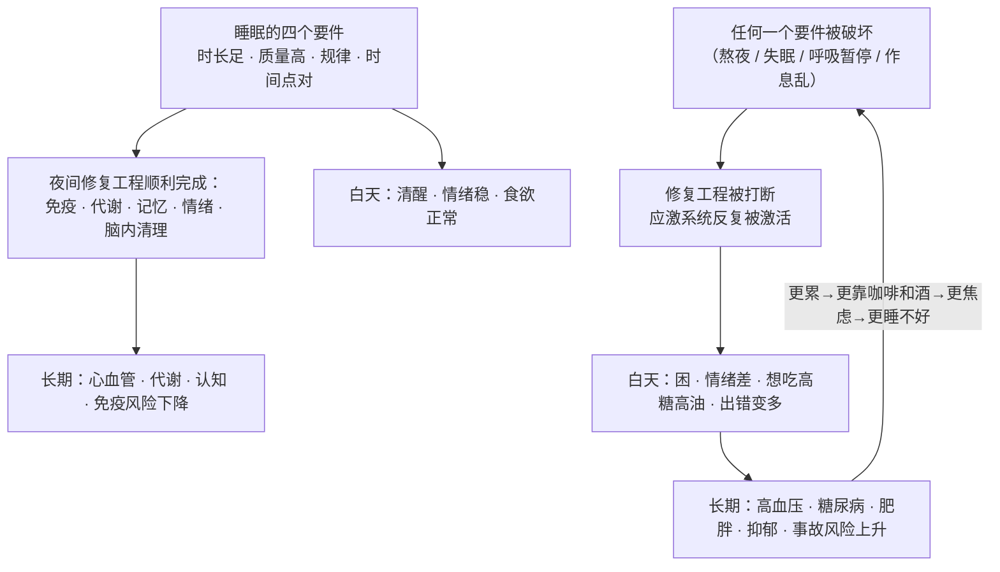
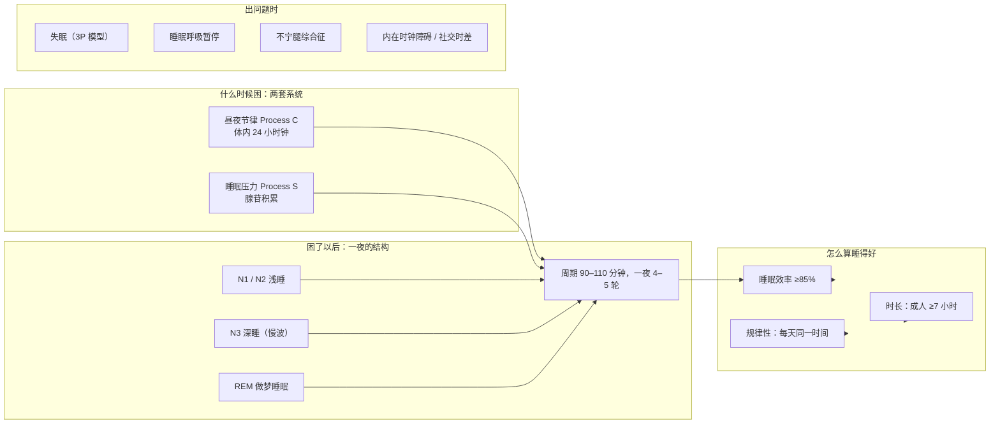
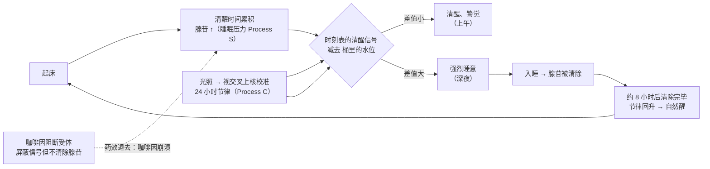
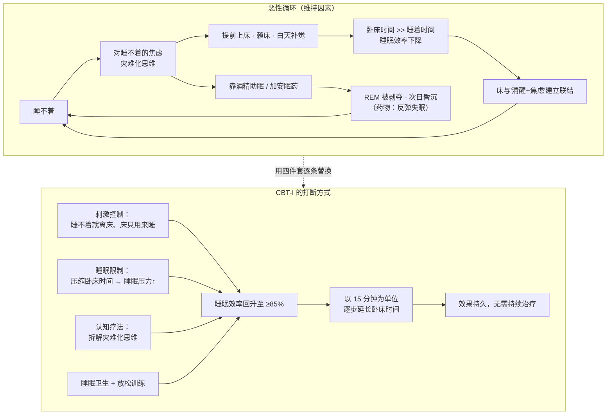
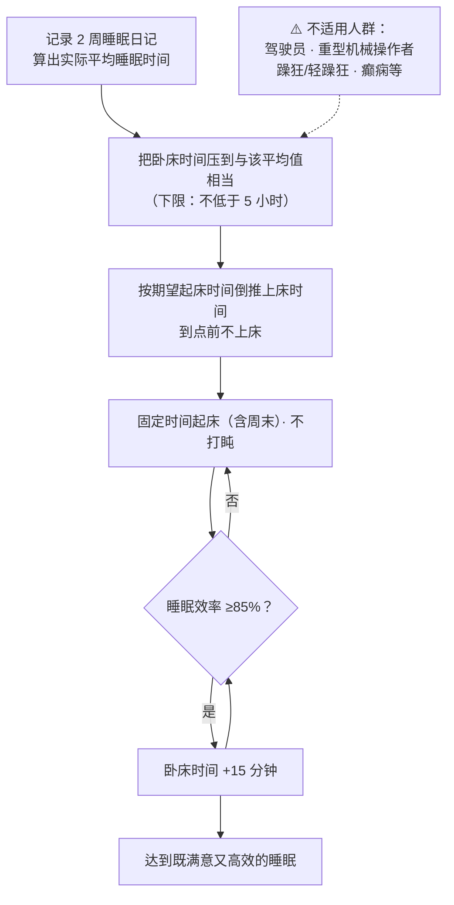
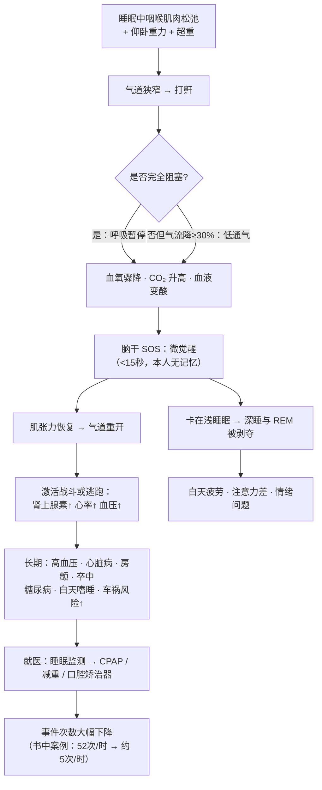
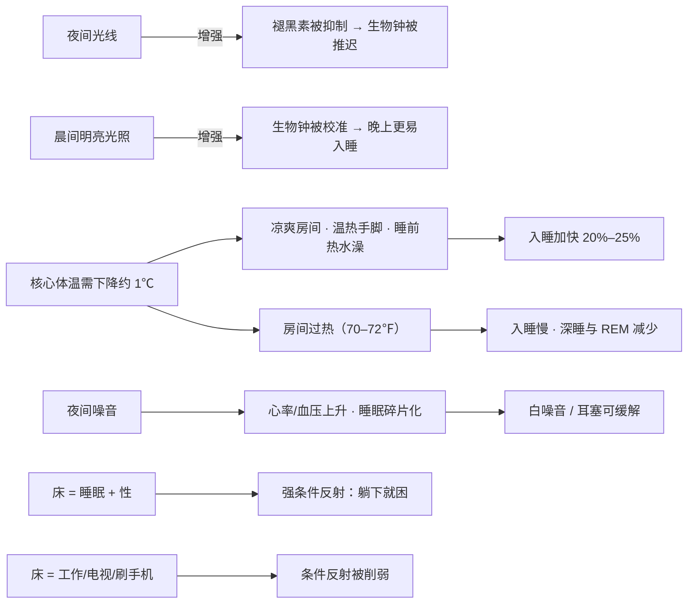
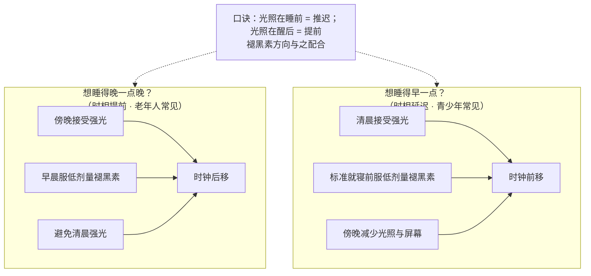
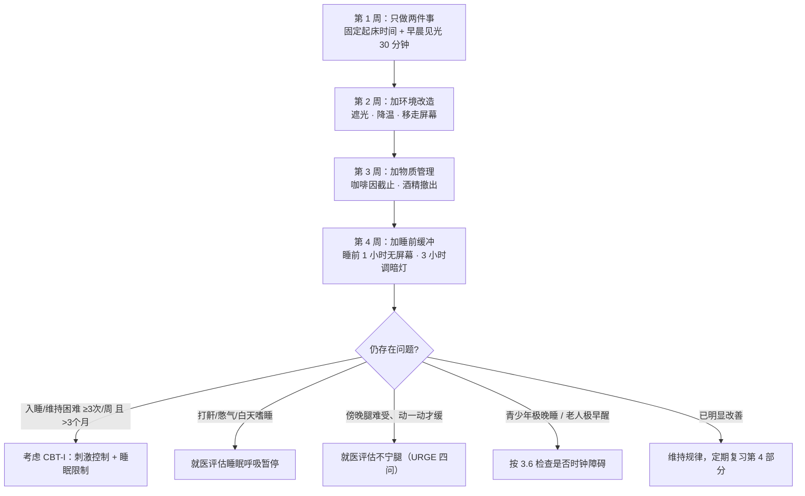

> **目标**：让零基础的家人看懂「睡眠是怎么运作的」，并照着做，改善全家睡眠质量，进而拥有更健康的身体。
> **原则**：本笔记严格复现四位作者/机构的原观点，不做引申创作。凡是重要的结论和数字，均给出**原文摘录（英文）+ 直译 + 出处页码**；笔记自己的归纳一律用「📝 归纳」前缀标出，与原观点分开。本文用 📝 表示"笔记自己的归纳"，⚠️ 表示"重要提醒"，[MC] 等方括号是四本书的简称（见下方"出处缩写表"）。
> **用法**：第 1 部分认词 → 第 2 部分懂理 → 第 3 部分看图 → 第 4 部分复习（含常见问答）→ 第 5 部分照做。每隔两周用第 4 部分自测一次。

## 总目录

| 部分 | 内容 | 谁最该看 |
|---|---|---|
| 0 | 全篇逻辑链（一图看懂） | 所有人，先看这个 |
| 1 | 核心概念（词语表） | 遇到不懂的词回来查 |
| 2 | 关键观点 15 组（附原文） | 想弄懂"为什么"的人 |
| 3 | 逻辑关系图（7 张） | 复习时看 |
| 4 | 复习要点（速记 / 自测 / 数字表 / 误区表 / **家人常见问答**） | 所有人，每两周一次 |
| 5 | 可执行行动清单（全家 / 分人群 / 日记模板） | 想立刻开始改变的人 |
| 6–7 | 来源索引、复习记录 | 查证据时用 |

---

## 出处缩写表

| 缩写 | 书目 | 性质 |
|---|---|---|
| **[WW]** | *Why We Sleep*（《我们为什么要睡觉》），Matthew Walker | 科普·机制与后果 |
| **[MC]** | *Mayo Clinic Guide to Better Sleep*（梅奥诊所睡眠指南） | 临床·实操与就医 |
| **[OH]** | *The Oxford Handbook of Sleep and Sleep Disorders*（Morin & Espie 主编，2012） | 学术手册·失眠的行为治疗 |
| **[PP]** | *Principles and Practice of Sleep Medicine*（《睡眠医学原理与实践》） | 教科书·调控机制 |

页码说明：[WW] / [MC] 用**该 PDF 的页码**；[OH] 用**书中印刷页码**（PDF 内会标 `(p. xxx)`）。

---

## 0. 全篇逻辑链（先记住这一条）

📝 归纳：这条链的关键在于**它是闭合的**——睡不好会让「让睡眠变好的条件」本身被破坏（白天更累、更想靠咖啡和酒、更焦虑、更不想动）。所以改善睡眠不是靠某一个妙招，而是**打断循环**。第 3.2 节的图会专门展示这个循环以及专业治疗是如何下刀的。

---

## 1. 核心概念（先把词认全）

### 1.1 概念地图

### 1.2 概念速查表

**睡眠的基本机制**

| 概念 | 一句话解释 | 最容易误会的地方 |
|---|---|---|
| **昼夜节律（circadian rhythm）** | 身体自带的、约 24 小时一轮的内在节律，决定你什么时候想醒、什么时候想睡 | 它不是「习惯」，是生物钟；**你睡没睡它都照走** |
| **视交叉上核（SCN）** | 大脑里的「主时钟」，约 2 万个神经元，位于视神经交叉点上方，靠光信号校准 | 名字吓人，实际体积很小（梅奥形容"不比一粒种子大"），但影响全身 |
| **褪黑素（melatonin）** | 天黑后由松果体释放的「黑暗信号」，告诉全身"夜晚开始了" | 它管**什么时候开跑**，不参与跑步本身——不是强力催眠药 |
| **腺苷 / 睡眠压力（adenosine, Process S）** | 清醒每一分钟都在脑内累积的化学物质，越积越困 | 咖啡因只是**屏蔽**了这个信号，并没有消除它 |
| **授时因子（zeitgeber）** | 德语"时间给予者"，任何能校准生物钟的重复信号：光、进食、运动、温度、社交 | 光是最主要的一个，但不是唯一一个 |
| **睡眠类型（chronotype）** | 你是"百灵鸟型"还是"猫头鹰型"，由基因强烈决定 | 猫头鹰不是懒，是 DNA 决定的 |
| **社交时差（social jet lag）** | 生活作息与体内生物钟不匹配，等于每周都在倒时差 | 不是坐飞机才会有 |

**一夜的结构与质量**

| 概念 | 一句话解释 | 最容易误会的地方 |
|---|---|---|
| **N1 / N2 / N3 / REM** | 睡眠的四个阶段：N1 最浅、N2 浅、N3 最深（慢波睡眠）、REM 做梦期 | 没有哪个阶段"更好"，各司其职 |
| **睡眠周期** | N1→N2→N3→N2→REM 为一轮，平均 90–110 分钟，一夜 4–5 轮 | 前半夜深睡多，后半夜 REM 多 |
| **睡眠效率** | 睡着时间 ÷ 躺在床上的时间，≥85% 算好 | 好睡者通常 85–90%，失眠者偏低；详见 2.7 的算例 |
| **睡眠规律性** | 每天上床与起床时间的一致性 | 规律性本身就是一个独立指标，不只看总时长 |
| **睡眠债** | 欠下的睡眠量会结转累积 | 周末补觉补不回来，还会让周一更难起 |
| **睡眠惯性（sleep inertia）** | 刚醒来时迷糊、发蒙、反应慢的状态，通常 15–30 分钟消退；从深睡中被叫醒时最重 | 不是"没睡醒的病"，但贪睡键会把它拉长 |
| **微觉醒（arousal）vs 觉醒（awakening）** | 脑子从睡眠短暂切到清醒**不到 15 秒**叫微觉醒；**满 15 秒以上**叫觉醒（[MC] p.32） | 这就是呼吸暂停患者"每晚被打醒上百次自己却不知道"的原因 |
| **慢波睡眠反弹** | 错过的深睡，身体会在之后一夜补回来一些 | 说明深睡对身体是"必需品"，不是奢侈品 |

**睡眠障碍与治疗**

| 概念 | 一句话解释 | 最容易误会的地方 |
|---|---|---|
| **睡眠反应性** | 压力对睡眠的破坏程度，高反应性是失眠的风险因素 | 同样的压力，有人睡得着有人睡不着 |
| **失眠 3P 模型** | 素质（predisposing）＋诱发（precipitating）＋维持（perpetuating） | 真正让失眠慢性化的是第三项 |
| **CBT-I** | 失眠认知行为治疗，慢性失眠的一线治疗 | 不是"聊天"，是一套可操作的行为处方 |
| **刺激控制 / 睡眠限制** | CBT-I 的两个核心技术：重建"床＝睡着"的条件反射；压缩卧床时间来加大睡眠压力 | 睡眠限制会让白天更困，这是设计的一部分 |
| **CPAP（持续正压通气）** | 治疗阻塞性呼吸暂停的核心设备：睡觉时戴面罩，机器送出温和气流把塌陷的气道"撑开" | 不是"呼吸机救命机"，是家用小仪器；适应期换面罩很正常 |
| **多导睡眠图（polysomnography / 睡眠监测）** | 在睡眠实验室同时记录脑电、呼吸、心跳、眼动、肢体动作的检查，是诊断呼吸暂停等疾病的金标准 | 医生不会给普通失眠者常规开这个检查 |
| **白噪音** | 把人耳能听到的所有频率混合在一起的均匀"沙沙"声，用来盖住突发的环境噪声 | 不是"助眠音乐"，作用是遮蔽；美国睡眠医学会推荐夜噪困扰者尝试 |
| **光照疗法（光疗）** | 用约 10,000 勒克斯（勒克斯是衡量光线亮度的单位，大晴天户外约 10 万、室内灯约 300–500）的专用光箱在特定时间照射，把生物钟往前或往后拨 | 时机决定方向：睡前照→推迟，醒后照→提前（详见 2.14） |
| **食欲素（orexin）** | 白天让人保持清醒的脑内化学信使；阻断它是一类新安眠药的作用原理 | 与"食欲"无关，名字容易误导 |
| **猝倒（cataplexy）** | 大笑、愤怒等强烈情绪引发的突然、短暂肌肉无力 | 是发作性睡病的特征症状之一，见 2.15 |
| **不宁腿综合征（RLS）** | 静坐或躺下时腿部出现难以描述的不适、必须动一动才缓解的病症 | 是真实的神经系统疾病，不是"心理作用" |

---

## 2. 关键观点（按作者原意分组）

> 每条的格式：**观点 → 作者原话（直译）→ 原文摘录 → 出处**。📝 前缀为笔记归纳，不是作者原话。

### 2.1 睡眠不是"关机"，而是一整夜的修复工程

**观点**：睡着时身体并不休息，而是在执行一份很长的任务清单。

> 直译：「睡眠绝不是身体停工休息的一段时间，恰恰相反：睡眠是你一天中**最高效**的时段之一——身体在逐项完成一份长长的待办清单，以保持你的健康与头脑敏锐。」
>
> 原文：*"Sleep encompasses one of the most productive parts of your day — an astonishingly busy stretch when your body ticks through a lengthy to-do list to help keep you healthy and mentally sharp."*
>
> —— [MC] 第 1 章，p.12

夜间进行的工作（[MC] 第 1 章）：修复细胞、再生组织、武装免疫系统；脑内"清洗系统"给细胞洗澡、冲走白天产生的有害废物；整理当天经历，一部分存为记忆、一部分丢掉；像自己的心理治疗师一样磨平情绪的尖刺。

📝 归纳：所以"少睡几小时没什么"这个直觉是错的——你砍掉的不是空闲时间，是维修班次。

---

### 2.2 两套系统决定你什么时候困：Process S 与 Process C

**观点 A：睡眠由两个独立系统共同决定。**

> 原文：*"The model consists of a homeostatic process (process S) and a circadian process (process C), which combine to determine the onset and offset of sleep."*
>
> 直译：该模型由一个稳态过程（过程 S）与一个昼夜过程（过程 C）组成，二者共同决定睡眠的开始与结束。
>
> —— [PP] 第 37 章（睡眠-觉醒调节）

> 原文：*"There are two main factors that determine when you want to sleep and when you want to be awake... The first factor is a signal beamed out from your internal twenty-four-hour clock... The second factor is a chemical substance that builds up in your brain and creates a 'sleep pressure.'"*
>
> —— [WW] 第 2 章，p.20

**观点 B：这两个系统互不通信，只是"通常对齐"。**

> 原文：*"They are two distinct and separate systems that are ignorant of each other. They are not coupled; though, they are usually aligned."*
>
> 直译：它们是两个彼此独立、互不知情的系统，并不耦合，只是通常对齐。
>
> —— [WW] 第 2 章，p.35

**观点 C：人的内在周期略长于 24 小时，需要每天用光校准。**

> 原文：*"the average duration of a human adult's endogenous circadian clock runs around twenty-four hours and fifteen minutes... The light of the sun methodically resets our inaccurate internal timepiece each and every day."*
>
> —— [WW] 第 2 章，p.23

**观点 D：睡眠压力靠"睡着"才能清除。**

> 直译：「在睡眠中，大脑有机会降解并清除当天的腺苷，一场大规模疏散就此展开……对成年人而言，约 8 小时的健康睡眠后，腺苷清除完毕。」
>
> 原文：*"Across the night, sleep lifts the heavy weight of sleep pressure... After approximately eight hours of healthy sleep in an adult, the adenosine purge is complete."*
>
> —— [WW] 第 2 章，p.37–38

**观点 E：节律不看你睡没睡。**

> 原文：*"your circadian rhythm will march up and down every twenty-four hours irrespective of whether you have slept or not."*
>
> —— [WW] 第 2 章，p.26

📝 归纳（白话版，帮助理解，非作者原话）：
- 把身体想成**一家两班倒的工厂**：
  - **Process S（睡眠压力）是一只水桶**——你每清醒一分钟，"困意水"就往桶里滴一滴；睡着时排水口打开，大约 8 小时排空。咖啡因的作用是**塞住桶上的水位计**，让你看不见水位，但水照涨。
  - **Process C（昼夜节律）是墙上的作息时刻表**——几点该精神、几点该犯困，写死了，不管你桶里有多少水。
- 你的**困意强度 = 时刻表上的"清醒信号"减去桶里的水位**。上午：清醒信号强、水位低 → 精神。深夜：清醒信号降到谷底、水位满 → 困到不行。
- 熬夜通宵后早上反而"精神了"，是因为时刻表在早上给你托了一把——**不是你不困了，是桶里的水还在**，到下午你会被淹死（ Walker 称之为"咖啡因崩溃"的同款机制，见 2.6）。

---

### 2.3 一夜的结构：四个阶段与周期

| 阶段 | 特征与功能（[MC] 第 1 章，p.22–25） | 占比／时长 |
|---|---|---|
| **N1** | 最浅，清醒与睡眠的过渡；α 波转为 θ 波；容易被叫醒 | 1–7 分钟，约 5% |
| **N2** | 心率体温下降、肌肉放松；出现纺锤波与 K-复合体，被认为参与长期记忆存储 | 一夜中占比最大的阶段，可达约一半 |
| **N3（深睡／慢波）** | 最慢的脑波；免疫增强、生长激素分泌高峰、**脑内类淋巴系统冲洗废物**；难被叫醒，醒后有睡眠惯性 | 约 20%–25%；第一个周期里最长，20–40 分钟 |
| **REM** | 眼球快速运动、身体近乎瘫痪（防把梦演出来）、脑电接近清醒；情绪记忆被处理、前额叶维护 | 约 25%；第一次约 10 分钟，最后一轮可达一小时 |

> 直译：「深睡时，你大脑的类淋巴系统也在执行重要的清理工作：脑脊液涌入大脑，冲走白天累积的有害蛋白废物，并带来新鲜的营养供应。」
>
> 原文：*"Your brain's glymphatic system also conducts its vital cleanup during deep sleep. Cerebrospinal fluid floods into your brain, washing away harmful protein wastes that accumulated during the day."*
>
> —— [MC] 第 1 章，p.24–25

📝 归纳：
- **前半夜保深睡、后半夜保 REM**——所以"只睡前半段"和"只睡后半段"损失的东西不一样；**熬夜和早起不是等价的**。
- 这也解释了为什么"补觉"补不回来：深睡集中在前半夜，睡晚了会先被砍掉。
- 醒来时觉得脑子发懵（睡眠惯性）最常发生在从深睡中被强行叫醒的时候——这是正常生理现象，15–30 分钟自行消退（[MC] p.69）。

---

### 2.4 睡眠到底给了你什么（收益侧）

**（1）记忆与学习**

> 直译：「因为（海马体的临时存储被清空），睡眠不足可使第二天的学习能力下降多达 40%。」
>
> 原文：*"sleep deprivation can reduce learning the next day by up to 40%"*
>
> —— [MC] 第 1 章，p.18–19

**（2）情绪调节：普通版与"夜间疗法"版**

普通版（[MC]）：

> 直译：「睡眠以两种重要方式提供情绪支持：帮你把昨天发生的事放回恰当的位置，并让你为明天的事件做好健康应对的准备。」
>
> 原文：*"sleep provides emotional support in two important ways: helping you put what happened yesterday into the proper perspective, and preparing you to have a healthy response to tomorrow's events."*
>
> —— [MC] 第 1 章，p.19

机制：睡不够时，大脑里管情绪的部位（杏仁核）和管理智的部位（前额叶）之间的配合变差，导致情绪失控（[MC] p.19）。

深度版（[WW] 第 10 章"做梦即夜间治疗"）——这是 Walker 的核心理论之一：

> 直译：「REM 睡眠做梦提供了一种**夜间疗法**。也就是说，REM 睡眠中的梦把你白天经历的困难、甚至创伤性情绪事件的痛苦刺痛抽走，让你第二天早上醒来时获得情绪上的解决。」
>
> 原文：*"REM-sleep dreaming offers a form of overnight therapy. That is, REM-sleep dreaming takes the painful sting out of difficult, even traumatic, emotional episodes you have experienced during the day, offering emotional resolution when you awake the next morning."*
>
> —— [WW] 第 10 章，p.195

其机制核心：**REM 是一天 24 小时中大脑唯一完全关闭去甲肾上腺素（一种应激化学物质）的时段**——

> 原文：*"REM sleep is the only time during the twenty-four-hour period when your brain is completely devoid of this anxiety-triggering molecule."*
>
> —— [WW] 第 10 章，p.195

夜间疗法理论的两个目标（[WW] p.196）：**① 记住**那些有价值经历的细节并纳入知识体系；**② 忘掉（溶解）**包裹在这些记忆外面的、内脏性的痛苦情绪电荷。Walker 的比喻：

> 直译：「REM 睡眠通过夜间的治疗工作，完成了把苦涩的情绪外皮从信息丰富的果实上剥离的精妙把戏。」
>
> 原文：*"REM sleep performed the elegant trick of divorcing the bitter emotional rind from the information-rich fruit."*
>
> —— [WW] 第 10 章，p.196

实验支持（[WW] p.197）：两组人看同一组情绪图片、间隔 12 小时再看一次。中间睡了一夜的那组，主观情绪反应显著下降，脑扫描（MRI）显示主管情绪的部位反应性大幅降低、管理智的部位重新上线；中间一直清醒的那组，**情绪反应完全没有随时间消解**。

📝 归纳：这段话解释了一个家常体验——"气得半死，睡一觉就好多了"不是时间冲淡了情绪，是 REM 睡眠把情绪的"刺"拔掉了。反过来也成立：**长期睡不好的人，等于每晚都少做一次免费心理治疗**。

**（3）免疫**

深睡期间免疫系统得到增强，"释放出追捕病毒与细菌的细胞"（[MC] p.24）。

**（4）能量守恒**

睡眠时体温下调、代谢变慢、消化减弱，身体可节省多达三分之一的能量需求（[MC] p.19）。

**（5）食欲与体重（反面证据）**

> 直译：「睡眠不足会降低传递饱腹信号的瘦素浓度，并提高引发饥饿的饥饿素水平……这是典型的生理双重打击。」
>
> 原文：*"Inadequate sleep decreased concentrations of the satiety-signaling hormone leptin and increased levels of the hunger-instigating hormone ghrelin. It was a classic case of physiological double jeopardy."*
>
> —— [WW] 第 8 章，p.163–164

作者还补充：睡眠剥夺还会让身体自己产生一种类似大麻的化学物质（会让你想吃零食），并强调"有人认为睡得少是因为清醒时消耗更多热量——遗憾的是，这不成立"（[WW] p.164 附近）。

---

### 2.5 睡不够的代价（递进：从一晚到长期）

**第一层：一晚**

一晚睡太少就会疲劳、易怒、表现下降、容易出错；"好在一两晚好睡眠就能还清小额睡眠债"（[MC] 第 2 章，p.29）。

**第二层：连续多晚**

> 直译：「不足的睡眠会导致身体最基本功能出现细小但重要的紊乱，启动一连串压力反应，损害你的心理与身体健康。这种损害是累积性的，并与若干特定疾病相关。」
>
> 原文：*"Inadequate sleep leads to small but important disruptions of your body's most basic functions, starting a cascade of stress that harms your mental and physical well-being. The damage is cumulative."*
>
> —— [MC] 第 2 章，p.29

**第三层：长期（作者列举的关联）**

- 睡眠不足与肥胖、糖尿病、高血压、感染增多、认知功能下降乃至死亡相关（[MC] 第 6 章，p.88）。
- **U 型曲线**：

> 直译：「每晚睡 7 到 8 小时的人活得更长。研究人员将其描述为一条 U 型曲线——一生中离每晚 7–8 小时越远（睡得太少或太多），因任何原因死亡的风险越大。」
>
> 原文：*"People who sleep 7 to 8 hours a night live longer. Researchers describe it as a U-shaped curve, meaning that the further you get from 7 to 8 hours per night over your lifetime — getting either too little sleep or too much — the greater your risk of death from any cause."*
>
> —— [MC] 第 3 章，p.53

- 睡眠呼吸暂停与心血管疾病相关，睡得太少会升高高血压风险（Framingham 睡眠心脏研究，[MC] p.33）。
- 睡眠过多或过少都与心血管疾病风险上升相关（Jackson 心脏研究，[MC] p.33）。
- 轮班工作与心梗、2 型糖尿病风险升高相关；因还与结直肠癌、乳腺癌、前列腺癌相关，**WHO 在 2010 年判定轮班工作"可能致癌"**（[MC] p.42）。
- 社交时差与肥胖、2 型糖尿病、癌症、心脏病、阿尔茨海默病风险升高相关（[MC] p.38）。
- [WW] 的表述更强烈：

> 原文：*"Routinely sleeping less than six or seven hours a night demolishes your immune system, more than doubling your risk of cancer... Inadequate sleep—even moderate reductions for just one week—disrupts blood sugar levels so profoundly that you would be classified as pre-diabetic."*
>
> —— [WW] 第 8 章开篇

- 阿尔茨海默病：作者称"睡眠不足正迅速被认为是决定是否罹患阿尔茨海默病的关键生活方式因素之一"，并指出 65 岁以上成人中每 10 人就有 1 人患病（[WW] 第 7 章）。

⚠️ **必须保留的限定**：这些流行病学研究呈现的是**关联**。[MC] 自己就指出，关于"睡太多"与健康的因果关系，专家未能达成共识，甚至存在"是睡太多导致不健康，还是不健康的人睡得更久"的反向解释（[MC] p.36）。读数据时请按"关联"理解，不要当成"确定因果"。

---

### 2.6 现代生活如何偷走睡眠（五个因素）

[WW] 第 13 章给出的答案（[WW] p.248）：

1. **持续的电力照明与 LED 光**
2. **恒温的室内环境**
3. **咖啡因**（第 2 章已述）
4. **酒精**
5. **打卡上班的遗产（强制早起）**

**（1）夜间人造光**

> 直译：「人工的晚间光线，即使强度不高，也会欺骗你的视交叉上核，让它以为太阳还没落山。本该在黄昏时分松开的褪黑素刹车，在电灯的压力下被强行踩住。」
>
> 原文：*"Artificial evening light, even that of modest strength, or lux, will fool your suprachiasmatic nucleus into believing the sun has not yet set."*
>
> —— [WW] 第 13 章，p.250

[MC] 补充了量化：蓝光的波长"在削减褪黑素水平方面比暖色光（如红光那头）强三倍"；蓝光还会提高心率、让人更警觉、升高体温，"没有一样对入睡有帮助"（[MC] p.44）。

[MC] 还引用了一项 4.3 万余名女性的研究：睡觉时房间开着灯或电视的人更容易肥胖并持续增重，**但一盏小夜灯不会产生同样结果**（[MC] p.67）。

📝 归纳：这里两本书的落点不同——[WW] 强调"光延迟了生物钟"，[MC] 强调"光还有代谢层面的关联"。两者不矛盾，是同一原因的两种后果。

**（2）酒精**

> 直译：「睡前喝一杯酒或许帮你放松，但大量饮酒会夺走你的 REM 睡眠，把你留在较浅的睡眠阶段；大量饮酒还可能导致夜间呼吸受损；酒精作用消退后你也容易在半夜醒来。」
>
> 原文：*"Having a nightcap or alcoholic beverage before sleep may help you relax, but heavy use robs you of REM sleep, keeping you in the lighter stages of sleep."*
>
> —— [WW] 附录，p.321

作者的 REM-记忆实验（[WW] p.254–255）：三组学生学习同一套人工语法，第 1 天睡前喝酒的那组，7 天后**忘掉超过 50%**；即使前两晚都睡得好、只在第 3 晚喝酒的那组，仍然遗忘约 **40%**。

> 直译：「每晚饮酒都会扰乱你的睡眠，而'戒断'这个讨人厌的建议，是我能给出的最好、也最诚实的建议。」
>
> 原文：*"Nightly alcohol will disrupt your sleep, and the annoying advice of abstinence is the best, and most honest, I can offer."*
>
> —— [WW] 第 13 章，p.256

📝 归纳（把 2.4 的"夜间疗法"连起来看）：酒精恰好砍的是 REM——**它剥夺的不只是"梦"，还是每晚那次情绪疗愈和记忆整理**。这解释了为什么"借酒消愁"短期见效、长期反而更焦虑。

**（3）温度**

入睡需要核心体温下降约 1℃（2–3℉）：

> 原文：*"To successfully initiate sleep... your core temperature needs to decrease by 2 to 3 degrees Fahrenheit, or about 1 degree Celsius. For this reason, you will always find it easier to fall asleep in a room that is too cold than too hot."*
>
> —— [WW] 第 13 章，p.256

推荐室温：[WW] 给 **18.3℃（65℉）**（p.258）；[MC] 给 **64–68℉（约 18–20℃），"再低几度也无妨"**（p.68）。两本书一致。

机制：手、脚、头布满一种特殊的血管（医学上叫动静脉吻合支），睡前会主动"散热"；温热的手脚帮助核心降温。作者提到，实验中把脚和手加温约 0.5℃，健康年轻人入睡时间**缩短 20%**，老年人缩短 18%，**失眠患者缩短 25%**；且半夜醒来的概率从 58% 降到 4%（[WW] p.259）。

热水澡：不是因为"暖"，而是因为出浴后皮肤表面的血管变粗（扩张）、核心体温骤降：

> 原文：*"Hot baths prior to bed can also induce 10 to 15 percent more deep NREM sleep in healthy adults."*
>
> —— [WW] 第 13 章，p.260

**（4）闹钟与贪睡键**

> 直译：「被人为粗暴唤醒的人会出现血压飙升和心率急剧加速，这是神经系统'战斗或逃跑'分支的一次爆发式活动……如果你使用贪睡功能，意味着你会在短时间内反复承受这种心血管冲击。」
>
> 原文：*"Participants artificially wrenched from sleep will suffer a spike in blood pressure and a shock acceleration in heart rate... using the snooze feature means that you will repeatedly inflict that cardiovascular assault again and again."*
>
> —— [WW] 第 13 章，p.260–261

[MC] 的说法更温和但一致：贪睡会**延长睡眠惯性**（那种迷糊、发蒙、有时走路打晃的状态），通常 15–30 分钟消退，贪睡会把它拉长（[MC] p.69）。

---

### 2.7 失眠：怎么来的（3P 模型）与怎么破（CBT-I）

**（1）定义与诊断门槛**

> 直译：「每周至少出现 3 次、持续超过 3 个月的失眠，被视为慢性失眠。」
>
> 原文：*"Insomnia that occurs at least three times a week and lasts more than three months is considered chronic insomnia."*
>
> —— [MC] 第 6 章，p.86–87

ICSD-3（一本国际通用的睡眠障碍诊断标准）诊断标准（[MC] p.87–88）要点：入睡困难／维持困难／早醒 ＋ 白天疲劳、注意记忆受损、情绪紊乱等后果；**不能单纯用"睡眠机会不足"或"环境太差"解释**；≥3 次／周；≥3 个月；不能用其他睡眠障碍更好解释。
临床显著性阈值（医生用来判断"算不算异常"的界线，[MC] p.88）：儿童与青年入睡延迟 >20 分钟、中年及以上 >30 分钟；夜间醒来同理；早于预期 30 分钟以上醒来。

📝 归纳：**"睡不着"本身不等于失眠病**——必须有白天功能受损，且排除了"你只是给自己留的时间不够/环境太差"。

**📝 归纳：睡眠效率怎么自己算（算例来自 [MC] p.95 原文）**

书中给的例子：你晚上 9 点上床、花 2 小时才睡着、凌晨 5 点醒、6 点起床——9 小时卧床，实际只睡 6 小时，睡眠效率 = 6 ÷ 9 ≈ **66%**（低于 85%，属于低）。医生因此开出"6 小时睡眠处方"：**午夜上床、6 点起床**，先把效率拉起来。这也是睡眠限制疗法（见下）的标准开场。

**（2）3P 模型（[MC] 第 6 章，p.88–89；该模型的学术源头见 [OH]，Spielman 的应激-素质模型与限制卧床时间疗法，[OH] 印刷页 3–4）**

| P | 含义 | 例子（作者原文） |
|---|---|---|
| **素质 Predisposing** | 让你比别人更容易失眠 | 女性风险高于男性；家族史；上夜班；**与打鼾或翻来覆去的床伴同睡** |
| **诱发 Precipitating** | 触发事件 | 生活压力、疾病、药物、作息改变 |
| **维持 Perpetuating** | 让失眠慢性化的真正元凶 | 对睡不着的焦虑、"我必须睡够"的执念、赖床补觉、白天打盹、靠酒助眠 |

> 直译：「诱发因素不必然导致失眠，但会搭好舞台。」
>
> 原文：*"Predisposing factors don't cause insomnia but can set the stage."*
>
> —— [MC] p.89

📝 归纳：为什么这个模型重要？因为它决定了**治疗打的是第三个 P**。消除压力事件（第二个 P）并不能治好已经慢性化的失眠。

**（3）一线治疗：CBT-I**

> 直译：「2016 年美国医师学会作出里程碑式推荐……结论是：对所有慢性失眠患者，CBT-I 必须作为一线治疗使用，而不是安眠药。」（该委员会给出的推荐强度为"强烈推荐"）
>
> 原文：*"CBT-I must be used as the first-line treatment for all individuals with chronic insomnia, not sleeping pills."*
>
> —— [WW] 第 14 章，p.272；推荐强度见 p.275 注 VIII

[MC] 的对应表述：

> 原文：*"Cognitive behavioral therapy for insomnia (CBT-I) is considered the first-line treatment because of its high success rate and lasting results."*
>
> 数据：「CBT-I 对尝试者有效率 70%–80%，且效果持久」，通常 **6–8 次**即可完成；"单用比与药物联用更成功"，减少用药需求本身就被视为 CBT-I 的优点之一。
>
> —— [MC] 第 6 章，p.93

**（4）CBT-I 的五个核心组件（[MC] 第 6 章，p.93–99）**

| 组件 | 作者的原话要点 | 具体做法 |
|---|---|---|
| **刺激控制** | 源自巴甫洛夫的经典条件反射（就是"一开灯狗就流口水"那种学习机制）：目标是让"床"与"睡着"的联结强到一躺下就困 | 只在困了才上床；睡不着就起床（[MC]：约 10 分钟；[WW]：约 20 分钟）；起床后做安静放松的事，**不看屏幕**；固定起床时间；不午睡；床只用于睡眠和性 |
| **睡眠限制** | 「越困，睡着的几率越高」；通过压缩卧床时间来加大（自动平衡式的）睡眠压力 | 卧床时间先压到与实际睡眠时间相当（**不要少于 5 小时**）；睡眠效率达到 85% 后，以约 15 分钟为单位逐步增加；固定起床时间；不打盹 |
| **认知疗法** | 处理"灾难化思维"：*我永远睡不着了！我的明天完了！* | 识别这些念头是**不准确且适得其反**的，替换为准确、正向的推理 |
| **睡眠卫生** | 处理习惯、行为与环境中干扰睡眠的因素 | 见第 5 部分清单 |
| **放松疗法** | 冥想、引导想象、放松呼吸、渐进式肌肉放松 | [MC] 第 6 章 p.97–99 给出了可直接照做的分步练习 |

⚠️ **两本书的差异，请如实记住**：离床等待时间，[MC] 说 **约 10 分钟**，[WW] 说 **超过 20 分钟**。两者都是作者原话，取哪个都可，关键是**不要盯着时钟数时间**——[MC] 明确说"不要看钟，凭感觉估计过了约 10 分钟"。

📝 归纳（白话版）：**"睡眠限制"为什么反直觉却有效**——把它想成"饿了才好吃饭"。在床上躺 10 个小时只睡 6 小时，等于把胃口摊薄：床被训练成"躺着发呆的地方"。压缩到 6 小时后，每一分钟卧床都带着满满的睡意，睡眠被"压实"了，效率回升，然后才逐步放宽。前两周白天会更困——**这是疗程的一部分，不是失败**（也正因如此，驾驶员等人群不宜自行操作，见 5.5 的边界说明）。

**（5）睡眠卫生不是万能药（[OH] 的关键限定）**

> 直译：「从概念上看，不良睡眠卫生似乎既非失眠发生的必要条件，也非充分条件。原发性失眠患者未必比睡眠良好者更多地做出不良睡眠卫生行为，而单用睡眠卫生指导并不能稳定产生显著获益。」
>
> 原文：*"poor sleep hygiene appears to be neither necessary nor sufficient for the occurrence of insomnia. Patients with primary insomnia do not necessarily engage in more poor sleep hygiene practices than good sleepers... monotherapy with sleep hygiene instructions does not reliably produce significant benefit."*
>
> —— [OH] 印刷页 411–412

另一处同样明确：应向所有患者强调睡眠卫生，**但"仅仅纠正睡眠卫生往往不够"**（[OH] 印刷页 779）。

[MC] 也持同一立场：如果医生给你的方案只涉及改善睡眠习惯（睡眠卫生），**这不算是充分的治疗**——AASM（美国睡眠医学会）强调治疗失眠障碍应包含 CBT-I 或其他行为学成分（[MC] p.93）。

📝 归纳：这是本笔记最重要的一处"纠偏"。很多人以为"睡眠卫生 = 治疗失眠"，作者们明确反对。睡眠卫生是**地基**，不是**药**。

---

### 2.8 安眠药：处方药、非处方药与补充剂的真面目

**（1）两位作者的总体立场（先看这个）**

**[WW]（Walker）：强烈警告**

> 原文：*"No past or current sleeping medications on the legal (or illegal) market induce natural sleep."*
>
> 直译：无论过去还是现在，合法（或非法）市场上没有任何一种睡眠药物能诱导出**自然睡眠**。
>
> —— [WW] 第 14 章，p.264

他的论据链：
1. 药效有限：一项汇总 65 项"药物 vs 安慰剂（一种不含药物的假药，用来做对比）"研究、近 4500 人的评估发现，服药者主观上觉得入睡更快、睡得更沉，**但睡眠记录显示没有差别**——与安慰剂相比没有客观获益；委员会的总结是效果"相当小且临床意义可疑"（p.265–266）。
2. 反弹失眠：停药后睡眠往往比用药前更糟，属于耐受与戒断（p.265）。
3. 恶性循环：次日昏沉 → 喝更多咖啡 → 更睡不着 → 加大药量（p.264–265）。
4. 死亡率与癌症关联：Kripke 的匹配队列研究中，用药者在两年半内死亡可能性是未用药者的 **4.6 倍**；重度使用者（>132 片/年）**5.3 倍**；即便偶尔使用（每年仅 18 片）也达 **3.6 倍**；用药者 2.5 年内罹患癌症的可能性高 30%–40%（p.267–269）。
5. **作者自己给出的限定**（必须保留）：

> 直译：「这些发现证明了安眠药致癌吗？没有。至少单靠它们不能。也存在其他解释。例如，可能是促使他们去开药的那个睡眠问题本身——而不是安眠药——使他们易患病……但安眠药确实导致死亡与癌症的可能性同样存在。」
>
> 原文：*"Do these findings prove that sleeping pills cause cancer? No... it could be that the poor sleep that individuals were suffering prior to taking these drugs... predisposed them to ill health."*
>
> —— [WW] p.269–270

他同时声明自己"不反对药物"，只是认为目前尚不存在那种有充分证据、获益远大于风险、能产生自然睡眠的药（p.270）。

**[MC]（梅奥诊所）：以 CBT-I 为一线，药物为有限度的补充**

> 原文：*"While cognitive behavioral therapy is typically the first-line treatment for insomnia and has a high success rate, medications are sometimes prescribed to help improve sleep... Doctors generally don't recommend relying on prescription sleeping pills for more than a few weeks, but several medications are approved for long-term use."*
>
> —— [MC] 第 6 章，p.101

**（2）处方药分几类、各自怎么起效（[MC] 第 7 章，p.102–108）**

📝 归纳：理解下面这张表只需记住一个原则——**安眠药要么"踩深睡眠的油门"，要么"松清醒的刹车"**（[MC] p.105 原文：*"Insomnia medications target overactive pathways. Some enhance sleep pathways, while others inhibit wakefulness pathways."*）。

| 类别 | 代表药 | 作用原理 | 作者强调的要点 |
|---|---|---|---|
| **Z 药**（非苯二氮卓类受体激动剂） | 唑吡坦（Ambien）、艾司唑仑类（Lunesta）、扎来普隆（Sonata） | 增强一种让神经安静下来的物质（GABA）的作用，让大脑"减速" | 处方量最大（美国每年 >250 万人服用唑吡坦）；FDA 要求附**最强烈警告**——极少数人会在睡眠状态下走路、做饭、进食、打电话甚至开车，本人次日毫无记忆；FDA 复盘 25 年记录发现 66 例重伤、其中 20 例致死，几乎全部涉及唑吡坦（p.104、p.106） |
| **苯二氮卓类** | 替马西泮（Restoril）、地西泮（Valium） | 同样增强 GABA，但作用更宽泛 | 会**改变睡眠结构——减少恢复性深睡与 REM**；依赖与戒断问题（戒断症状被比作酒精依赖）；一般只用 7–10 天；**与阿片类止痛药合用可抑制呼吸致死**——约每 7 例阿片过量死亡中就有 1 例涉及苯二氮卓（p.106、p.107 侧栏） |
| **食欲素受体拮抗剂（DORA）** | 苏沃雷生（Belsomra）、莱博雷生（Dayvigo）、达利雷生（Quviviq） | 阻断让人清醒的食欲素信号，相当于"关小清醒的音量" | 较新（近十年内获批）；作用更特异，**无明显戒断症状、目前无耐受证据**（p.107） |
| **褪黑素受体激动剂** | 雷美替胺（Rozerem） | 模拟褪黑素，对准睡眠时序系统 | 有助入睡，但**不增加总睡眠时间或深睡**；一项全面综述认为改善幅度小；不良反应较少（p.107–108） |
| **抗抑郁药类（低剂量用于睡眠）** | 曲唑酮、多塞平（Silenor） | 抗组胺等副作用让人困倦 | 多塞平获 FDA 批准用于"维持睡眠"；但 **AASM、美国医师学会、退伍军人事务部等均不推荐曲唑酮作一线**——有趣的是，如今曲唑酮用于失眠的处方量已超过用于抑郁的处方量（p.108） |

**（3）非处方药与补充剂：作者们的逐项裁决（[MC] 第 7 章，p.108–113）**

先看大背景：约 **8.4%** 的美国成年人在用某种睡眠药物（CDC 数据，p.104）；而绝大多数非处方助眠产品的效果，远不如广告暗示的那么好。

| 产品 | 作者的裁决 | 关键证据 |
|---|---|---|
| **抗组胺类（ZzzQuil、Unisom 等）** | **不推荐**（AASM 明确不推荐苯海拉明） | 镇静作用**三天就耐受**——某研究显示某抗组胺药仅 3 天就失效；残留次日宿醉感、头晕、老人跌倒、便秘、尿潴留，某些还与认知损害及痴呆风险相关（p.108–110） |
| **褪黑素补充剂** | **AASM 不推荐用于治疗失眠**；时差场景除外（见 2.14） | 效果"温和"：著名研究显示**入睡只快了 4 分钟、总睡眠只多了约 13 分钟**（p.111）；质量管控差——一项分析美国在售 25 个品牌褪黑素软糖的研究发现，**只有 3 个品牌含量在标签的 ±10% 以内，其余 22 个实际含量为标示的 74%–347%**，有些还含血清素（p.111 侧栏）。若仍想用：睡前约 30 分钟服、不超过 10 mg、认准 USP Verified 或 GMP 标识（p.111） |
| **缬草** | 证据**不一致** | 一项公认最严格的研究（随机分组、用假药做对比）未发现它改善癌症患者的睡眠（p.112–113） |
| **卡瓦** | **应避免** | 与肝损伤相关，**部分病例致死**（p.113） |
| **大麻 / CBD** | 科学不支持用于睡眠 | 对五十年研究的综述发现：**多数研究中大麻恶化而非改善睡眠**；CBD 研究 56% 的人睡眠改善、但近 27% 反而变差；戒断时常见睡眠紊乱（p.112） |
| **口服 GABA 补充剂** | 证据"非常有限" | 口服 GABA 能否通过血脑屏障进入大脑本身存疑（p.111–112） |
| **酸枣仁** | 大鼠研究显示睡眠增加，**人体研究缺乏**；一般认为安全 | 与处方安眠药作用于同一 GABA 系统（p.113） |

📝 归纳：这张表回答了家里最常见的困惑——**"药店/网店买的助眠保健品，到底哪个行？"** 作者的答案整体是：多数不行或证据不足；褪黑素被寄予厚望但实测效果温和，且剂量标签不可信。

---

### 2.9 睡眠呼吸暂停：家庭里最该警惕的"隐形病"

**是什么**

> 直译：「睡着时，你咽喉与气道内的软组织可能塌陷，阻断你的呼吸，直到你至少醒到足以让气道重新打开、恢复呼吸为止。这每小时可发生数十次，一晚可远超 100 次。」
>
> 原文：*"During sleep, the soft tissue in your throat and air passage can collapse... This can happen dozens of times each hour, well over 100 times in a night."*
>
> —— [MC] 第 8 章，p.116

**"每晚醒上百次自己却不知道"的原理（[MC] p.32 的关键区分）**

> 直译：「微觉醒是大脑从睡眠短暂转入清醒的状态，持续**不到 15 秒**；若这种睡眠到清醒的转变持续 **15 秒或更久**，则称为觉醒。」

再加上：**对 40 岁的人，每小时多达 15 次微觉醒都算正常**。📝 归纳：呼吸暂停引发的绝大多数是"微觉醒"——脑电波醒了、人没有记忆，所以患者只会觉得"睡了一夜还是累"，完全不知道发生了什么。这就是为什么诊断要靠睡眠监测、为什么要问床伴。

**后果链（作者原文，[MC] p.117–118）**：气道塌陷 → 血氧骤降、二氧化碳升高、血液变酸 → 大脑里的感应器发出警报把你唤醒 → 肌张力恢复、气道打开 → 反复循环。同时激活"战斗或逃跑"，释放让人紧张兴奋的激素 → 心率、血压、代谢率上升 → 长期损害心脏与血管（高血压、心脏病、房颤、卒中）。另外，"很容易卡在浅睡眠里"，身体被剥夺了对长期健康最重要的深睡。

**严重度分级（[MC] 第 5 章，p.74）**：每小时异常呼吸事件 5–15 次＝轻度；15–30 次＝中度；>30 次＝重度。
**患病率（[MC] 第 8 章，p.116）**：美国男性 14%、女性 5%；男性约为女性的三倍（p.120）。
**最重要风险因素**：超重——"体重增加 10% 已被证明会使（患病几率）增加六倍"（[MC] p.120–121）。

**关键提醒（[MC] p.117）**：肌肉最松弛的是 REM 睡眠期，因此 REM 期最可能发生气道完全闭合；**仰卧会加重**（重力把舌头等组织往下拉）。

**治疗（[MC] 第 8–9 章）**：CPAP（持续正压通气）是核心——睡觉时戴一个小面罩，机器持续送出温和气流，把塌陷的气道"吹开"；减重、口腔矫治器、体位治疗等作为综合方案的一部分。书中的 John 案例：从每小时 52 次事件降到约 5 次，同时减重约 50 磅、规律作息，血压显著下降。

**与失眠的关系（[MC] p.119–120 及 p.91–92）**：呼吸暂停可导致或加重失眠；两者同时存在时医学上叫 COMISA（失眠合并呼吸暂停）——研究显示，**每 10 个失眠者中约有 1 人同时患有阻塞性睡眠呼吸暂停，而每 10 个呼吸暂停患者中有 4 人被诊断为失眠**。

📝 归纳：这条对家庭特别重要——**家人打鼾不是"睡得香"，是需要评估的信号**。而失眠患者若同时有打鼾，单纯做 CBT-I 可能不够。

---

### 2.10 环境四要素：光、温度、声音、床

| 要素 | 作者原话要点 | 出处 |
|---|---|---|
| **光（晚上）** | 「睡前一小时避免使用电子设备，是防止蓝光重置你内在时钟最确定的方法」 | [MC] p.44 |
| **光（操作）** | 睡前 **3 小时**开始调暗家中灯光；常待的卧室/起居区换用 **2700K–3000K**（K 是色温单位，数字越小灯光越偏暖黄）暖色灯泡；卧室尽可能黑，必要时遮光帘或眼罩 | [MC] p.67 |
| **光（早上）** | 「早晨拥抱光线……醒来后接受明亮光照数小时，可让你的昼夜节律保持同步，并帮你晚上更快入睡、白天不那么困」 | [MC] p.67 |
| **温度** | 卧室尽可能凉爽且仍舒适，理想 **64–68℉（约 18–20℃）**，再低几度也无妨；睡前一两小时内洗澡有助调节体温、缩短入睡时间 | [MC] p.68–69 |
| **温度（工具）** | 若无法降温，用风扇：流动的空气"制造单调的感觉，促进入睡"，减少醒来次数 | [MC] p.69 |
| **声音** | 「你的身体永远不会真正习惯噪音」——夜间的声音会碎片化睡眠，减少慢波与 REM 睡眠，增加最浅的阶段 | [MC] p.67–68 |
| **声音（对策）** | AASM 推荐尝试白噪音；耳塞与眼罩在 ICU 患者中被证明有益 | [MC] p.68 |
| **床** | 中等硬度的床垫在舒适度与脊柱对齐上最佳，并已被证明可改善下背痛者的睡眠质量；若现有床垫不舒服到不足以支撑好睡眠、"今天你不会买它"，考虑更换 | [MC] p.70 |
| **床（用法）** | 「把卧室从多功能房间改回只用于睡眠的地方……如果可能，床只用于睡眠和性」 | [MC] p.66 |
| **宠物** | 猫的深睡集中在下午、夜间更醒；狗夜里自然醒数次；研究显示与猫狗同床者夜醒更多、睡眠效率更低。但"若宠物不干扰你的睡眠，可能无需赶它下床" | [MC] p.50、p.70–71 |
| **孩子同床** | 「事实是，与孩子同床时，无论父母还是孩子睡得都更少」——研究发现同床孩子入睡更久、总睡眠更少、醒得更晚 | [MC] p.50 |

---

### 2.11 白天做的事，决定夜里睡得怎样

**咖啡因**

- 机制（[MC] p.45）：腺苷累积让人困，咖啡因抢占受体（细胞上接收信号的小开关）、把腺苷"挤开"，从而屏蔽困意。
- 半衰期：两本书给的数字不同——[WW] **5–7 小时**（p.33），[MC] **3–7 小时**（p.45）。请按"至少按 5 小时以上估算"来理解。
- [WW] 的举例：晚饭后 7:30 喝一杯咖啡，**凌晨 1:30 时可能仍有 50% 的咖啡因在你的脑组织中起作用**（p.33）。
- 常见来源含量（[MC] p.45）：14 oz Dunkin' 现煮咖啡 210 mg；红牛 80 mg；星巴克 tall 拿铁 75 mg；12 oz 健怡可乐 46 mg；Bang Shot 能量饮料 300 mg。
- **"脱因≠无因"**：一杯脱因咖啡通常含普通咖啡 15%–30% 的剂量；晚上喝三四杯脱因咖啡，对睡眠的损害等于一杯普通咖啡（[WW] p.33）。
- 年龄：年纪越大，清除咖啡因越慢，对咖啡因的睡眠干扰越敏感（[WW] p.33–34）。

**酒精**：见 2.6（2）。要点：剥夺 REM、加重夜间呼吸问题、半夜醒来。

**运动**

> 直译：「睡眠与体力活动是双向关系……更出人意料的是，运动与次日睡眠之间并没有紧密的对应关系；而睡眠对次日运动的影响反而很强——前一晚睡得差，第二天的运动强度与时长明显更糟。」
>
> 原文：*"sleep may have more of an influence on exercise than exercise has on sleep."*
>
> —— [WW] 第 14 章，p.273

- 长期看：越活跃，睡眠量与主观质量越好；一项为期四个月的干预中，老年失眠者平均每晚多睡近 1 小时（p.273）。
- **时机**：运动后体温可维持高位一两个小时，太靠近就寝时间会难以降温入睡——**至少在睡前两三小时完成锻炼**（[WW] p.274）。

**饮食**

- [WW] 的谨慎结论：相关研究有限，"很难给普通成年人下确定建议"；可说的是**不要过饱或过饿上床**，并避免碳水化合物占比过高（>总能量 70%）的饮食，尤其是糖（p.274）。
- 极端节食（每天只吃约 800 千卡，差不多一顿丰盛午餐的热量，持续一个月）会让人更难入睡并减少深睡（p.274）。
- 时间点建议："晚上避免大餐和大量饮水"（[WW] 附录第 5 条，p.321）——大餐引起消化不良干扰睡眠，喝太多液体导致夜尿频繁醒来。

**小睡**

> 直译：「如果你要小睡，就睡对、睡短。30 分钟以内的小睡很可能让你恢复精力且没有睡眠惯性的迷糊。」
>
> 原文：*"If you're going to nap, do it right and keep it short. Naps of 30 minutes or less have a good chance of leaving you feeling restored and alert."*
>
> —— [MC] 第 4 章，p.65

- 一项比较 5/10/20/30 分钟小睡的研究：5 分钟效果消退太快，20 与 30 分钟会因深睡而昏沉，**10 分钟那组效果最好**——醒来后立即改善警觉与表现，并持续数小时（[MC] p.64–65）。
- [WW] 附录：**下午 3 点以后不要小睡**（p.322）。
- ⚠️ [MC] 的红旗：**习惯性小睡与高血压、抑郁、糖尿病、认知下降相关（尤其老年人）**——如果你发现自己越来越需要打盹、白天大部分时间困，去和医生谈（p.65）。

---

### 2.12 不同年龄与性别的差异（[MC] 第 2 章，p.34、p.39–40）

| 人群 | 推荐时长 | 作者补充的要点 |
|---|---|---|
| 婴儿 4–12 个月 | 12–16 小时（含小睡） | — |
| 1–2 岁 | 11–14 小时（含小睡） | — |
| 3–5 岁 | 10–13 小时（含小睡） | — |
| 6–12 岁 | 9–12 小时 | — |
| 13–17 岁 | 8–10 小时 | 睡眠不足者自伤与自杀念头风险更高；青少年天然偏晚睡。研究者的比喻：**青少年早上 7 点起床上学，相当于他们的 50 岁老师凌晨 4:30 起床**；而美国高中平均 8:00 打上课铃 |
| 18–60 岁 | **7 小时或以上** | 年轻成人、补觉者、生病者可能需要 >9 小时 |
| 60 岁以上 | 需求不变（7–9 小时） | 更难入睡、更易被打断；深睡减少、浅睡增多；倾向于早睡早起；可能需要更多卧床时间 |

- **只有约 1% 的人**真的睡 6 小时或更少就够，这是由基因突变造成的短睡眠特质，会在家族中遗传（[MC] p.29）。
- 性别：男女需求总体相似，不另设指南；但**女性通常入睡更慢、更容易醒来觉得累**；女性患失眠的可能性比男性高 40%，患不宁腿综合征的可能性是男性的两倍；**男性患阻塞性睡眠呼吸暂停的可能性是女性的两倍**（[MC] p.39–40）。
- 青少年：对睡眠影响最大的单一因素是**父母设定的就寝时间**；其次是远离屏幕、遵循健康的睡前流程（[MC] p.39）。

**（补充）女性一生的三个睡眠挑战期（[MC] 第 3 章，p.51–52）**

| 阶段 | 作者的要点 |
|---|---|
| **月经周期** | 黄体期（每次月经前）孕酮（一种女性激素）水平变化会改变睡眠结构，"此阶段睡眠不好并不少见"；有经前综合征（PMS）者影响更强，可出现恼人的梦、睡不解乏、白天困倦 |
| **孕期** | 最后一个孕期中，**超过 1/5 的人睡眠差到符合失眠障碍标准**（尿频、腹部不适、乳房胀痛、烧心）；浅睡增多、REM 减少、效率下降。⚠️ 两个警示：孕期睡眠呼吸暂停与**早产、子痫前期、剖宫产、低出生体重**相关；孕末月每晚睡 <6 小时与**产程延长及剖宫产风险升高**相关。孕期失眠也与产后抑郁相关联。好消息：孕期适度午睡未被显示损害夜间睡眠 |
| **更年期** | 潮热影响大多数女性并干扰睡眠，机制是**雌激素（女性体内的一种激素）水平下降，使大脑里的"恒温器"变得极度敏感**——极小的温度变化就触发全力散热（血管扩张、出汗）；潮热通常持续几分钟，长的可达一小时 |

---

### 2.13 不宁腿综合征（RLS）：被最多人误会"不是病"的病

> **为什么补这一节**：RLS 的红旗（"腿部有难以描述的感觉"）在就医清单里出现过，但之前没有解释它是什么。它常被本人和家人当成"心理作用"而拖延就医。

**是什么（[MC] 第 11 章，p.162）**

> 直译：「今天，该病症通常被定义为一种想移动腿部的冲动，这种冲动在夜间坐下或躺下时恶化，只有移动腿或起身走动才能缓解。据某些估计，多达 10% 的人口有这种冲动，其中约 3% 经历中重度症状。女性比男性更常见，且随年龄增长变得普遍得多。」

书中的 Becky 案例（76 岁）：从"睡前把一条腿垂到床边"开始，发展到连续两晚完全无法入睡、夜里在屋里踱步、一年增重 20 磅、结婚 50 多年的丈夫被迫分房睡。她自己说：

> 「我原以为不宁腿不是什么真实存在的东西，我以为那是心理作用。」

**诊断五条标准（[MC] p.164–165，全部满足才能诊断）**

| # | 标准 |
|---|---|
| 1 | 感到想移动腿的冲动，可能伴有也可能不伴有腿部其他不适感 |
| 2 | 冲动在休息或不活动时（如坐着、躺着）开始或加重 |
| 3 | 移动腿后症状缓解 |
| 4 | 症状在夜间加重 |
| 5 | 没有其他疾病或行为引起这些症状 |

记忆口诀 **URGE**（p.165）：**U**ncontrollable urge（不可抗拒的冲动）、**R**est（休息时出现）、**G**ets better with movement（活动后缓解）、**E**vening（傍晚加重）。

**可能的原因（[MC] p.163–164）**：研究者尚未完全弄清，但主要嫌疑是——**多巴胺**（一种让身体想动起来的脑内物质，它的水平在傍晚和夜间自然下降，恰好是症状出现的时间；刺激多巴胺受体的药物能缓解症状）与**铁缺乏**（铁是大脑处理多巴胺所必需；补铁在一些病例中能减轻症状）。**遗传**也有份：超过一半的患者有家族成员患此病。**加重因素**：咖啡因、尼古丁、酒精、压力或运动太少；某些抗抑郁药、抗精神病药、止吐药、感冒过敏药也可能加重症状。

**治疗要点（[MC] p.165–169）**

- **先做生活方式**（轻度患者可能只需要这些）：腿部按摩（作者解释了"反刺激"原理——像锤到手指后吮吸拇指，用一种感觉盖过另一种）、拉伸、适度运动、减少咖啡因/酒精/烟草（越靠近睡前摄入越可能加重）。
- **药物**：加巴喷丁类药物通常先试；多巴胺类药物因"增强效应（augmentation）"风险靠后——**约 80% 规律服用卡比多巴-左旋多巴者，症状先好转、后复发，且比原来更严重更早出现**（原本只在夜间的症状提前到傍晚甚至全天）。多巴胺类药物还有冲动控制障碍（控制不住去做某件事的冲动）风险：研究发现**近 1/6 服药者出现强迫性赌博、购物等问题**——若家人服药后出现异常行为，立即联系医生。
- **安眠药对 RLS 一般无效**："不宁腿的冲动仿佛比安眠药更强，让人同时又困又清醒"（p.169）；正确路径是治腿，睡眠会随之改善。

**两个家庭须知（[MC] p.170–171）**
- **孕期**：约 **1/4** 的孕妇经历 RLS，常在孕晚期出现；孕期治疗以补铁、按摩、瑜伽、适度运动为主（热水澡要短，高温有孕期风险）；多数产后自行消失，但孕期有过 RLS 的女性**日后患此病的可能性是常人四倍**。
- **儿童**：约 **2%–4%** 的儿童患 RLS；因孩子说不清症状，**常被误诊为多动症（ADHD）或"生长痛"**——区分点：生长痛不会引起"必须动一动"的持续冲动。儿童治疗以改善睡眠作息、限制咖啡因、增加运动为主。

---

### 2.14 内在时钟障碍：为什么"孩子是夜猫子、老人是早起鸟"

> **为什么补这一节**：笔记里"社交时差""青少年晚睡""老人早醒"散落各处，但没讲清楚它们背后是同一类问题——**主时钟与外界时间错位**。Mayo 第 13 章把它们归为六种正式的昼夜节律障碍。

**总原理（[MC] 第 13 章，p.183）**

> 直译：「当这个内部主时钟与太阳和 24 小时的白天失去同步时，你可能发现自己白天犯困、夜间清醒……你的作息可能与工作或上学所需的作息对不上。」

**六种昼夜节律障碍速览（[MC] p.183–186）**

| 障碍 | 典型表现 | 关键数字 |
|---|---|---|
| **轮班工作障碍** | 夜班时身体不断与"该睡了"的信号对抗：在家失眠、上班嗜睡 | 约 15%–20% 的美国劳动者上晚班或夜班；**约 1/3 的夜班者**出现障碍 |
| **时差障碍** | 到了新时区，身体还在旧时区：该醒时困、该睡时清醒 | 跨**至少 2 个时区**才出现症状；**向东飞比向西飞更难受**；恢复速度约为**每天 1 个时区（1 小时）** |
| **睡眠时相延迟障碍** | 生物钟整体后移：不到凌晨 2–3 点根本睡不着，早上叫不醒 | 睡眠模式比标准**延迟 ≥2 小时**（最多可达 6 小时）才能诊断；**最常见于青少年和年轻成人**；若放任不管、允许自然睡，他们能睡满一整夜——问题在"时间"不在"睡眠能力" |
| **睡眠时相提前障碍** | 生物钟整体前移：晚上 6–7 点就困、凌晨 2–3 点就醒 | 比标准**提前 ≥3 小时**才能诊断；**最常见于老年人**；睡眠质量本身可能不差，但晚间社交、家庭生活受损，夜间开车有风险 |
| **非 24 小时节律障碍** | 生物钟每天比前一天晚约 20 分钟，睡眠时段不断漂移 | 罕见（<1/2000），**常见于全盲者**——无法接收光照信号来校准时钟 |
| **不规则睡眠-觉醒节律障碍** | 睡眠散碎成一次次的"小睡"，昼夜不分 | 通常与脑损伤或**痴呆**相关 |

**怎么拨回时钟：光照与褪黑素的方向法则（[MC] p.189）**

> 直译：「**睡前接触强光会把你的内部时钟推向更晚；醒来后接受光照则把时钟拉向更早。**做反了会加重时差症状。」

| 你的问题 | 方案（[MC] p.189） |
|---|---|
| **睡得太晚**（时相延迟，如青少年） | **清晨**早些接受强光照射 ＋ 傍晚减少光照 ＋ 标准就寝时间前服低剂量褪黑素——三管齐下把时钟往前拨 |
| **睡得太早醒得太早**（时相提前，如老人） | **早晨**服低剂量褪黑素 ＋ 避免清晨强光 ＋ **傍晚**接受强光照射——把时钟往后拨 |
| **倒时差** | 向西飞（如去欧洲）：**睡前**接受强光、抵达后**早晨**服褪黑素；向东飞（如回国）：**醒后**接受强光、抵达后**当地睡前**服褪黑素；0.5 mg 与大剂量同样有效 |
| **夜班** | 上班前做强光照射保持警觉；下班回家路上**戴太阳镜**（避免身体误以为"天亮了"）；睡前服褪黑素 |

**光疗箱怎么挑（[MC] p.188 侧栏）**：治疗强度约 **10,000 lux**（模拟日出后阳光）；距离面部 16–24 英寸、光线斜照眼睛；每次约 20 分钟；注意无频闪、紫外线（UV）可忽略、有安全认证。⚠️ "药店货架上的光箱无需处方即可买到，但要小心挑选，因为很多产品给不出足够的光强"。

**褪黑素补充剂在时差场景的特殊地位（[MC] p.111）**

> 直译：「褪黑素被普遍接受为时差的短期治疗方法，帮助重置身体的内部时钟。时机很重要：向东飞后，在当地就寝时间服褪黑素；向西飞后，在早晨服用，直到适应新时区。0.5 mg 的剂量通常与大剂量同样有效。」

📝 归纳：注意同一个褪黑素，两个场景两种待遇——**治失眠：AASM 不推荐（效果温和，见 2.8）；治时差：普遍接受（因为它本来管的就是"时序"）**。这正是 2.2 里"褪黑素管开跑发令、不参与跑步"的推论。

---

### 2.15 其他值得认识的睡眠障碍（速览）

> **为什么补这一节**：第 5.6 节的就医红旗里出现了"愤怒恐惧时突然肌肉无力""醒来动不了"等条目，但之前笔记没有解释它们对应什么病。这里给一句话对照，**目的只是让家人不再恐慌、知道何时就医**。

| 障碍 | 一句话认识（[MC] 第 5 章，p.75–76） | 何时警惕 |
|---|---|---|
| **发作性睡病** | 白天极度嗜睡、可毫无预警地突然睡着（吃饭、工作、驾驶中）；可伴**猝倒**（大笑/愤怒等强烈情绪引发的突然短暂肌肉无力）、入睡/醒来时的瘫痪感、逼真的幻觉 | 多始于青春期；美国约 **1/2000** 人患病。有上述组合症状应尽快就医 |
| **梦游等异态睡眠** | 梦游者看似清醒但表情茫然，发作可持续数秒到半小时，偶有走出家门；同类的还有睡中说梦话、睡眠相关进食障碍（梦中暴食，甚至吃生肉）、睡惊（尖叫、下床奔跑，多见于幼儿） | **梦游最常见于 5–25 岁**；成年后才开始的梦游需要评估（可由呼吸暂停等触发） |
| **睡眠瘫痪（"鬼压床"）** | 入睡或醒来时短暂动不了——是 REM 期肌肉麻痹机制"漏"到了清醒边缘的正常生理现象，也列入发作性睡病症状 | **偶尔发生很常见，不必恐慌**；频繁发生、尤其伴猝倒或白天嗜睡时应就医 |
| **爆炸头综合征** | 被一声巨响（如爆炸、雷声）惊醒，但实际并无此声响；不伴疼痛 | 罕见；平均首现年龄 58 岁；若频繁出现或造成恐惧，可就医 |
| **周期性肢体运动障碍** | 睡中腿部/脚部重复抽动，本人通常不知，多为床伴发现 | 常与不宁腿综合征伴发（见 2.13）；睡眠监测可发现 |

---

## 3. 逻辑关系图

### 3.1 双过程模型：你为什么会困

### 3.2 失眠如何形成，又如何被打破（对比图）

### 3.3 睡眠限制疗法的递进流程

> 出处：[MC] 第 6 章 p.94–95（含"不要少于 5 小时"与不适用人群）；[WW] 第 14 章 p.271–272。

### 3.4 睡眠呼吸暂停的因果链

### 3.5 影响入睡的四条环境杠杆（因果对比）

### 3.6 内在时钟的"方向舵"：光照与褪黑素怎么用（[MC] p.189）

### 3.7 从"知识"到"家庭行动"的递进

---

## 4. 复习要点

### 4.1 一页速记（背下这 15 句）

1. 睡眠是**主动的修复工程**，不是关机休息。（[MC] p.12）
2. 困意 = **睡眠压力（Process S）＋ 昼夜节律（Process C）**，两套系统**互不通信**。（[PP] 第 37 章；[WW] p.35）
3. 人的内在周期约 **24 小时 15 分**，需要每天靠光校准。（[WW] p.23）
4. 腺苷只能靠**睡着**清除；咖啡因只是**屏蔽**它。（[WW] p.32–33、p.37–38）
5. 褪黑素管"**什么时候开跑**"，不参与跑；治失眠证据温和，**治时差被普遍接受**。（[WW] p.28；[MC] p.111）
6. 一夜 **4–5 个周期**，每个 90–110 分钟；**前半夜深睡，后半夜 REM**。（[MC] p.22–25）
7. REM 睡眠是**一夜一次的免费心理治疗**——记住事实、溶解情绪（去甲肾上腺素全场关闭）。（[WW] p.195–196）
8. 成人 **≥7 小时**；只有约 **1% 的人**天生睡 6 小时就够；睡眠与寿命呈 **U 型曲线**（7–8 小时最优）。（[MC] p.29、p.34、p.53）
9. 睡眠效率 ≥**85%** 算好；规律性是与时长并列的独立指标。（[MC] p.32）
10. 慢性失眠 = **≥3 次/周且 >3 个月**且有白天功能受损；一线治疗是 **CBT-I**；**睡眠卫生单用不够**。（[MC] p.87、p.93；[OH] p.411–412）
11. 打鼾不是睡得香：**5–15 / 15–30 / >30 次每小时**对应轻中重度呼吸暂停；微觉醒（<15 秒）让你"毫无察觉"。（[MC] p.74、p.32）
12. 非处方助眠：抗组胺药 **3 天耐受**、AASM 不推荐；褪黑素**标签剂量普遍不准**；卡瓦伤肝应避免。（[MC] p.108–113）
13. 不宁腿记 **URGE**：不可抗拒的冲动、休息时出现、活动后缓解、傍晚加重——**是病，不是心理作用**。（[MC] p.165）
14. 时钟方向法则：**睡前光照＝推迟，醒后光照＝提前**；时差恢复约**每天 1 小时**，向东飞更难。（[MC] p.189、p.184）
15. 如果你只记住一条建议：**每天同一时间上床与起床，包括周末**。（[WW] p.321–322、p.272）

### 4.2 自测 10 问（每两周勾一次）

- [ ] 早上 10–11 点，你能不能又睡着？（能 → 你很可能睡眠时长或质量不足）（[WW] p.40）
- [ ] 中午之前不喝咖啡，你能不能正常运作？（不能 → 你很可能在用咖啡因自我治疗慢性睡眠剥夺）（[WW] p.40）
- [ ] 如果不设闹钟，你会不会睡过头？（会 → 你需要的睡眠比给自己安排的更多）（[WW] p.41）
- [ ] 你会不会在屏幕前把同一句话读两三遍？（是 → 睡眠不足的典型信号）（[WW] p.41）
- [ ] 你开车时会不会记不清最后几个红绿灯是什么颜色？（[WW] p.41）
- [ ] 你的入睡时间是不是经常超过 30 分钟？（[MC] 的红旗之一，p.73）
- [ ] 你的床伴有没有听到你打鼾、憋气、喘息或呛到？（[MC] p.73）
- [ ] 你的周末起床时间与工作日相差是否超过 1 小时？（[MC] 建议控制在 1 小时内，p.69–70）
- [ ] 你的卧室温度是否在 18–20℃ 区间？（[MC] p.68）
- [ ] 你睡前 1 小时是否还在用电子设备？（[MC] p.44）

### 4.3 数字速查表

| 数字 | 含义 | 出处 |
|---|---|---|
| 24h15m | 人内在昼夜周期的平均长度 | [WW] p.23 |
| 20,000 | 视交叉上核的神经元数量 | [WW] p.24 |
| 40% / 30% / 30% | 晨型 / 夜型 / 中间型的人口比例 | [WW] p.26 |
| 12–16 小时 | 清醒多久后不可抗拒的睡意通常出现 | [WW] p.32 |
| 5–7 小时 | 咖啡因半衰期（[MC] 记为 3–7 小时） | [WW] p.33 / [MC] p.45 |
| 15–30% | 脱因咖啡中残留的咖啡因比例 | [WW] p.33 |
| 8 小时 | 成人清除完腺苷大致所需睡眠时间 | [WW] p.37–38 |
| 90–110 分钟 | 一个睡眠周期的平均长度 | [MC] p.22 |
| 25% / 20–25% | REM 占总睡眠比例 / N3 深睡占比 | [MC] p.22–24 |
| ≥85% | 好的睡眠效率门槛（好睡者通常 85–90%） | [MC] p.32；[OH] |
| 15 秒 | 微觉醒与觉醒的分界线 | [MC] p.32 |
| 15 次/小时 | 40 岁人群每小时微觉醒的正常上限 | [MC] p.32 |
| 7–8 小时 | U 型曲线的最低死亡风险区间 | [MC] p.53 |
| 7 小时 | 18–60 岁成人的最低推荐时长 | [MC] p.34 |
| 1% | 天生短睡眠者（≤6 小时）的人口比例 | [MC] p.29 |
| 18.3℃ / 64–68℉ | 理想卧室温度 | [WW] p.258 / [MC] p.68 |
| 2700–3000K | 晚间推荐灯泡色温 | [MC] p.67 |
| 3 小时 | 睡前开始调暗家中灯光的时间 | [MC] p.67 |
| 2–3 小时 | 运动应在睡前多久之前完成 | [WW] p.274 |
| 10 分钟 | 效果最好的小睡时长（≤30 分钟为安全上限） | [MC] p.64–65 |
| 3 次/周 ＋ 3 个月 | 慢性失眠的门槛 | [MC] p.87 |
| 70–80% | CBT-I 的有效率 | [MC] p.93 |
| 6–8 次 | CBT-I 通常所需疗程次数 | [MC] p.93 |
| 5 小时 | 睡眠限制的卧床时间下限 | [MC] p.95 |
| 5–15 / 15–30 / >30 | 呼吸暂停轻 / 中 / 重度（每小时事件数） | [MC] p.74 |
| 10% | 体重增加 10% 使呼吸暂停几率上升约 6 倍 | [MC] p.120–121 |
| 30–40% | 用药者 2.5 年内癌症风险升幅（观察性关联） | [WW] p.269 |
| 8.4% | 美国成年人使用某种睡眠药物的比例（CDC） | [MC] p.104 |
| 3 天 | 某抗组胺类助眠药失效所需时间 | [MC] p.110 |
| 4 分钟 / 13 分钟 | 褪黑素补充剂实测效果：入睡加快 / 总睡眠增加 | [MC] p.111 |
| 74%–347% | 25 个褪黑素品牌中 22 个的实际含量偏差范围 | [MC] p.111 |
| 1/7 | 阿片类过量死亡中涉及苯二氮卓的比例 | [MC] p.107 |
| 10% / 3% | 不宁腿的人群患病率 / 中重度比例 | [MC] p.162 |
| 1/6 | 服用多巴胺类药物的 RLS 患者出现冲动控制障碍的比例 | [MC] p.169 |
| 1/4 | 孕妇经历不宁腿的比例 | [MC] p.170 |
| 2%–4% | 儿童不宁腿患病率（常被误诊为 ADHD） | [MC] p.171 |
| ≥2 小时 / ≥3 小时 | 时相延迟 / 时相提前障碍的诊断门槛 | [MC] p.185 |
| 1 小时/天 | 时差的自然恢复速度（每个时区约一天） | [MC] p.184 |
| 10,000 lux | 治疗用光疗箱的推荐强度 | [MC] p.188 |
| 1/2000 | 发作性睡病患病率（美国） | [MC] p.75 |
| 5–25 岁 | 梦游最常见的年龄段 | [MC] p.76 |

### 4.4 常见误区对照表

| 常见说法 | 作者的观点 | 出处 |
|---|---|---|
| "少睡几小时没事，我能扛" | 睡眠剥夺可使第二天学习能力下降多达 40%；长期损害是累积性的 | [MC] p.18–19、p.29 |
| "周末补觉就还上了" | 周末晚睡晚起补不回工作日缺的觉，还会让周一更难起 | [WW] p.321 |
| "褪黑素是天然安眠药" | 治失眠：AASM 不推荐，实测仅缩短入睡 4 分钟；标签含量 74%–347% 不等。治时差：普遍接受。管发令、不管跑步 | [WW] p.28；[MC] p.110–111 |
| "睡前一杯酒助眠" | 酒精剥夺 REM、加重夜间呼吸问题、半夜醒来；即使前两晚睡得好，第 3 晚饮酒仍会抹掉约 40% 的记忆——而 REM 正是"夜间心理治疗"的时段 | [WW] p.321、p.255、p.195–196 |
| "药店买的助眠药比处方药安全" | 抗组胺类 3 天耐受、次日宿醉、老人跌倒与认知风险，AASM 不推荐；卡瓦有致死性肝损伤病例 | [MC] p.108–113 |
| "脱因咖啡不影响睡眠" | 脱因咖啡含普通咖啡 15–30% 的咖啡因；晚上三四杯等于一杯普通咖啡 | [WW] p.33 |
| "洗热水澡是因为暖和才睡得快" | 恰恰相反——是出浴后核心体温骤降；热水澡还能增加健康成人 10–15% 的深睡 | [WW] p.260 |
| "睡不着就多在床上躺着" | 这是失眠慢性化的核心维持因素；正确做法是压缩卧床时间、睡不着就离床 | [MC] p.94–95 |
| "只要改善睡眠习惯就能治好失眠" | 单用睡眠卫生不能稳定产生显著获益；慢性失眠需 CBT-I 等行为治疗 | [OH] p.411–412；[MC] p.93 |
| "打鼾说明睡得香" | 打鼾是睡眠呼吸暂停的常见信号；男性患病率 14%、女性 5% | [MC] p.116、p.74 |
| "他每晚其实没醒，只是白天懒" | 呼吸暂停引发的多是 <15 秒的微觉醒，本人毫无记忆；40 岁人群每小时 15 次微觉醒都算正常 | [MC] p.32 |
| "老年人需要的睡眠变少了" | 需求不变（7–9 小时），只是更难入睡、深睡减少、时钟前移 | [MC] p.34、p.40、p.185 |
| "青少年晚睡是叛逆/懒" | 青少年天然偏晚型；严重的属"时相延迟障碍"（延迟 ≥2 小时可诊断）；7 点上学 = 老师 4:30 起床 | [MC] p.39、p.185 |
| "腿晚上难受是心理作用" | 不宁腿是真实的神经系统疾病（多巴胺/铁相关），URGE 四条可自查 | [MC] p.162–165 |
| "猫头鹰型就是懒" | 由 DNA 硬性决定，不是选择；社会对早起时间表的偏袒使夜型人长期睡眠不足 | [WW] p.26–27 |
| "开着小夜灯/电视睡没关系" | 4.3 万余名女性的研究中，开着灯或电视睡觉者更易肥胖（小夜灯未显示同样结果） | [MC] p.67 |
| "让孩子跟我们一起睡更省心" | 研究显示同床时父母与孩子睡得都更少；同床孩子入睡更久、总睡眠更少 | [MC] p.50 |
| "睡眠手环说我睡得很好，就是我不行" | 手环计算总睡眠时长还算可靠，但会漏掉细微而重要的症状；其数据"不足以作为诊断依据"，只能给医生参考 | [MC] p.30–31、p.77 |
| "大麻/CBD 是天然的助眠品" | 五十年研究综述：多数研究中大麻恶化而非改善睡眠；戒断还常见睡眠紊乱 | [MC] p.112 |

### 4.5 家人常见问答（FAQ）

**Q1：孩子晚上不肯睡、早上叫不醒，是懒吗？**
不是。青少年身体时钟天然后移（[MC] p.39），严重的属于时相延迟障碍——比标准延迟 ≥2 小时（可达 6 小时）才诊断（p.185）。做法：按 3.6 的方向法则——**清晨强光 + 傍晚减光 + 固定起床时间**；父母设定的就寝时间是对青少年睡眠影响最大的单一因素（p.39）。

**Q2：老人凌晨四五点就醒，要不要紧？**
先看两点：① 总时长是否还有 7 小时（哪怕提前睡）；② 是否影响白天状态。时相提前在老年人中常见（提前 ≥3 小时才诊断），睡眠质量本身可能不差（p.185）。想拨回来：**傍晚接受强光 + 避免清晨强光 + 早晨低剂量褪黑素**（p.189）。若早醒伴情绪低落，也可能是抑郁的信号，应就医。

**Q3：半夜醒来睡不着，该不该看时间？**
**不要。** [MC] 明确说"盯着时钟计时无济于事"，凭感觉估计约 10 分钟睡不着就离床，做点安静的事（p.94）。[WW] 的门槛是约 20 分钟（p.322）。把钟面转开（p.321）。

**Q4：全家出游倒时差怎么办？**
恢复速度约**每天 1 个时区**；跨 ≥2 个时区才有时差，≤3 个时区可能只是普通疲劳（p.184、p.111）。向东飞：抵达后当天睡不着的那个"晚上"按当地时间睡前服褪黑素；向西飞：早晨服。**0.5 mg 与大剂量同样有效**（p.111、p.189）。机上不喝酒（p.184）。⚠️ 方向别搞反——睡前强光推迟时钟、醒后强光提前时钟，做反了加重时差（p.189）。

**Q5：晚上腿又胀又痒、不动难受，是什么？**
对照 **URGE 四问**：不可抗拒的想动冲动？休息时出现？动一动缓解？傍晚/夜间加重？——四条全中基本就是不宁腿（2.13）。它是真实的神经系统疾病，与多巴胺和铁有关。**先做的**：按摩/拉伸、减少咖啡因酒精尼古丁；**要做的**：就医查铁蛋白，别硬扛，也别指望安眠药（对 RLS 一般无效）。

**Q6：醒来时动不了、好像还看见人影，是"鬼压床"吗？**
这在医学上叫**睡眠瘫痪**——REM 期的肌肉麻痹机制"漏"到了清醒边缘，属正常生理现象的越界；偶发很常见，不必恐慌（2.15）。**但若频繁发生、尤其合并白天嗜睡或大笑时突然腿软（猝倒），要就医排查发作性睡病**（p.75）。

**Q7：睡眠手环的数据可信吗？**
半可信。[MC] 的原话：手环"计算你每晚睡多久方面做得相当不错，但在揭示更细微但重要的症状方面可能不足"；其数据"不足以作为诊断依据，但可给医生提供一些总体参考"（p.30–31、p.77）。**行动**：手环发现异常 → 记进睡眠日记 → 带给医生看，不要自己下诊断。

**Q8：为什么我吃了褪黑素没用？**
三个可能：① 它本来就不参与"产生睡眠"，只管"发令"（[WW] p.28）；② 治失眠的实测效果温和（入睡仅快 4 分钟，[MC] p.111）；③ 标签剂量普遍不准，你实际吃进去的可能是标示量的 74%–347%（p.111）。**它真正有用的场景是倒时差和时钟障碍**（p.111、p.189）。

**Q9：周末多睡一会儿行不行？**
可以，但**控制在比工作日晚 1 小时以内**，且别把周末补觉当成常规还债方式（[MC] p.69–70；[WW] p.321）。

**Q10：白天没精神，靠咖啡顶着可以吗？**
短期可以，长期是危险信号。[WW] 的自测题：**"中午之前不靠咖啡因能否正常运作？不能 → 你很可能在用咖啡因自我治疗慢性睡眠剥夺"**（p.40）。咖啡因屏蔽困意但不清除腺苷，债还在滚。

**Q11：安眠药到底能不能吃？**
两本书的共同底线：**CBT-I 一线，药物有限度补充；不自行长期服用，也不自行突然停药**（[MC] p.101–102）。若医生开药，问清类别（Z 药/苯二氮卓/DORA/褪黑素类，见 2.8 的对照表）、疗程、以及**绝不与酒精或阿片类止痛药同服**（[MC] p.106–107）。

**Q12：家人在吃多巴胺类药物治疗不宁腿，最近开始疯狂购物/赌博，和药有关系吗？**
**可能有关，立即联系医生。** 研究发现近 1/6 服用多巴胺类药物的 RLS 患者出现冲动控制障碍（强迫性赌博、购物等）（[MC] p.169）。

---

## 5. 可执行行动清单

> 使用方式：打印或抄到手机备忘录，每完成一项打勾。建议按 5.3 的四周节奏推进，不要一次全改。

### 5.1 全家 12 条基础规则（源自 [WW] 附录 NIH 12 条，p.321–322；作者特别强调：**若只能坚持一条，就坚持第 1 条**）

- [ ] **1. 固定作息**：每天同一时间上床与起床。周末晚睡晚起补不回工作日的欠账，只会让周一更难起。*作者原话：如果十二条里你只能记住并做到一条，就是这一条。*
- [ ] **2. 运动，但不要太晚**：多数日子里运动至少 30 分钟，但**不要在睡前 2–3 小时内**运动。
- [ ] **3. 远离咖啡因与尼古丁**：咖啡、可乐、某些茶、巧克力都含咖啡因，其影响**完全消退最长需 8 小时**；尼古丁同样让人睡得很浅，且吸烟者常因尼古丁戒断而在清晨过早醒来。
- [ ] **4. 睡前不喝酒**（见 2.6）。
- [ ] **5. 晚上避免大餐与大量饮水**：少量零食可以；大餐引起消化不良、干扰睡眠；喝太多液体会导致频繁起夜。
- [ ] **6. 排查会干扰睡眠的药物**：一些心脏/血压/哮喘处方药，以及感冒、过敏的非处方药与草药，可能扰乱睡眠；**询问医生或药师能否改在白天或傍晚早些时候服用**——不要自行停药。
- [ ] **7. 下午 3 点以后不小睡**。
- [ ] **8. 睡前放松**：不要把白天排满到没有缓冲时间；阅读或听音乐应成为睡前流程的一部分。
- [ ] **9. 睡前洗个热水澡**（机制见 2.6）。
- [ ] **10. 卧室三原则：黑暗、凉爽、无电子设备**。温度为凉爽一侧；电视/手机/电脑会让你失去所需睡眠；舒适的床垫枕头有帮助；**失眠者常看钟——把钟面转过去**。
- [ ] **11. 正确的光照**：每天至少 30 分钟自然日光；尽量随日出而起或早晨用很亮的灯；入睡困难者建议**早晨 1 小时日晒 + 睡前调暗灯光**。
- [ ] **12. 不要醒着躺在床上**：躺了 **20 分钟以上**仍清醒，或开始感到焦虑担忧，就起床做放松的事，直到困了再回床。（[MC] 的对应做法是约 10 分钟，见 2.7(4)）

### 5.2 卧室改造检查表（逐项打勾）

- [ ] 遮光：遮光帘 / 眼罩 / 移除发光指示灯（充电器、机顶盒）
- [ ] 降温：空调或风扇；目标是 18–20℃；睡眠临床医生对失眠患者的常见建议是**把恒温器设定值下调 3–5℉**（[WW] p.258）
- [ ] 寝具：棉质睡衣优于聚酯（棉吸湿 24% 自重的湿气，聚酯不到 1%，[MC] p.68 侧栏）；衣物不束缚、不堆叠
- [ ] 床垫：中等硬度；现场测试法——"如果你今天不会买它，就考虑换掉"（[MC] p.70）
- [ ] 声音：白噪音机 / 耳塞；厚窗帘、地毯、软装可改善声学（[MC] p.68）
- [ ] 清场：电视、书桌、工作设备搬出卧室；**床只用于睡眠与性**（[MC] p.66）
- [ ] 时钟：把钟面转开，或移出视线
- [ ] 电子设备：睡前至少 1 小时不用；**离床后也不要看屏幕**（[MC] p.94）
- [ ] 宠物：与猫狗同床者夜醒更多、睡眠效率更低（[MC] p.50）；按 [MC] p.71 的 12 问自查，若睡眠差就试着换安排
- [ ] 孩子：尽量让孩子睡自己的床——同床时父母与孩子睡得都更少（[MC] p.50）

### 5.3 四周小步推进计划（kaizen 法，[MC] 第 4 章 p.59）

📝 归纳：[MC] 建议的方法是"小步法"——先构想你想要的睡眠是什么样（几点准备、几点吃、几点喝、几点起、起来感觉如何），然后**只做一步小改变**，坚持约两周，看有无改善；有改善就继续，没改善就调整，再找下一个机会。不要一次全改。

| 周次 | 只加这一件事 | 观察指标 |
|---|---|---|
| 第 1 周 | **固定起床时间**（含周末，最多比工作日晚 1 小时）＋ 起床后见光（户外 30 分钟或很亮的灯） | 早上清醒速度、白天困意 |
| 第 2 周 | 卧室降温到 18–20℃ ＋ 全遮光 | 入睡时间、夜醒次数 |
| 第 3 周 | 设定咖啡因截止时间（建议中午之后不再摄入）＋ 睡前不喝酒 | 入睡时间、睡眠连续性 |
| 第 4 周 | 睡前 1 小时不用电子设备 ＋ 睡前 3 小时调暗灯光（换 2700–3000K 灯泡） | 入睡时间、早晨精神状态 |

每天用 5.6 的睡眠日记记录，两周后回看趋势，再决定下一步。

### 5.4 分人群清单

**成年人（自己）**
- [ ] 给自己 **至少 8–9 小时的卧床机会**（[WW] p.40：睡不够的人通常是没给足机会时间）
- [ ] 工作日与周末起床时间差控制在 1 小时内（[MC] p.69–70）
- [ ] 若需要闹钟：**关掉贪睡功能，一次起床**（[WW] p.261）
- [ ] 若怀疑"睡前拖延"：把"属于我自己的时间"提前安排到傍晚，而不是拖到深夜（[MC] p.41）

**孩子与青少年（家长做）**
- [ ] **设定就寝时间**——研究显示这是对青少年睡眠影响最大的单一因素（[MC] p.39）
- [ ] 限制晚间屏幕时间（社交媒体用得越多、睡眠越少，明显成正比，[MC] p.39）
- [ ] 睡前流程照搬"给孩子那套"：洗澡、看书这类安抚性活动，家长自己也照做（[MC] p.58）
- [ ] 按年龄核对时长（6–12 岁 9–12 小时；13–17 岁 8–10 小时，[MC] p.34）
- [ ] 孩子极晚睡且叫不醒（比同龄标准晚 ≥2 小时）：按 3.6 方向法则调整光照，无效则就医评估时相延迟障碍（[MC] p.185）
- [ ] 孩子晚上喊腿难受：想一下 URGE 四问，别急着归为"生长痛"——生长痛不会引起"必须动"的冲动（[MC] p.171）
- [ ] ⚠️ 作者明确提示：青少年缺觉者自伤与自杀念头风险更高（[MC] p.34）——持续缺觉请认真对待并就医

**老年人（父母辈）**
- [ ] 需求不变：**7–9 小时**（[MC] p.34）；可能需要更多卧床时间才达到（[MC] p.40）
- [ ] 咖啡因清除变慢 → 咖啡/茶尽量只在上午（[WW] p.33–34）
- [ ] 早醒想拨回来：**傍晚强光 + 避免清晨强光 + 早晨低剂量褪黑素**（[MC] p.189）
- [ ] ⚠️ 若越来越需要打盹、白天大部分时间困，去和医生谈——习惯性小睡与高血压、抑郁、糖尿病、认知下降相关（[MC] p.65）
- [ ] ⚠️ 老年人是安眠药的最大使用群体（占处方者的 50% 以上），也是感染的高危人群——[WW] 建议医学界重新评估对老年人的处方频率（p.269）；非处方抗组胺类对老人还有跌倒与认知风险（[MC] p.109）
- [ ] 注意：呼吸暂停与不宁腿综合征的患病率随年龄上升（[MC] p.40）

**打鼾者 / 疑似呼吸暂停**
- [ ] 让床伴留意：是否打鼾、憋气、喘息、呛到、夜间呼吸暂停（[MC] p.73）
- [ ] 观察白天是否嗜睡、注意力差、晨起头痛
- [ ] 若有上述情况：**就医，不要自行买"止鼾神器"**；医生可能安排睡眠监测（多导睡眠图）
- [ ] 若确诊：CPAP 需要适应期（换面罩很常见），同时配合减重与规律作息（[MC] 第 8–9 章）
- [ ] 侧睡（避免仰卧加重气道塌陷，[MC] p.117）

**疑似不宁腿（URGE 四问全中）**
- [ ] 先做能做的：腿部按摩、拉伸（早晚各一次）、适度运动（[MC] p.166、p.171）
- [ ] 减少咖啡因、酒精、尼古丁——越靠近睡前越可能加重症状（[MC] p.166）
- [ ] 就医查铁（低铁与症状相关，补铁在一些病例中有效，[MC] p.163）；孕晚期出现者尤其要告知医生
- [ ] 若已在服药：知道"增强效应"（症状复发且更早更重）与冲动控制障碍这两个预警信号，出现即联系医生（[MC] p.168–169）

**倒时差 / 出行的家庭**
- [ ] 行前算好时差方向：向东飞（如中国→美国东部）比向西更难调，按每天 1 小时预估恢复期（[MC] p.184）
- [ ] 到达后：向东飞→当地睡前服褪黑素 0.5 mg；向西飞→早晨服（[MC] p.111、p.189）
- [ ] 光照配合：向东飞→醒后晒太阳；向西飞→傍晚晒太阳（[MC] p.189）
- [ ] 机上避免饮酒（[MC] p.184）

**轮班工作者**
- [ ] 知晓风险：轮班与心梗、2 型糖尿病风险升高相关，WHO 2010 年判定其"可能致癌"（[MC] p.42）
- [ ] 白天睡觉时用遮光帘 + 眼罩 + 白噪音；必要时小睡维持警觉（[MC] p.43、p.65）
- [ ] 下班回家路上**戴太阳镜**，避免身体误判"天亮了"（[MC] p.189）
- [ ] 向雇主争取：休息时间的短睡安排、疲劳风险管理制度、避免白天会议、困倦驾驶教育（[MC] p.43）

**孕产期家庭**
- [ ] 孕期睡眠差很常见（孕晚期 >1/5 符合失眠标准），但**别硬扛**：孕期呼吸暂停与早产、子痫前期等相关，孕末月睡 <6 小时与产程延长、剖宫产风险相关——有打鼾或严重失眠要主动告诉产科医生（[MC] p.52）
- [ ] 孕期可以适度午睡（未被显示损害夜间睡眠，[MC] p.52）
- [ ] 用任何助眠产品（含非处方与补充剂）前先问医生（[MC] p.52）

### 5.5 失眠自助四步（在没有治疗师的情况下可先做的部分）

> ⚠️ 边界说明（笔记归纳，非作者原话）：以下内容整理自 [MC] 第 6 章与 [WW] 第 14 章，属于 CBT-I 中可自助实施的部分。**若你有驾驶或操作重型机械的工作、躁狂/轻躁狂或癫痫等情况，不要自行做睡眠限制**（[MC] p.95）。慢性失眠请优先找专业 CBT-I（[MC] p.100–101 给出了寻找渠道）。

- [ ] **第 1 步 · 记录**：连续 2 周记睡眠日记（上床时间、估计入睡时间、夜醒次数与时长、最后醒来时间、起床时间、白天状态）。这是诊断与疗效追踪的基础（[MC] p.91）。
- [ ] **第 2 步 · 刺激控制**：
  - [ ] 只在困了才上床
  - [ ] 睡不着就离开床（[MC]：约 10 分钟；[WW]：约 20 分钟），坐在椅子上做安静放松的事（看书、填字、编织、听引导冥想）
  - [ ] **不看手机、电脑、电视；不看时钟**
  - [ ] 感觉真的困了再回床
  - [ ] 固定起床时间；不打盹
- [ ] **第 3 步 · 睡眠限制**（谨慎版）：
  - [ ] 卧床时间压缩到接近你实际的睡眠时间（**不低于 5 小时**）
  - [ ] 由期望起床时间倒推上床时间，到点前不上床
  - [ ] 睡眠效率稳定达到 85% 后，每次增加 15 分钟
  - [ ] 若与床伴同睡，可请对方在这段时间暂时分房（[MC] p.95）
- [ ] **第 4 步 · 认知与放松**：
  - [ ] 写下脑中的灾难化念头（"我永远睡不着""明天完了"），逐条替换为更准确的表述（[MC] p.96）
  - [ ] 睡前做放松呼吸 / 引导想象 / 渐进式肌肉放松（[MC] p.97–99 有分步脚本）
  - [ ] 也可尝试"安排担忧时间"或"写下担忧清单 + 每条一个可执行的小步骤"（[MC] p.66）

附加选项（[MC] p.99–100）：光照疗法（针对昼夜节律紊乱，通常需要 30 分钟以上专用光疗灯，与其他疗法合用效果更好）；简短疗法（4 次，含睡眠限制与刺激控制四原则）；CBT-I 的 App 或线上课程（研究显示效果可与面诊相当，**但很多人会中途放弃，坚持者才获得长期改善**）。

### 5.6 睡眠日记模板 + 就医红旗

**睡眠日记（每天起床后 5 分钟内填完）**

| 日期 | 上床时间 | 估计入睡时间 | 夜间醒来次数／总时长 | 最后醒来时间 | 起床时间 | 小睡（有/无，时长） | 咖啡因（最后摄入时间） | 酒精（有/无） | 运动（时间） | 白天状态（1–5 分） |
|---|---|---|---|---|---|---|---|---|---|---|
| | | | | | | | | | | |

**红旗清单（出现任一持续问题，去看医生 —— [MC] 第 5 章 p.73，NIH 汇编；对应病症见 2.9 / 2.13 / 2.15）**

- [ ] 经常需要 30 分钟以上才能入睡（明明已经很累）→ 见 2.7 失眠
- [ ] 夜里醒来很多次且难以再睡 → 见 2.7；若伴打鼾见 2.9
- [ ] 醒得太早 → 老年人先想时相提前（2.14）；伴情绪低落要考虑抑郁（[MC] p.89 侧栏）
- [ ] 白天困、频繁打盹、或在做别的事时睡着了 → 见 2.15 发作性睡病
- [ ] 床伴听到你打鼾或发出其他声音，包括喷气、喘气、呛到 → 见 2.9 呼吸暂停
- [ ] 床伴发现你睡觉时短暂停止呼吸 → 见 2.9 呼吸暂停
- [ ] 腿部有难以描述的感觉（爬、刺、蠕动感）→ 见 2.13 不宁腿
- [ ] 床伴发现你睡觉时腿或手臂频繁抽动 → 周期性肢体运动（2.15）
- [ ] 愤怒或恐惧时突然肌肉无力 → 猝倒，警惕发作性睡病（2.15）
- [ ] 有时醒来却觉得动不了 → 偶发为睡眠瘫痪（2.15）；频发或伴猝倒需就医

**就诊前准备**：整理睡眠日记、正在服用的药物清单（含非处方药与补充剂）、咖啡因/酒精使用情况、白天疲劳程度、睡眠对生活的影响（[MC] p.91）。**若你与伴侣同睡，带上伴侣**——对方见过你睡着时的样子，能提供你自己不知道的信息（[MC] p.77）。

**给医生的问题清单（[MC] p.93 的建议）**：
- 我的情况符合失眠障碍吗？有没有可能需要排查的其他睡眠障碍（如呼吸暂停、不宁腿）？
- 一线治疗 CBT-I 适合我吗？如果只给我开药，能否同时安排行为治疗？
- 如果只让我"改善睡眠习惯"，请说明为什么这对我足够——指南认为这对慢性失眠是不够的。
- （若开助眠药）这是哪一类药？疗程多长？和我在吃的其他药有没有冲突？

---

## 6. 来源索引

| 主题 | 主要出处 |
|---|---|
| 睡眠是主动修复工程、脑区与脑波、睡眠分期、类淋巴清理 | [MC] 第 1 章（p.12–28） |
| 睡眠时长推荐、睡眠效率、昼夜节律、社交时差、年龄与性别差异 | [MC] 第 2 章（p.29–40） |
| 睡前拖延、轮班、屏幕与蓝光、咖啡因机制、女性三期（月经/孕期/更年期）、U 型曲线 | [MC] 第 3 章（p.41–57） |
| 睡眠作息、环境（光/声/温度）、床、宠物与孩子同床、小睡、放松、担忧管理 | [MC] 第 4 章（p.58–71） |
| 红旗清单、常见睡眠障碍概览（发作性睡病/异态睡眠/爆炸头综合征）、STOP-Bang、手环准确性 | [MC] 第 5 章（p.72–84） |
| 失眠定义、ICSD-3、3P 模型、CBT-I 五组件与具体操作 | [MC] 第 6 章（p.85–101） |
| 处方安眠药各类别、Z 药警告、非处方药与补充剂逐项裁决、AASM 用药推荐表 | [MC] 第 7 章（p.102–114） |
| 呼吸暂停机制、风险因素、CPAP 案例 | [MC] 第 8–9 章（p.115–151） |
| 不宁腿综合征：URGE 标准、多巴胺/铁病因、增强效应、孕期与儿童 | [MC] 第 11 章（p.161–171） |
| 内在时钟障碍六种、光照-褪黑素方向法则、光疗箱、时差与轮班处理 | [MC] 第 13 章（p.183–190） |
| 昼夜节律与腺苷双系统、褪黑素、咖啡因、时差、自测两问 | [WW] 第 2 章（p.19–42） |
| 睡眠剥夺与身体（瘦素/饥饿素、睾酮、免疫、癌症） | [WW] 第 8 章（p.155–178） |
| REM 做梦的"夜间疗法"理论（去甲肾上腺素关闭、记住事实/溶解情绪、MRI 实验） | [WW] 第 10 章（p.193–204） |
| 现代五因素（光/恒温/咖啡因/酒精/打卡）、温度实验、酒精与记忆、闹钟 | [WW] 第 13 章（p.247–262） |
| 安眠药的局限与风险、CBT-I 优于药物、运动与饮食 | [WW] 第 14 章（p.263–275） |
| NIH 十二条健康睡眠建议（附录） | [WW] 附录（p.321–322） |
| 双过程模型 Process S / Process C | [PP] 第 37 章（睡眠-觉醒调节） |
| 睡眠卫生单用不足、睡眠效率基准、Spielman 限床疗法的历史 | [OH] 印刷页 3–4、411–412、779 附近 |

---

## 7. 复习记录

| 日期 | 复习了哪几节 | 自测结果（4.2） | 下一步动作 |
|---|---|---|---|
| | | | |
| | | | |

---

### 最后一句提醒（笔记归纳）

这份笔记里，作者们反复回到同一个底层逻辑：**睡眠不是"少做事"，而是"做另一件必须做的事"**。改善它不靠某一个技巧，而靠三件事同时到位——**规律的时间、合适的环境、以及不去和失眠硬拼的心态**。先从第 5.3 节的第一周开始，只做一件小事。

---

## 附：修订记录

| 版本 | 日期 | 变更 |
|---|---|---|
| v1 | 2026-09-30 | 初版：核心概念 16 条、关键观点 12 组、逻辑图 6 张、复习与行动清单 |
| v2 | 2026-10-03 | **补遗漏**：新增不宁腿综合征（2.13）、内在时钟障碍与方向法则（2.14）、其他障碍速览（2.15）、女性三期睡眠（2.12）、REM"夜间疗法"（2.4）、处方药分类与非处方/补充剂裁决表（2.8）、微觉醒 vs 觉醒（2.9）、孩子同床与宠物研究（2.10）、U 型曲线（2.5）；**降门槛**：新增总目录、双过程"水桶+时刻表"白话类比、睡眠效率完整算例、睡眠限制"饿了才吃饭"类比、FAQ 12 问（4.5）、时钟方向图（3.6）、概念表拆分为三组并新增 13 个词条；**纠错**：青少年起床比喻的时间数字（7 点起床 = 老师 4:30 起，8:00 是平均上课铃）、恒温器下调 3–5℉ 的出处改为 [WW] p.258、清除三处英文残留 |
| v3 | 2026-11-06 | 新增"附录 8：新证据核查摘要（2026-11）"：收录 2024–2026 年研究对书内观点的核查结果——1 处直接冲突（Walker"短睡使癌症风险翻倍"被 155 万人荟萃分析反驳）、1 处侧重点校准（小睡）、1 处定量校准（蓝光）、1 项新增风险信号（褪黑素长期使用与心衰的观察性关联）、3 处被新证据强化（CPAP 死亡率获益、睡眠规律性预测力、CBT-I 一线地位）。详细证据与来源见同目录《新证据冲突核查报告-2026-11.md》 |
| v4 | 2026-11-06 | **语言通俗化（面向零基础/初中生）**：在不改动任何原书原文摘录与页码的前提下，给正文里 16 处生僻词加括号短注——勒克斯与色温 K、GABA（让神经安静的物质）、多巴胺（让身体想动的物质）、受体（细胞上接收信号的小开关）、ICSD-3（国际睡眠障碍诊断标准）、巴甫洛夫经典条件反射（"一开灯狗就流口水"）、安慰剂（不含药物的假药）、UV（紫外线）、动静脉吻合支（特殊散热血管）、孕酮/雌激素（女性激素）、冲动控制障碍（控制不住做某事的冲动）、AASM（美国睡眠医学会）、COMISA（失眠合并呼吸暂停）、稳态（自动平衡）；把"判断性、数字性内容""光谱另一端""内源性大麻素""脑干传感器""肾上腺素"等学术措辞改口语；清理英文残留"光 exposure"→"光照"；开头新增 📝/⚠️/[MC] 等标记说明 |

---

## 附录 8：新证据核查摘要（2026-11）【非书内内容】

> ⚠️ 体例说明：本笔记正文严格复现四本书的原观点；**本附录是唯一收录"书外新证据"的部分**，用于标记 2024–2026 年研究对书内内容的核查结果。每条都注明对应正文章节。完整证据、数据与来源链接见同目录《新证据冲突核查报告-2026-11.md》。

### 8.1 ⛔ 一处直接冲突：正文中该句应按"已被反驳"理解（对应 2.5 节）

2.5 节引用的 Walker 原话——"每晚经常睡少于六七小时……使你患癌症的风险增加一倍以上"——**与目前最佳汇总证据直接冲突**：Chen 等（BMC Cancer 2018）汇总 65 项研究、**155 万人、8.6 万例癌症**，短睡眠与总体癌症风险**无显著关联**（OR = 1.01）；Million Women Study（2021）对乳腺癌得出同样结论。
**读法**：2.5 节的其他引用（睡眠不足与肥胖/糖尿病/高血压/认知的关联）仍然成立；仅"癌症翻倍"这一数字表述**不成立**。正文 2.5 已有的⚠️"关联≠因果"限定框继续适用，且对这句话要更进一步——**直接存疑**。

### 8.2 ⚠️ 关于 [WW] 整体的使用提醒（对应全书引用）

《Why We Sleep》经独立研究者系统性纠错（Guzey；哥大统计学家 Gelman；Ritchie《科学的谎言》）确认存在若干被实锤的错误（"WHO 宣布睡眠流行病"不存在、"睡越短命越短"无引用支持、删改图表、数学错误等）。本笔记以 [MC]/[OH]/[PP] 为骨架、[WW] 为补充的写法恰好避开了绝大部分硬伤——**唯一中招的是 8.1 的癌症句**。
**读法**：[WW] 的机制讲解（双过程、腺苷、褪黑素发令、REM 夜间疗法）与 12 条实操建议未被推翻，可继续使用；**[WW] 的强数字表述（"翻倍""摧毁"）一律按夸张修辞对待，以 [MC] 的温和版本为准**。

### 8.3 🔄 小睡警示的侧重点校准（对应 2.11 节与 FAQ）

正文如实收录了 [MC] p.65 的警示："习惯性小睡与高血压、抑郁、糖尿病、认知下降相关（尤其老年人）。"
**新证据**（Paz et al., Sleep Health 2023，UK Biobank **37.9 万人**孟德尔随机化研究）：有午睡习惯与**更大的总脑容量**存在因果关联（相当于大脑衰老减缓 2.6–6.5 年）。
**调和读法**：[MC] 讲的是"**白天越来越困**可能是疾病的信号"（信号值得就医）；新研究讲的是"**有适度午睡习惯**本身可能护脑"。两者不是一回事。**正文规则不变**（≤30 分钟、10 分钟最优、下午 3 点前、突然嗜睡要就医），但"有午睡习惯"本身不再按风险信号对待。

### 8.4 🔄 蓝光的"音量"校准（对应 2.6、2.10、5.1 第 11 条）

新证据（2024 NSF 专家共识 + 2025 两项荟萃分析）显示：
- 专家组**未能就"屏幕光线总体上恶化成人睡眠"达成一致**（儿童青少年证据更强，限制依然成立）；
- 常人正常亮度刷手机 15–30 分钟，平均仅延迟入睡约 **10 分钟**（最吓人的 PNAS 实验用的是全亮度连续 4 小时 iPad）；
- 防蓝光眼镜（入睡仅快 4.9 分钟，p=0.54）与手机夜间模式（p=0.925）**均无显著效果**——这与正文已收录的 [MC]"证据不清"一致；
- 卧室顶灯（200–500 lux）远亮于手机（40–50 lux）。
**读法**：**睡前 1 小时不碰屏幕**的建议保留（行为学收益证据更强，且 [MC]/NIH 原话如此）；但优先级排序调整为——**先关大灯 → 再放下刺激性内容 → 最后才轮到蓝光本身**。别花钱买防蓝光眼镜。

### 8.5 ➕ 新增风险信号：褪黑素别长期吃（对应 2.8 与 FAQ Q8）

**AHA 2025 年会**（观察性研究，13.08 万失眠成人，其中 6.54 万人服用褪黑素≥1 年，未同行评审）：长期使用者 5 年内**新发心衰风险约升高 89%**（HR 1.89）、心衰住院约 3.5 倍、全因死亡 HR 2.09。研究者明确声明**无法证明因果**（失眠严重度等混杂因素未控制）。
**读法**：与正文 2.8 的谨慎立场方向一致（[MC] 原话"长期使用尚未被充分研究"——这个空白刚被填上一个警示信号）。**家庭执行**：褪黑素只做短期、时差/调时用途；连续吃超过一两个月，先和医生谈。

### 8.6 ✅ 被新证据强化的三处（无需改动，信心增加）

1. **CPAP 坚持使用**（对应 2.9、5.4）：2025 年《Lancet Respiratory Medicine》117.6 万人荟萃——PAP 治疗者全因死亡风险 HR 0.63，**每晚使用时间越长获益越大**。家里的 CPAP 使用者请记住：戴够时间就是获益本身。
2. **睡眠规律性**（对应速记第 15 条）：2024 年《SLEEP》6 万人研究——规律性对死亡率的**预测力强于时长**（最规律者全因死亡风险低 20–48%）；2025 年 8 万人研究——规律睡眠者抑郁风险低 38%、焦虑低 33%，独立于时长。"每天同一时间上床起床"从"重要"升级为"第一优先"。
3. **CBT-I 一线与补充剂不推荐**（对应 2.7、2.8）：2025 年 ESRS/AASM/ACP 的循证更新**逐项重申**了正文结论——CBT-I 一线、药物仅短期（≤4–5 周）、曲唑酮/抗组胺/褪黑素/缬草不推荐。另外，正文 2.8 收录的 DORA 类药物（达利雷生）已于 2025 年 9 月在中国开出首批处方。
